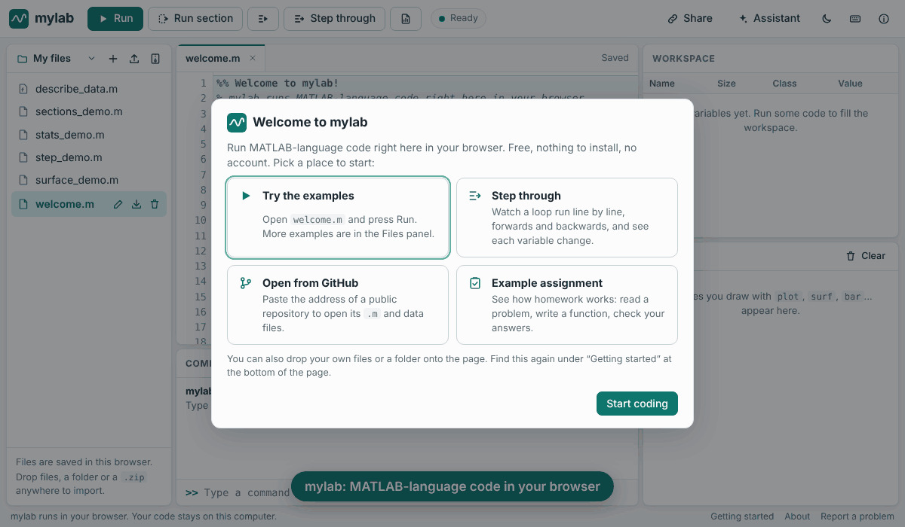

# mylab

**A free, open-source environment for running MATLAB-language code.** It's for
students, researchers and engineers who can't afford a MATLAB license.

- **Runs in your browser with nothing to install.** A full editor, command
  window, workspace and plots, running locally through WebAssembly.
- **Runs on your computer** as a command-line tool, a Python library, a Jupyter
  kernel, or a tool your AI assistant can use (MCP).
- **Has an AI helper built in.** It explains errors, fixes code and translates
  to Python, using free local models (Ollama) or your own API key. No paid
  account is needed.
- **Built for classes.** Share code as a link, step through a program
  forwards and backwards, publish a report, and auto-grade assignments in the
  browser or on Gradescope.
- **Covers a lot of the language:** matrices, N-D arrays, cells, structs,
  strings, tables, sparse matrices, dates, `containers.Map`, `classdef`
  classes and about 1,100 functions, from linear algebra to `fft`, `ode45`,
  `fminsearch`, `imread` and plotting.



```matlab
>> A = magic(4);
>> x = A(2:3, :) \ [1; 2];
>> t = linspace(0, 2*pi); plot(t, sin(t)), grid on
>> T = readtable('grades.csv'); T(T.Score > 90, :)
```

mylab is built on [NumPy](https://numpy.org), [SciPy](https://scipy.org) and
[Matplotlib](https://matplotlib.org). It is an independent project with its own
implementation. See [Legal](#license-and-trademarks).

---

## Ways to use it

### 1. In the browser (no install)

Open the web app, which is hosted with GitHub Pages from this repository. Your
files stay in your browser and the code runs on your own machine. The first
visit downloads about 30–60 MB, which is cached afterwards.
See [docs/WEB.md](docs/WEB.md).

### 2. On your computer

You need Python 3.10 or newer.

```bash
pip install "git+https://github.com/ghanemja/mylab"
```

```bash
mylab                      # interactive prompt
mylab myscript.m           # run a script
mylab -e "disp(sum(1:100))"
```

New to all this? Start with [docs/GETTING_STARTED.md](docs/GETTING_STARTED.md).

### 3. In Jupyter notebooks

```bash
pip install "mylab-lang[jupyter] @ git+https://github.com/ghanemja/mylab"
mylab-kernel install --user
```

See [docs/JUPYTER.md](docs/JUPYTER.md).

### 4. From AI assistants (Claude Desktop, Cursor, …)

```bash
pip install "mylab-lang[mcp] @ git+https://github.com/ghanemja/mylab"
```

Add `{"mcpServers": {"mylab": {"command": "mylab-mcp"}}}` to your client's
configuration. See [docs/MCP.md](docs/MCP.md).

### 5. In VS Code

An extension in [editors/vscode](editors/vscode) adds run, debug, error
checking and hover help. See [docs/VSCODE.md](docs/VSCODE.md).

### 6. For teaching

- Share any file as a link that opens and runs in the browser.
- Give students an assignment bundle; they press "Check my answers".
- Grade a whole class with `mylab-grade`, locally or on Gradescope.

See [docs/AUTOGRADER.md](docs/AUTOGRADER.md).

### 7. From Python

```python
from mylab.api import Session

s = Session()
r = s.run("y = cumsum(1:5)")
print(r.output)        # y = ...
s.get("y")             # numpy array
r.figures              # PNG bytes of any plots
```

---

## Open datasets

mylab also publishes two datasets for the community (see [datasets/](datasets/)):

- **[MATLAB Tasks](datasets/matlab-tasks/):** 157 original programming tasks
  with reference solutions and tests. Use them to benchmark AI code models on
  MATLAB, for graded teaching exercises, or to check MATLAB-language engines.
- **[MATLAB Corpus](datasets/matlab-corpus/):** 29,114 real-world `.m` files
  (4.1M lines) from 200 permissively licensed repositories, pinned and
  annotated.

## What's supported

| Area | Supported |
|---|---|
| Language | All operators and precedence, ranges, 1-based column-major indexing, `end`, logical indexing, arrays that grow on assignment, deleting with `x(i) = []`, `if`/`for`/`while`/`switch`/`try`, `break`/`continue`/`return`, command syntax (`hold on`) |
| Functions | Script-local functions, `.m` files on the path, multiple outputs, `nargin`/`nargout`, `varargin`/`varargout`, anonymous functions with captured variables, `global`, `eval`/`feval` |
| Data types | double, single, logical, char, int8–uint64 (saturating), complex numbers, N-D arrays, cell arrays, structs and struct arrays, string arrays, function handles, `containers.Map`, `table`, sparse matrices, `datetime`/`duration` |
| Classes | `classdef` value and handle classes, properties with defaults, `Constant`/`Dependent` properties, `get.`/`set.` methods, constructors, `Static` methods, inheritance with `obj@Parent`, operator overloading, custom `disp` |
| Library | About 1,100 functions: math, linear algebra, sparse solvers, statistics and distributions, signal processing (`fft`, `butter`, `filtfilt`, …), image processing (`imread`, `imresize`, `imfilter`, `edge`, `regionprops`, …), optimization (`fzero`, `fminsearch`, `fmincon`, `linprog`, …), ODEs (`ode45`, `ode15s`, …), interpolation, polynomials, strings and regex, dates, text and binary file I/O, tables, plotting with handles, animations |

The full list is in [docs/FUNCTIONS.md](docs/FUNCTIONS.md). Type `help name` in
mylab for any function. Known differences and gaps (for example Simulink,
GUIs, enumerations and object arrays) are in
[docs/COMPATIBILITY.md](docs/COMPATIBILITY.md).

## Speed

- **Vectorized code** runs at NumPy speed (compiled BLAS/LAPACK underneath).
- **Large array expressions can go faster than NumPy.** Install the optional
  accelerator with `pip install "mylab-lang[fast]"`. An expression such as
  `sin(x).^2 + 3*x - x./z` on arrays of 100,000 elements or more is then
  evaluated in one pass on all CPU cores, with no temporary arrays: about
  2–5× faster on a 4-core machine. Not available in the browser app.
- **Simple numeric loops are compiled.** Loops that do scalar arithmetic and
  read or write array elements are translated to fast code automatically,
  about 20–50× faster than interpreting them: 200,000 iterations of
  `s = s + k^2` take about 0.03 s. If anything unusual happens (an index
  out of range, a complex result), mylab falls back to the interpreter for
  that loop, so results and error messages stay the same.
- **Other loops are interpreted** (ones that call your own functions, use
  cells, structs or strings, or print): about 2–10 µs per statement. That's
  fine for coursework, but slower than MATLAB.

`benchmarks/bench.py` measures common patterns.

## Project layout

```
mylab/            the engine (lexer, parser, interpreter, values, indexing, display)
  builtins/       the function library, one module per area
  helpdocs/       help text for every function
  jit.py          loop compiler           debugger.py  debugger and tracer
  classdef.py     user-defined classes    grader.py    autograder
  api.py          Session API used by every front end
  cli.py          `mylab` command         kernel.py    Jupyter kernel
  mcp_server.py   MCP server
web/              the browser app (Pyodide + CodeMirror, no build step)
editors/vscode/   VS Code extension
datasets/         MATLAB Tasks benchmark and MATLAB Corpus index
examples/         runnable example scripts and a sample assignment
tests/            pytest suite, including 5,377 conformance checks against GNU Octave
docs/             guides, function list, compatibility notes
```

## How it is tested

- **2,600+ unit tests** on Linux, Windows and macOS.
- **Conformance suite:** 257 scripts with 5,377 checks. Each result is
  compared with GNU Octave, an independent implementation of the same
  language, with corrections where MATLAB is documented to differ. All
  checks pass. See [tests/conformance](tests/conformance/README.md).
- **MATLAB Tasks:** 157 programming tasks with checked answers; all pass.
- **MATLAB Corpus:** mylab parses 99.1% of 29,114 real-world files.

mylab has not been run side by side with MATLAB itself. If you find a
difference, please [open an issue](../../issues).

## Contributing

Contributions are very welcome: new functions, bug reports with a small `.m`
snippet, documentation, and translations of the web app. Please read
[CONTRIBUTING.md](CONTRIBUTING.md) and **[CLEANROOM.md](CLEANROOM.md)** first.
The clean-room rules keep the project legally safe for everyone.

## License and trademarks

mylab is released under the [MIT License](LICENSE).

mylab is not affiliated with, endorsed by, or sponsored by The MathWorks, Inc.
MATLAB® is a registered trademark of The MathWorks, Inc. The name is used here
only to describe compatibility. mylab contains no MathWorks code or
documentation.
