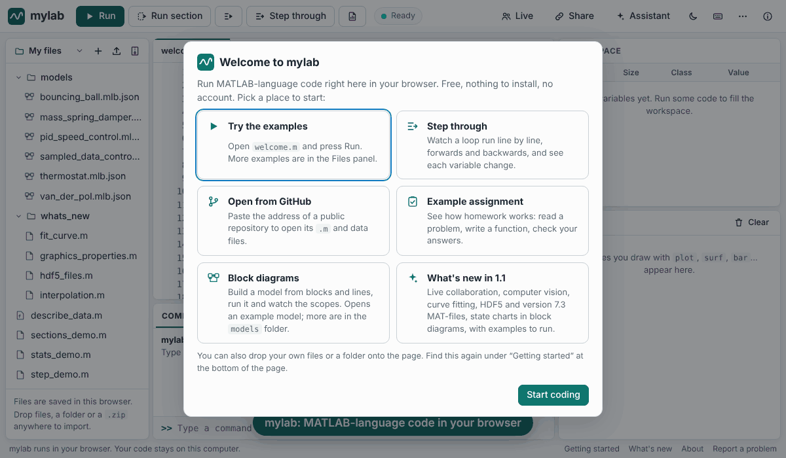

# mylab

**A free, open-source environment for running MATLAB-language code.** It's for
students, researchers and engineers who can't afford a MATLAB license.

- **Runs in your browser with nothing to install.** A full editor, command
  window, workspace and plots, running locally through WebAssembly. The
  editor underlines problems as you type, shows help when you hover a
  function, and has a command palette, a variable viewer and a version
  history.
- **Runs on your computer** as a command-line tool, a Python library, a Jupyter
  kernel, or a tool your AI assistant can use (MCP).
- **Has an AI helper built in.** It explains errors, fixes code and translates
  to Python, using free local models (Ollama) or your own API key. No paid
  account is needed.
- **Apps.** Build windows with buttons, sliders, tables and plots using
  `uifigure`/`uicontrol` code, or with the visual app builder in the web app.
  `mylab myapp.m` opens the app in your browser. See
  [docs/APPS.md](docs/APPS.md).
- **Block diagrams (mylab Blocks).** Build a model from 107 blocks and signal
  lines in the browser, or with `add_block`/`add_line`, and simulate it with
  `sim`: variable- and fixed-step solvers, events, multi-rate, live scopes,
  `linmod`. `.slx` files can be imported: of 82 public files, 50 import
  fully and 31 of the 68 models run. See
  [docs/BLOCKS.md](docs/BLOCKS.md).
- **Built for classes.** Share code as a link, step through a program
  forwards and backwards, publish a report, and auto-grade assignments in the
  browser or on Gradescope.
- **Covers a lot of the language:** matrices, N-D arrays, cells, structs,
  strings, tables, sparse matrices, dates, `containers.Map`, `classdef`
  classes and more than 2,600 functions, from linear algebra to `fft`,
  `ode45`, `fminsearch`, `fit`, `imread` and plotting.



```matlab
>> A = magic(4);
>> x = A(2:3, :) \ [1; 2];
>> t = linspace(0, 2*pi); plot(t, sin(t)), grid on
>> T = readtable('grades.csv'); T(T.Score > 90, :)
```

mylab is built on [NumPy](https://numpy.org), [SciPy](https://scipy.org) and
[Matplotlib](https://matplotlib.org). It is an independent project with its own
implementation. See [Legal](#license-and-trademarks).

---

## Ways to use it

### 1. In the browser (no install)

The web app is published from this repository to GitHub Pages:
**https://ghanemja.github.io/mylab/**. Your files stay in your browser and the
code runs on your own machine. The first visit downloads about 30–60 MB,
which is cached afterwards. To run your own copy from a checkout, use
`python scripts/build_web.py --serve`. See [docs/WEB.md](docs/WEB.md).

### 2. On your computer

You need Python 3.10 or newer.

```bash
pip install "git+https://github.com/ghanemja/mylab"
```

This also installs NumPy, SciPy, Matplotlib, Pillow and h5py (for HDF5 files
and version 7.3 MAT-files).

Optional extras: `[symbolic]` for symbolic math (`syms`, `solve`; see
[docs/SYMBOLIC.md](docs/SYMBOLIC.md)), `[fast]` for faster large-array math,
`[excel]`, `[jupyter]`, `[mcp]`.

```bash
mylab                      # interactive prompt
mylab myscript.m           # run a script
mylab -e "disp(sum(1:100))"
```

New to all this? Start with [docs/GETTING_STARTED.md](docs/GETTING_STARTED.md).

### 3. In Jupyter notebooks

```bash
pip install "mylab-lang[jupyter] @ git+https://github.com/ghanemja/mylab"
mylab-kernel install --user
```

See [docs/JUPYTER.md](docs/JUPYTER.md).

### 4. From AI assistants (Claude Desktop, Cursor, …)

```bash
pip install "mylab-lang[mcp] @ git+https://github.com/ghanemja/mylab"
```

Add `{"mcpServers": {"mylab": {"command": "mylab-mcp"}}}` to your client's
configuration. See [docs/MCP.md](docs/MCP.md).

### 5. In VS Code

An extension in [editors/vscode](editors/vscode) adds run, debug, error
checking and hover help. See [docs/VSCODE.md](docs/VSCODE.md).

### 6. For teaching

- Share any file as a link that opens and runs in the browser.
- Give students an assignment bundle; they press "Check my answers".
- Grade a whole class with `mylab-grade`, locally or on Gradescope.

See [docs/AUTOGRADER.md](docs/AUTOGRADER.md).

### 7. From Python

```python
from mylab.api import Session

s = Session()
r = s.run("y = cumsum(1:5)")
print(r.output)        # y = ...
s.get("y")             # numpy array
r.figures              # PNG bytes of any plots
```

---

## Open datasets

mylab also publishes two datasets for the community (see [datasets/](datasets/)):

- **[MATLAB Tasks](datasets/matlab-tasks/):** 157 original programming tasks
  with reference solutions and tests. Use them to benchmark AI code models on
  MATLAB, for graded teaching exercises, or to check MATLAB-language engines.
- **[MATLAB Corpus](datasets/matlab-corpus/):** 29,114 real-world `.m` files
  (4.1M lines) from 200 permissively licensed repositories, pinned and
  annotated.

## What's supported

| Area | Supported |
|---|---|
| Language | All operators and precedence, ranges, 1-based column-major indexing, `end`, logical indexing, arrays that grow on assignment, deleting with `x(i) = []`, `if`/`for`/`while`/`switch`/`try`, `break`/`continue`/`return`, command syntax (`hold on`) |
| Functions | Script-local functions, `.m` files on the path, multiple outputs, `nargin`/`nargout`, `varargin`/`varargout`, anonymous functions with captured variables, `global`, `eval`/`feval` |
| Data types | double, single, logical, char, int8–uint64 (saturating), complex numbers, N-D arrays, cell arrays, structs and struct arrays, string arrays, function handles, `containers.Map`, `table`, sparse matrices, `datetime`/`duration` |
| Classes | `classdef` value and handle classes, properties with defaults, `Constant`/`Dependent` properties, `get.`/`set.` methods, constructors, `Static` methods, inheritance with `obj@Parent`, operator overloading, custom `disp`, object arrays, enumerations, events and listeners, `@Class` and `+package` folders |
| Library | More than 2,600 functions: math, linear algebra, sparse solvers, statistics and distributions, signal processing (`fft`, `butter`, `filtfilt`, …), image processing (`imread`, `imresize`, `imfilter`, `edge`, `regionprops`, …), optimization (`fzero`, `fminsearch`, `fmincon`, `linprog`, …), ODEs (`ode45`, `ode15s`, …), interpolation, polynomials, strings and regex, dates, text and binary file I/O, tables, plotting with handles, animations, categorical arrays, JSON, WAV audio and Excel files, curve fitting (`fit`, `fittype`, `cfit`), HDF5 and version 7.3 MAT-files, symbolic math (`syms`, `diff`, `int`, `solve`, `dsolve`; needs SymPy) |

The full list is in [docs/FUNCTIONS.md](docs/FUNCTIONS.md). Type `help name` in
mylab for any function. Known differences and gaps are in
[docs/COMPATIBILITY.md](docs/COMPATIBILITY.md).

## Speed

- **Vectorized code** runs at NumPy speed (compiled BLAS/LAPACK underneath).
- **Large array expressions can use numexpr.** With the optional
  [numexpr](https://github.com/pydata/numexpr) package
  (`pip install "mylab-lang[fast]"`), an expression such as
  `sin(x).^2 + 3*x - x./z` on arrays of 100,000 elements or more is handed to
  numexpr, which evaluates it in one pass on all CPU cores without temporary
  arrays: about 2–5× faster than doing it one operation at a time with NumPy
  on a 4-core machine. The gain is numexpr's; without it mylab uses NumPy.
  Not available in the browser app.
- **Simple numeric loops are compiled.** Loops that do scalar arithmetic and
  read or write array elements are translated to fast code automatically,
  about 20–50× faster than interpreting them: 200,000 iterations of
  `s = s + k^2` take about 0.03 s. If anything unusual happens (an index
  out of range, a complex result), mylab falls back to the interpreter for
  that loop, so results and error messages stay the same.
- **Small functions called in loops are inlined.** A loop that calls an
  anonymous function such as `f = @(x) a*x + 1`, or a one-line function in
  the same file, runs about 100× faster than before (50,000 calls in about
  0.005 s).
- **Other loops are interpreted** (ones that call longer functions, use
  cells, structs or strings, or print): about 2–10 µs per statement. That's
  fine for coursework, but slower than MATLAB.

`benchmarks/bench.py` measures common patterns. `benchmarks/octave_compare`
times 30 cases against GNU Octave 10.3: on the machine used for 1.1.0, mylab
took no longer than Octave on any of them (FFT and `eig` are level with it).
It has not been timed against MATLAB.

## Project layout

```
mylab/            the engine (lexer, parser, interpreter, values, indexing, display)
  builtins/       the function library, one module per area
  helpdocs/       help text for every function
  jit.py          loop compiler           debugger.py  debugger and tracer
  classdef.py     user-defined classes    grader.py    autograder
  api.py          Session API used by every front end
  cli.py          `mylab` command         kernel.py    Jupyter kernel
  mcp_server.py   MCP server
web/              the browser app (Pyodide + CodeMirror, no build step)
editors/vscode/   VS Code extension
datasets/         MATLAB Tasks benchmark and MATLAB Corpus index
examples/         runnable example scripts and a sample assignment
tests/            pytest suite, including 5,377 conformance checks against GNU Octave
  probes/         MATLAB-behaviour checks (705 original, 469 held out)
validation/       kit for running the same checks on MATLAB itself
benchmarks/       speed checks, including the comparison with GNU Octave
docs/             guides, function list, compatibility notes
```

## How it is tested

Every push runs these on GitHub Actions:

- **About 6,700 tests** on Linux, Windows and macOS with Python 3.10 and 3.14,
  and with the oldest and newest supported NumPy, SciPy and Matplotlib.
- **Conformance suite:** 257 scripts with 5,377 checks. Each result is
  compared with GNU Octave, an independent implementation of the same
  language, with corrections where MATLAB is documented to differ. All
  checks pass. See [tests/conformance](tests/conformance/README.md).
- **MATLAB-behaviour checks:** 705 small scripts asserting documented MATLAB
  behaviour, and 469 more written afterwards and kept out of sight while
  gaps were closed. 695 and 469 pass, and a check that passes may never fail
  again. Corrections to checks are listed in
  [tests/probes/heldout/CORRECTIONS.md](tests/probes/heldout/CORRECTIONS.md).
- **MATLAB Tasks:** 157 programming tasks with checked answers; all pass.
- **Speed:** a job fails if a benchmark case gets more than 25% slower.

Run on request:

- **Real code:** 25 repositories from the MATLAB Corpus (185 scripts and test
  suites, such as matGeom's 721 unit tests) run unchanged; all pass. See
  [datasets/matlab-corpus](datasets/matlab-corpus/README.md#running-real-code-the-regression-suite).
- **MATLAB Corpus:** mylab parsed 99.1% of 29,114 real-world files when this
  was last measured (1.0.0).

mylab has not been run side by side with MATLAB itself. If you have MATLAB,
[validation/](validation/) runs the same checks there and tells you what
differs. If you find a difference, please
[report it](../../issues/new?template=report-a-difference.yml).

## Running code you did not write

mylab runs MATLAB code with the permissions of the account that starts it.
Like MATLAB, that code can read and write files, start programs (`system`,
`!command`) and use the network (`webread`). If you host mylab for other
people, for example as a shared server, an autograder or a tool for an AI
assistant:

- Set the environment variable `MYLAB_PYTHON=0`. It turns off calls from
  MATLAB code into Python (`py.*`, `pyrun`, `pyrunfile`), which would
  otherwise give that code everything Python can do.
- `MYLAB_PYTHON=0` is not a sandbox: shell commands, file access and the
  network still work. Run each person's code in an isolated environment, such
  as a container or a separate unprivileged account without network access,
  with limits on time and memory.

The browser app is different: code runs inside the browser tab, which cannot
reach your files or start programs.

## Contributing

Contributions are very welcome: new functions, bug reports with a small `.m`
snippet, documentation, and translations of the web app. Please read
[CONTRIBUTING.md](CONTRIBUTING.md) and **[CLEANROOM.md](CLEANROOM.md)** first.
The clean-room rules keep the project legally safe for everyone.

## License and trademarks

mylab is released under the [MIT License](LICENSE).

mylab is not affiliated with, endorsed by, or sponsored by The MathWorks, Inc.
MATLAB® is a registered trademark of The MathWorks, Inc. The name is used here
only to describe compatibility. mylab contains no MathWorks code or
documentation.
