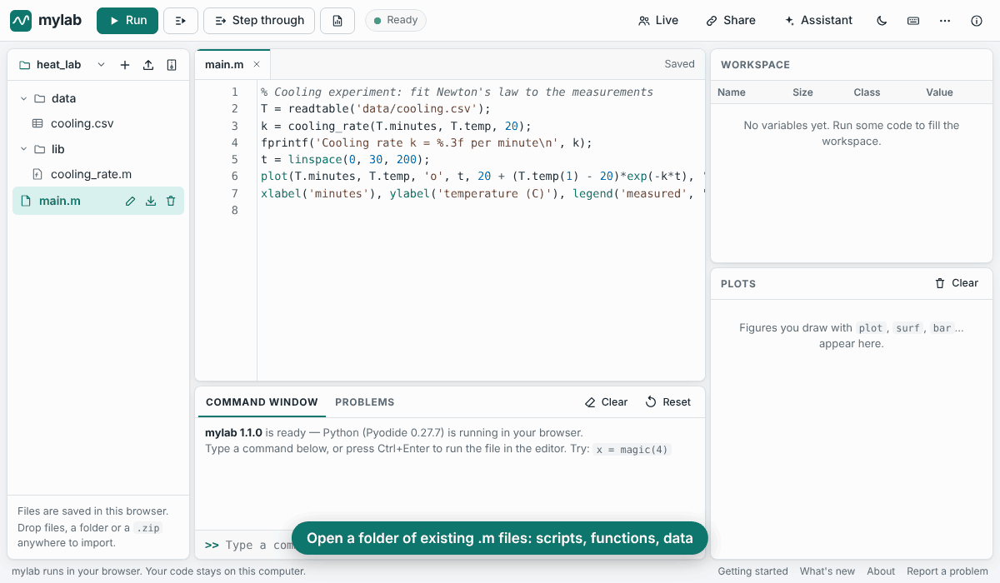

# mylab

**A free, open-source environment for running MATLAB-language code.** It's for
students, researchers and engineers who can't afford a MATLAB license.

- **Runs in your browser with nothing to install:** an editor that underlines
  problems as you type, command window, workspace, plots, a variable viewer
  and step-by-step debugging, all running locally through WebAssembly.
- **Live collaboration:** send a link and work on the same project at the same
  time, with everyone's cursors in view. No account; browser to browser and
  end-to-end encrypted.
- **Runs on your computer** as a command-line tool, a Python library, a Jupyter
  kernel, a VS Code extension, or a tool your AI assistant can use (MCP).
- **An AI helper** explains errors and fixes code, with free local models
  (Ollama) or your own API key.
- **Covers a lot of the language:** matrices, N-D arrays, cells, structs,
  strings, tables, sparse matrices, dates, `classdef` classes and more than
  2,800 functions, from `ode45`, `fit` and `fft` to image processing,
  computer vision (OpenCV) and C/C++ MEX files.
- **Apps and block diagrams:** build apps with `uifigure` or the visual
  builder ([docs/APPS.md](docs/APPS.md)), and simulate block diagrams with
  state charts and physical networks, including imported `.slx`/`.mdl` models
  ([docs/BLOCKS.md](docs/BLOCKS.md)).
- **Built for classes:** share code as a link, step forwards and backwards
  through a program, publish reports, and auto-grade assignments in the
  browser or on Gradescope.


```matlab
>> A = magic(4);
>> x = A(2:3, :) \ [1; 2];
>> t = linspace(0, 2*pi); plot(t, sin(t)), grid on
>> T = readtable('grades.csv'); T(T.Score > 90, :)
```

mylab is built on [NumPy](https://numpy.org), [SciPy](https://scipy.org) and
[Matplotlib](https://matplotlib.org). It is an independent project with its own
implementation. See [Legal](#license-and-trademarks).

## Get started

**In the browser:** **https://ghanemja.github.io/mylab/**. Your files stay in
your browser and code runs on your own machine. The first visit downloads
about 40 MB, which is cached afterwards. See [docs/WEB.md](docs/WEB.md).

**Bring what you have.** Open a folder of existing `.m` files (or drop it on
the page) and run it as it is: scripts, functions in subfolders and data files
work together. Simulink `.slx` and `.mdl` models open as block diagrams you can
simulate.



**On your computer** (Python 3.10 or newer):

```bash
pip install mylab-lang
```

```bash
mylab                      # interactive prompt
mylab myscript.m           # run a script
mylab -e "disp(sum(1:100))"
```

To get the latest version from GitHub instead, use
`pip install "git+https://github.com/ghanemja/mylab"`. Optional extras:
`[symbolic]` (SymPy, [docs/SYMBOLIC.md](docs/SYMBOLIC.md)), `[vision]`
(OpenCV, [docs/VISION.md](docs/VISION.md)), `[fast]`, `[excel]`, `[jupyter]`
and `[mcp]`. New to all this? Start with
[docs/GETTING_STARTED.md](docs/GETTING_STARTED.md).

**Other ways to use it:**

| | |
|---|---|
| Jupyter | `pip install "mylab-lang[jupyter]"`, then `mylab-kernel install --user` ([docs/JUPYTER.md](docs/JUPYTER.md)) |
| AI assistants | `pip install "mylab-lang[mcp]"` and add `{"mcpServers": {"mylab": {"command": "mylab-mcp"}}}` to your client ([docs/MCP.md](docs/MCP.md)) |
| VS Code | the extension in [editors/vscode](editors/vscode) runs and debugs files, underlines errors and shows help on hover ([docs/VSCODE.md](docs/VSCODE.md)) |
| Python | `from mylab.api import Session; Session().run("y = cumsum(1:5)")` |
| C and C++ | `mex file.c` builds a MEX file you call like a function ([docs/MEX.md](docs/MEX.md)) |
| Teaching | share links, live sessions, assignment bundles with "Check my answers", and `mylab-grade` for a whole class ([docs/AUTOGRADER.md](docs/AUTOGRADER.md)) |

## Features

| | In the browser | On your computer |
|---|:---:|:---:|
| **Writing and running code** | | |
| Editor that underlines problems as you type, with hover help and autocomplete | ✓ | ✓ in VS Code |
| Command window and interactive prompt | ✓ | ✓ |
| Debugging: breakpoints, stepping (forwards and backwards in the browser) | ✓ | ✓ `mylab --debug`, VS Code |
| Your existing `.m` projects: folders, functions, data files | ✓ open or drop a folder, or a GitHub repository | ✓ |
| Jupyter notebooks, with inline plots | | ✓ |
| Python API (`Session().run(...)`) | | ✓ |
| **Math and speed** | | |
| Matrix multiply, `\`, `inv`, `eig`, `svd` on BLAS/LAPACK through NumPy | ✓ single core | ✓ all cores |
| Vectorized code at NumPy speed | ✓ | ✓ |
| Loops compiled automatically: 200,000 steps of `s = s + k^2` in about 0.03 s | ✓ | ✓ |
| Large array expressions on all cores with numexpr | | ✓ `[fast]` |
| **Plots and apps** | | |
| 2-D and 3-D plots with graphics handles, subplots, legends | ✓ as images | ✓ in windows |
| Animations with `drawnow` | ✓ as GIFs | ✓ |
| Apps with `uifigure`/`uicontrol`, and a visual app builder | ✓ | ✓ opens in your browser |
| Published reports with code, output and figures | ✓ | |
| **Simulink models and block diagrams** | | |
| Open existing Simulink `.slx` and `.mdl` models and simulate them | ✓ | ✓ |
| Diagram editor: blocks from a palette, wiring, live scopes, keyboard and touch | ✓ | |
| 146 blocks; variable- and fixed-step solvers, zero-crossing events, several sample rates | ✓ | ✓ |
| Enabled, triggered, function-call and other subsystems; buses; model references | ✓ | ✓ |
| State charts, and electrical and mechanical physical networks | ✓ | ✓ |
| Build, run and linearize models from code: `add_block`, `add_line`, `sim`, `linmod` | ✓ | ✓ |
| Save a copy as `.slx` or `.mdl`, for mylab to read back | ✓ | ✓ |
| **Data and libraries** | | |
| Tables, CSV, Excel, JSON, images, audio files | ✓ | ✓ |
| MAT-files of every version, HDF5, NetCDF | ✓ | ✓ |
| Computer vision on OpenCV | ✓ loaded on first use | ✓ `[vision]` |
| Symbolic math on SymPy | ✓ loaded on first use | ✓ `[symbolic]` |
| C and C++ MEX files | | ✓ |
| System commands and files anywhere on disk | | ✓ |
| **Working with others and with AI** | | |
| Live collaboration: shared files, everyone's cursors, follow a session | ✓ | |
| Share links, assignments with "Check my answers" | ✓ | |
| Grading a whole class, locally or on Gradescope | | ✓ `mylab-grade` |
| Built-in AI assistant: explain errors, fix code (Ollama or your API key) | ✓ | |
| AI agents (Claude, Cursor, …) run code through MCP | | ✓ `mylab-mcp` |

Of 82 public Simulink files tested, all 82 open, 50 convert with every block,
and 31 of the 68 models run to the end. Most of the others use blocks mylab
doesn't have yet ([docs/BLOCKS.md](docs/BLOCKS.md)).

### Language and library

| Area | Supported |
|---|---|
| Language | All operators, ranges, column-major indexing with `end` and logical masks, growing and deleting, all control flow, command syntax, script-local and file functions, `varargin`/`varargout`, anonymous functions, `global`, `eval` |
| Data types | double, single, logical, char, saturating integers, complex, N-D arrays, cells, structs, strings, function handles, `containers.Map`, `dictionary`, `table`/`timetable`, `timeseries`, sparse, `datetime`/`duration`, `categorical` |
| Classes | `classdef` value and handle classes, property validation, `Dependent`/`Constant`, `get.`/`set.`, inheritance, operator overloading, enumerations, events, `@Class` and `+package` folders |
| Library | 2,859 functions: linear algebra, statistics, signal and image processing, computer vision, optimization, ODEs, interpolation, curve fitting, strings and regex, file I/O (MAT-files of every version, HDF5, NetCDF, Excel, JSON, images, audio), plotting, symbolic math (with SymPy) |

The full list is in [docs/FUNCTIONS.md](docs/FUNCTIONS.md); `help name` works
for every function. Known differences are in
[docs/COMPATIBILITY.md](docs/COMPATIBILITY.md).

## Compared with GNU Octave

GNU Octave is the established free alternative, and a good one. mylab was
measured against Octave 10.3, with its statistics, signal, control, image and
other packages, on the same machine:

| | mylab | GNU Octave 10.3 |
|---|:---:|:---:|
| 469 MATLAB-behaviour checks that neither had seen | 379 passed (all 469 after fixes) | 333 passed |
| All 1,174 MATLAB-behaviour checks | 1,170 passed | 810 passed |
| Checks for string arrays, tables and `datetime` | 69 of 69 passed | 14 of 69 passed |
| Simulink `.slx` and `.mdl` models | ✓ | |
| Browser app, live collaboration, AI assistant, MCP server | ✓ | not built in |
| Track record | new | decades of use |

The checks are written from MATLAB's public documentation
([tests/probes](tests/probes/)). Octave's tables, strings and dates come from
its datatypes package. Eleven of its failures come from the build used, which
can't print hidden figures and has no Java.

Speed, best of three runs on the same 4-core machine:

| Operation | mylab | Octave 10.3 | |
|---|---:|---:|---:|
| Calling a small function 200,000 times in a loop | 0.03 s | 1.28 s | 46× |
| A recursive function (`fib(22)`) | 0.005 s | 0.23 s | 43× |
| Calling an anonymous function 200,000 times | 0.03 s | 0.63 s | 24× |
| Updating struct fields 200,000 times | 0.13 s | 1.81 s | 14× |
| `for` and `while` loops of a million steps, a bubble sort | | | 4–8× |
| Vectorized arithmetic on 10 million elements | 0.11 s | 0.64 s | 6× |
| `ode45`, text parsing, sorting, `arrayfun`/`cellfun` | | | 2–4× |
| 30,000 `containers.Map` inserts and lookups | 0.4 s | stopped after 6 min | |
| Matrix multiply, `\`, `eig`, `svd`, FFT | | | level |

Of the 29 cases both could run, mylab was at least 1.5× faster on 19 and level
on 10 ([all results](benchmarks/octave_compare/MYLAB_1_1_0_VS_OCTAVE_10_3.txt)).
Matrix maths is level because both hand it to BLAS and LAPACK. Code that the
loop compiler can't handle (calls to longer functions, cells, structs,
strings, printing) runs at about 2–10 µs per statement. That is fine for
coursework, though probably slower than MATLAB, which mylab has not been timed
against.

## How it is tested

Every push runs, on GitHub Actions:

- about 7,700 tests on Linux, Windows and macOS with Python 3.10 and 3.14, and
  with the oldest and newest supported NumPy, SciPy and Matplotlib;
- 5,377 conformance checks compared with GNU Octave
  ([tests/conformance](tests/conformance/README.md));
- 1,174 MATLAB-behaviour checks written from MATLAB's public documentation,
  469 of them kept out of sight while gaps were closed. A check that passes may
  never fail again;
- the browser app in the engines of Chrome, Firefox and Safari, with an
  accessibility scan and an integrity check on every file it loads from a CDN;
- the 157 [MATLAB Tasks](datasets/matlab-tasks/) and a speed check.

On request, 185 scripts and test suites from 25 real repositories run
unchanged ([datasets/matlab-corpus](datasets/matlab-corpus/README.md)).

mylab has never been run side by side with MATLAB, and the project does not use
MATLAB: MathWorks' terms forbid using it to test software like mylab
([docs/MATLAB-TERMS-REVIEW.md](docs/MATLAB-TERMS-REVIEW.md)). If you find a
difference from MATLAB's documented behaviour, please
[report it](../../issues/new?template=report-a-difference.yml).

## Open datasets

- **[MATLAB Tasks](datasets/matlab-tasks/):** 157 original programming tasks
  with reference solutions and tests, for benchmarking AI code models or for
  teaching.
- **[MATLAB Corpus](datasets/matlab-corpus/):** 29,114 real-world `.m` files
  from 200 permissively licensed repositories, pinned and annotated.

## Running code you did not write

On your computer, mylab runs code with the permissions of the account that
starts it: like MATLAB, that code can read and write files, start programs and
use the network. If you host mylab for others (a shared server, an autograder,
a tool for an AI assistant), set `MYLAB_PYTHON=0` to turn off calls into Python,
and run each person's code in an isolated environment, such as a container
without network access, with time and memory limits. `MYLAB_PYTHON=0` alone is
not a sandbox.

In the browser app, code runs inside the browser tab, which cannot reach your
files or start programs. Code from a live session or a share link runs only
when you press Run.

## Contributing

Contributions are very welcome: new functions, bug reports with a small `.m`
snippet, documentation, and translations of the web app. Please read
[CONTRIBUTING.md](CONTRIBUTING.md) and **[CLEANROOM.md](CLEANROOM.md)** first.
The clean-room rules keep the project legally safe for everyone.

## License and trademarks

mylab is released under the [MIT License](LICENSE).

mylab is not affiliated with, endorsed by, or sponsored by The MathWorks, Inc.
MATLAB® and Simulink® are registered trademarks of The MathWorks, Inc. The
names are used here only to describe compatibility. mylab contains no
MathWorks code or documentation.
