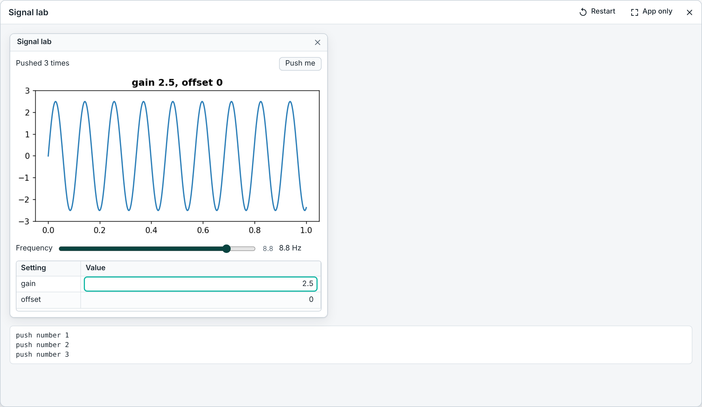
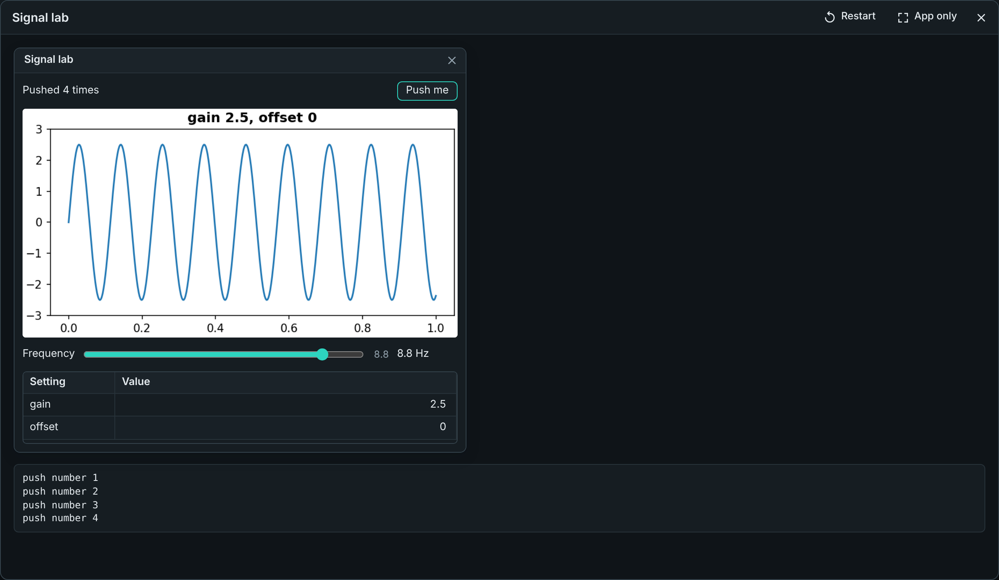
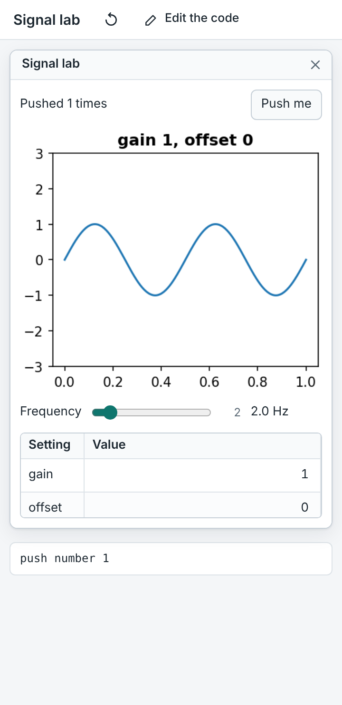
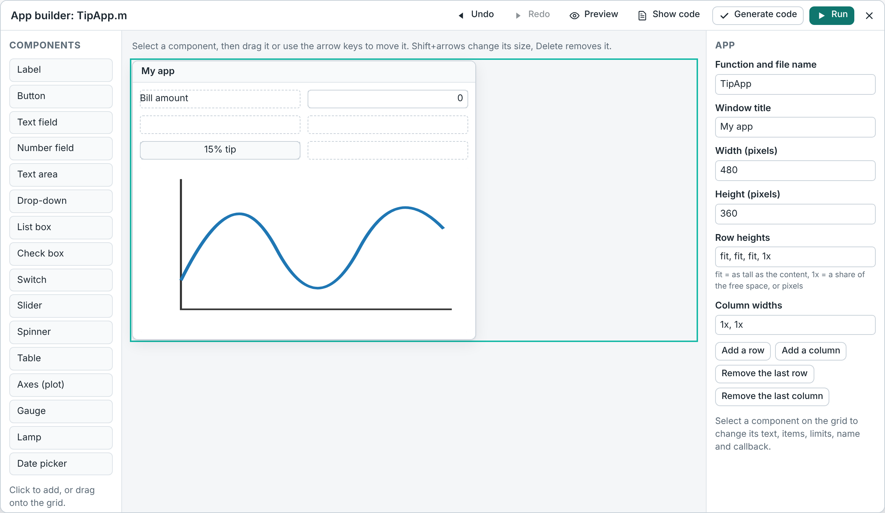

# Apps: windows with buttons, sliders and plots

mylab runs apps written in the MATLAB language. An app is a window with
controls. Your code decides what happens when someone uses them.



Contents: [A first app](#a-first-app) · [Running an app](#running-an-app) ·
[Layout](#layout) · [Components](#components) · [Callbacks](#callbacks) ·
[Three ways to write an app](#three-ways-to-write-an-app) ·
[The app builder](#the-app-builder) · [Sharing an app](#sharing-an-app) ·
[What is not supported](#what-is-not-supported) ·
[For developers](#for-developers)

## A first app

```matlab
fig = uifigure('Name', 'Counter');
grid = uigridlayout(fig, [1 2]);
label = uilabel(grid, 'Text', '0');
button = uibutton(grid, 'Text', 'Add one');
fig.UserData = 0;
button.ButtonPushedFcn = @(src, event) addOne(fig, label);

function addOne(fig, label)
    fig.UserData = fig.UserData + 1;
    label.Text = num2str(fig.UserData);
end
```

- `uifigure` makes the window.
- `uigridlayout` arranges what you put in it in rows and columns.
- `uilabel` and `uibutton` make the components.
- `ButtonPushedFcn` is the button's *callback*: the function that runs when
  the button is pressed.

Three complete examples are in [`examples/apps/`](../examples/apps):
a unit converter, a plot explorer with a slider, and a to-do list with a
table. In the web app, open the command palette (Ctrl+Shift+P) and type
"example app".

## Running an app

**In the web app.** Open the file and press **Run**. The App panel opens with
the window. The app keeps running until you close it, so callbacks remember
their variables between clicks. Text that callbacks print appears under the
app and in the Command Window. The Command Window shares the workspace with
the app: `label.Text = 'hello'` changes the label at once.

- The **App** button in the top bar hides and shows the panel.
- **Restart** runs the file again.
- **App only** hides the editor. **Edit the code** brings it back.
- Run also works for a function file without inputs (`function myapp`) and
  for a class file (`classdef MyApp`): it calls the function or creates the
  object.



**From a terminal.**

```bash
mylab myapp.m
```

mylab prints an address such as `http://127.0.0.1:53211/?t=…` and opens it in
your web browser. The page shows the app. The command keeps running until you
close the app window or the browser tab. What callbacks print appears in the
terminal and on the page.

- `mylab --no-browser myapp.m` only prints the address.
- The server listens on your own computer only (`127.0.0.1`). The address
  contains a random token. Requests without it are refused.

**In Jupyter and through the MCP server.** You get a picture of the window (a
static HTML snapshot) and a note. The controls do not run code there.

## Layout

There are two ways to place components.

**A grid (recommended).** The window is divided into rows and columns. The
grid follows the size of the window, so the app also works on a phone.

```matlab
grid = uigridlayout(fig, [3 2]);          % 3 rows, 2 columns
grid.RowHeight = {'fit', '1x', 30};       % as tall as the content, the rest, 30 pixels
grid.ColumnWidth = {'1x', '2x'};          % one third and two thirds
ax = uiaxes(grid);
ax.Layout.Row = 2;                        % put it in row 2 ...
ax.Layout.Column = [1 2];                 % ... across both columns
```

New components take the next free cell, row by row.

**Positions in pixels.** `Position` is `[left bottom width height]`, counted
from the bottom-left corner of the window or panel.

```matlab
uibutton(fig, 'Text', 'OK', 'Position', [20 20 100 30]);
```

On a narrow screen a window laid out in pixels is scaled down to fit.



## Components

| Function | What it is | Main properties |
|----------|------------|-----------------|
| `uifigure` | the window | `Name`, `Position`, `CloseRequestFcn` |
| `uigridlayout` | rows and columns | `RowHeight`, `ColumnWidth`, `Padding` |
| `uipanel`, `uitabgroup` + `uitab` | boxes and tabbed pages | `Title`, `SelectedTab` |
| `uilabel` | text | `Text` |
| `uibutton` | push button; `uibutton(parent, 'state')` stays pressed | `Text`, `ButtonPushedFcn` |
| `uieditfield` | one line of text; `uieditfield(parent, 'numeric')` for a number | `Value`, `Limits`, `ValueChangedFcn` |
| `uitextarea` | several lines of text | `Value` (cell array of lines) |
| `uidropdown`, `uilistbox` | choose from a list | `Items`, `ItemsData`, `Value` |
| `uicheckbox`, `uiswitch` | on / off | `Value` |
| `uibuttongroup` + `uiradiobutton` / `uitogglebutton` | choose one of a few | `SelectedObject`, `SelectionChangedFcn` |
| `uislider`, `uispinner`, `uiknob` | a number in a range | `Value`, `Limits`, `ValueChangingFcn` |
| `uigauge`, `uilamp` | show a number or a state | `Value`, `Color` |
| `uitable` | a table of values | `Data`, `ColumnName`, `ColumnEditable`, `CellEditCallback` |
| `uiaxes` | a plot | use `plot(ax, x, y)`, `title(ax, ...)` |
| `uiimage`, `uihyperlink`, `uidatepicker`, `uimenu` | picture, link, date, menu | |
| `uialert`, `uiconfirm`, `uiprogressdlg` | message, question, progress | |

Every component has `Position`, `Visible`, `Enable`, `Tooltip`, `Tag`,
`UserData`, `FontSize`, `FontWeight`, `FontColor`, `BackgroundColor`,
`Parent` and `Children`. Read and change properties with a dot
(`button.Text = 'Go'`) or with `get` and `set`. `delete(h)` removes a
component, `isvalid(h)` tells whether it still exists, and
`findobj(fig, 'Tag', 'ok')` finds one by its tag. `help uibutton` (or any
other name) lists the properties mylab knows.

**Plots.** Give the axes as the first input: `plot(ax, x, y)`, `bar(ax, y)`,
`title(ax, 'Signal')`, `xlabel(ax, 't')`, `hold(ax, 'on')`, `cla(ax)`. The
plot is shown as an image. It is drawn again after every callback that
changed it.

**Tables.** `Data` can be a matrix, a cell array, a string array or a
`table`. When the user changes a cell, the new value is stored in `Data`
first. Then `CellEditCallback` runs. `event.Indices` is `[row column]`.
Logical columns are shown as check boxes.

## Callbacks

A callback is called with two inputs: the component (`src`) and an event.

```matlab
slider.ValueChangedFcn = @(src, event) disp(event.Value);
```

| Property | Runs when | The event has |
|----------|-----------|---------------|
| `ButtonPushedFcn` | a button is pressed | `Source`, `EventName` |
| `ValueChangedFcn` | a value was changed (Enter, or the slider was released) | `Value`, `PreviousValue` |
| `ValueChangingFcn` | while a slider is dragged or text is typed | `Value` |
| `SelectionChangedFcn` | another tab or radio button was chosen | `OldValue`, `NewValue` |
| `CellEditCallback` | a table cell was edited | `Indices`, `PreviousData`, `NewData`, `EditData` |
| `CloseRequestFcn` | the window's close button was pressed | |
| `SizeChangedFcn` | the window changed size | |

A callback can be:

- a function handle: `@myFunction` or `@(src, event) myFunction(a, b)`,
- a cell array with extra inputs: `{@myFunction, a, b}` calls
  `myFunction(src, event, a, b)`,
- text to run: `'disp(1)'` (classic style).

If a callback stops with an error, the error is shown and the app keeps
running.

## Three ways to write an app

**1. A script or function with `uifigure`.** This is the style of the
example above. If the app is one function, write the callbacks as nested
functions. They all see the same variables.

```matlab
function counter
    n = 0;
    fig = uifigure;
    label = uilabel(fig, 'Text', '0');
    uibutton(fig, 'Text', 'Add', 'Position', [100 60 100 22], 'ButtonPushedFcn', @add);
    function add(~, ~)
        n = n + 1;
        label.Text = num2str(n);
    end
end
```

**2. The classic style: `figure` and `uicontrol`.**

```matlab
f = figure('Name', 'Adder', 'Position', [100 100 300 120]);
a = uicontrol('Style', 'edit', 'String', '2', 'Position', [20 70 60 22]);
out = uicontrol('Style', 'text', 'String', '', 'Position', [100 70 60 20]);
uicontrol('Style', 'pushbutton', 'String', 'Double', 'Position', [20 20 80 30], ...
    'Callback', @(src, ~) set(out, 'String', num2str(2 * str2double(get(a, 'String')))));
```

- Styles: `pushbutton`, `togglebutton`, `checkbox`, `radiobutton`, `edit`,
  `text`, `slider`, `popupmenu`, `listbox`.
- `Units` can be `'pixels'`, `'normalized'` (fractions of the parent),
  `'characters'`, `'points'`, `'inches'` or `'centimeters'`.
- `guidata(h, data)` and `data = guidata(h)` keep one value for the whole
  window. `guihandles(fig)` returns a struct with every component that has a
  `Tag`. `gcbo` and `gcbf` are the component and the window of the callback
  that is running. `setappdata` and `getappdata` work too.
- Axes made with `axes('Parent', f, ...)` are drawn behind the controls.
  `axes('Parent', panel)` puts an axes into a panel.

**3. A class file as App Designer exports it.** mylab runs
`classdef MyApp < matlab.apps.AppBase` files: properties for the components,
`createComponents`, `startupFcn`, `createCallbackFcn`, `registerApp` and
`runStartupFcn`. In MATLAB, open the app in App Designer and use
*Save → Export to .m file*. Then run the `.m` file in mylab. `.mlapp` files
themselves cannot be opened: they are binary.

## The app builder

The web app has a simple builder. You lay out the app with the mouse or the
keyboard, and the builder writes the code.



1. Open the command palette (Ctrl+Shift+P) and choose **New app**. Give the
   app a name.
2. **Add components.** Click one in the list on the left, or drag it onto a
   cell of the grid.
3. **Arrange them.** Drag a component to another cell. Drag the small square
   at its corner to make it cover more cells. With the keyboard: Tab to a
   component, arrow keys move it, Shift+arrow keys change its size, Delete
   removes it, Enter jumps to its properties.
4. **Set properties** on the right: the text, the list of items, limits, the
   name used in the code, and the name of the callback function. With no
   component selected you see the settings of the app: title, size, row
   heights and column widths.
5. **Preview** hides the grid lines. **Show code** shows the code that will
   be written. Undo is Ctrl+Z, redo is Ctrl+Y.
6. **Generate code** writes `Name.m` and opens it in the editor. **Run**
   writes it and starts the app.

The generated file is one function. Each component is a variable. Each
callback is a nested function at the end of the file, so it can use every
component by name:

```matlab
    function showTip(src, event)
        label1.Text = sprintf('Tip: %.2f', 0.15 * bill.Value);
    end
```

To change the layout later, open the file and press **Edit layout** (or
choose *Open this file in the app builder* in the command palette). The
design is stored as a comment at the end of the file. When the builder
writes the file again, it keeps the code inside the callback functions and
inside `startup`. Other changes you made by hand outside those functions are
replaced. The version history (⋯ → *Version history*) keeps the earlier
file.

## Sharing an app

In the web app, press **Share** and tick **Open as app**. The link contains
the code. Whoever opens it sees only the running app, without the editor.
*Edit the code* shows the code. The link ends with `&app=1`.

## What is not supported

- **`.mlapp` and `.fig` files.** They are binary. Export an App Designer app
  to a `.m` file. GUIDE apps (`.fig` + `gui_mainfcn`) do not run.
- **Waiting for the user in the web app.** In the browser, code cannot stop
  and wait for a click. `uiwait` returns at once there, and `uiconfirm`
  with an output returns its default answer and prints a note. Use callbacks
  instead (`uiconfirm(..., 'CloseFcn', @answered)` works everywhere). With
  the `mylab` command both wait as they do in MATLAB, as long as they are
  not called from inside a callback.
- **Plots are images.** No zooming, panning or data tips. Mouse callbacks on
  plots and figures (`WindowButtonDownFcn`, `ButtonDownFcn` of lines, ...)
  are stored but never run.
- **Looks.** Components look like web controls, not like MATLAB's. A knob is
  shown as a slider and a gauge as a bar. `uiswitch` styles look the same.
- **Not available:** `uitree`, `uihtml`, `uitoolbar`, `uicontextmenu`,
  `uistyle`, range sliders, `dialog`, drag and drop, keyboard callbacks
  (`KeyPressFcn` is stored but never runs), and timers that update a window
  while no callback runs.
- **Progress dialogs** only appear when they are still open after a callback
  returns: the window is redrawn between callbacks, not during one.
- **Properties.** The common properties work. Some rarely used ones are
  accepted and ignored. A name mylab does not know at all raises an error.
- **The app builder** makes grid layouts only (no panels or tabs inside the
  grid), and one callback per component.

## For developers

- `mylab/ui.py` holds the component tree and the protocol. Its first lines
  describe the JSON tree and the events. A front end needs two calls:
  `Session.ui_snapshot()` and `Session.ui_event({"id": ..., "event": ...})`.
  `RunResult.ui` is the tree after a run.
- `mylab/builtins/uicomponents.py` maps the MATLAB function names onto it.
- `mylab/uiweb/uirender.js` and `uirender.css` draw the tree as HTML
  controls. `mylab/uiweb/__init__.py` has the local server (`AppServer`) and
  `static_html`. `web/js/uirender.js` and `web/css/uirender.css` are copies;
  `python scripts/build_web.py` refreshes them and a test checks them.
- `web/js/uiapp.js` is the App panel and `web/js/designer.js` the builder.
- Tests: `tests/test_ui_*.py` drive apps without a browser.
  `scripts/test_web_apps.mjs` drives them in Chromium.
