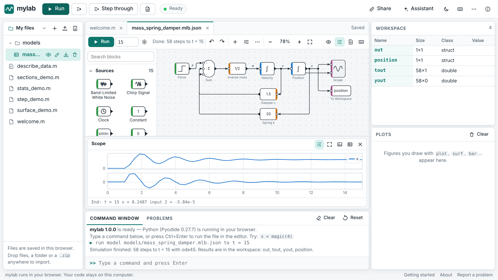
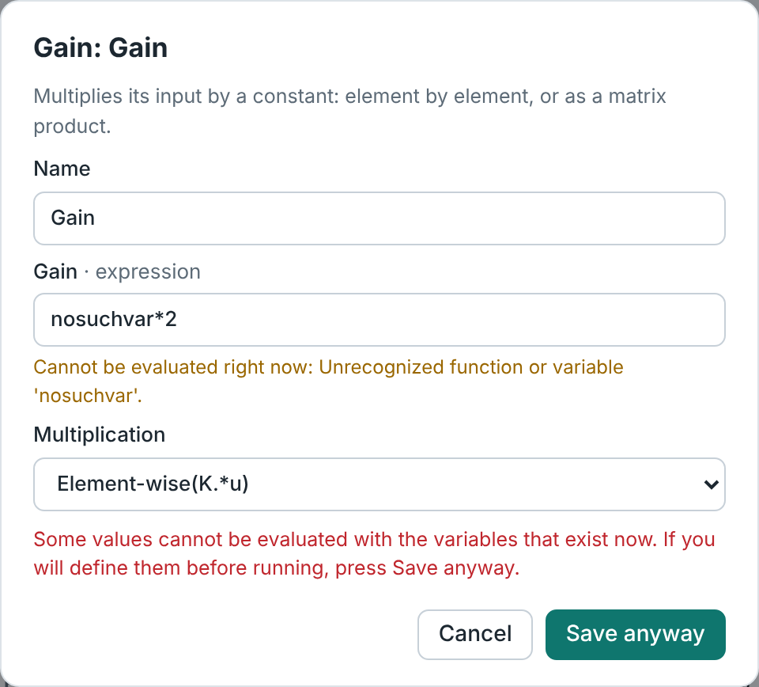
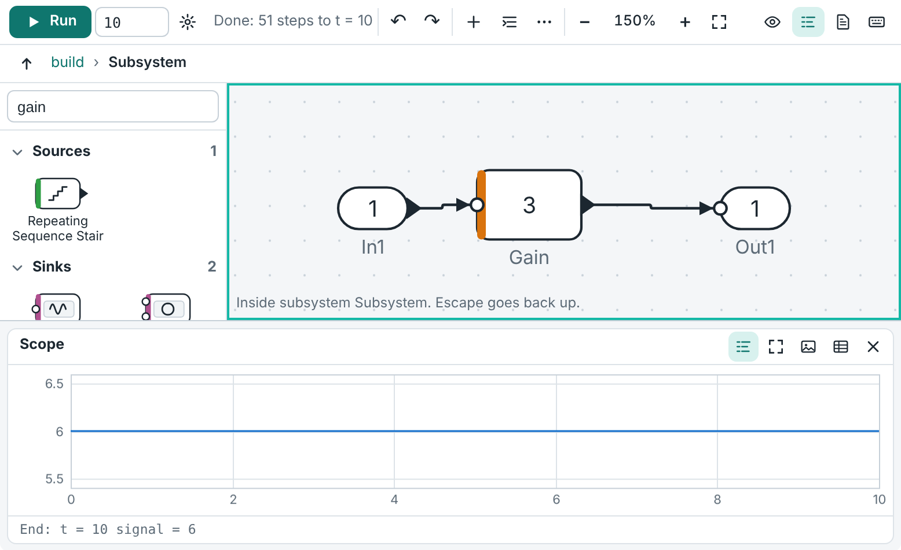
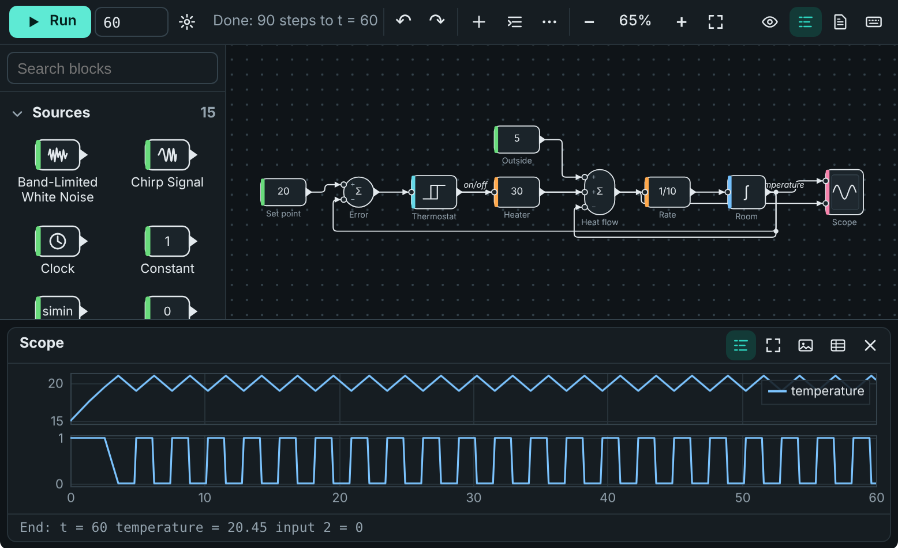
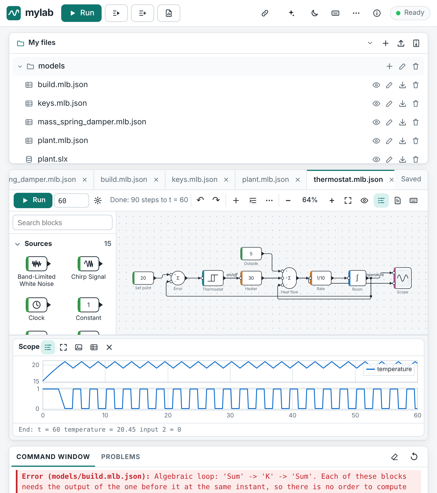

# mylab Blocks: block diagrams

mylab Blocks lets you build a model of a dynamic system from blocks joined by
signal lines, run it over time, and look at the signals. It is meant for
courses in control, signals and system dynamics.

It covers similar ground to Simulink® and can import simple `.slx` and `.mdl` models, but
it is a separate program written from scratch. It is not affiliated with The
MathWorks, Inc., and it does not try to be a complete replacement (see
[What is not supported](#what-is-not-supported)).



Contents: [In the browser](#in-the-browser) · [From code](#from-code) ·
[The model file](#the-model-file) · [Blocks](#blocks) · [How a model runs](#how-a-model-runs) ·
[Subsystems, buses and model references](#subsystems-buses-and-model-references) ·
[State charts](#state-charts) · [Physical networks](#physical-networks) ·
[Importing .slx and .mdl files](#importing-slx-and-mdl-files) ·
[Writing .slx and .mdl files](#writing-slx-and-mdl-files) · [What is not supported](#what-is-not-supported) ·
[How it was checked](#how-it-was-checked)

## In the browser

A model is a file in your project whose name ends in `.mlb.json`. Opening it
shows the diagram editor instead of the text editor.

Where to find block diagrams:

- **The examples.** Six example models are in the `models` folder of *My
  files* in the Files panel, next to the `.m` examples; click one to open it.
  The **Block diagrams** card of the welcome window (**Getting started** at
  the bottom of the page) opens the mass-spring-damper example. The examples
  are also in the command palette (Ctrl+Shift+P, *Example model: …*) and in
  the ⋯ menu of the diagram toolbar.
- **A new model.** The **+** button of the Files panel (New file, Alt+N)
  offers *Block diagram* next to *Script or function*. It makes a small model
  to start from (a step into a first-order system, shown on a scope); a name
  typed with `.mlb.json` at the end chooses it too. Ctrl+Shift+P → **New block
  diagram…** makes an empty one.

### Building a model

- **Add blocks.** Drag a block from the library on the left onto the canvas,
  or click it. The search box filters by name and description. You can also
  press **A** (or double-click the canvas) and type the name of a block.
- **Draw lines.** Drag from an output port (a small triangle) to an input port
  (a small circle). Or click one port and then the other. Dropping a line on a
  block uses its first free input.
- **Branch a signal.** Start another line at the same output, or hold Ctrl and
  drag from an existing line. A dot marks where the lines part.
- **Move, resize, turn.** Drag blocks; drag a corner handle to resize; **R**
  rotates and **F** flips. Drag the middle part of a line to move it. Lines
  are always drawn with horizontal and vertical pieces.
- **Parameters.** Double-click a block (or press Enter). Values are MATLAB
  expressions, so a gain can be `K` or `1/(m*g)`; the variables are read from
  the workspace when the model runs. The dialog refuses values with unclosed
  brackets or quotes, and tells you when a value cannot be evaluated with the
  variables that exist now (you can save it anyway).

  

- **Names.** Double-click a block's name (or press F2) to rename it.
  Double-click a line (or press L) to name the signal; scopes use the name in
  their legend.
- **Subsystems.** Select blocks and press Ctrl+G to put them into a subsystem.
  Double-click a subsystem (or press Enter) to look inside; Escape or the path
  shown above the canvas leads back. A subsystem can have its own variables
  (set in its parameter dialog) that the blocks inside can use.

  

- **Tidy up.** *Arrange* places all blocks in columns from sources to sinks.
  The ⋯ menu aligns and spaces the selected blocks. Ctrl+Z and Ctrl+Y undo
  and redo any change. Ctrl+C, Ctrl+V and Ctrl+D copy, paste and duplicate.
- **Problems.** A block with an input that is not connected gets an amber
  mark, and the port is highlighted. When the engine has loaded, it also
  checks the model as you edit: parameters that cannot be evaluated and
  unknown blocks get a red mark, the blocks of an algebraic loop an amber
  one (the loop is solved by iteration). The counter in the toolbar
  lists all problems; choosing one shows the block.

### Running

**Run** (or F5, or Ctrl+Enter) simulates the model up to the stop time shown
in the toolbar. The gear button holds the solver settings. **Stop** ends a run
that takes too long; like everywhere in the web app this restarts the engine,
which clears the workspace.

Each Scope block opens a plot under the canvas when the model runs (the first
three by themselves, the others from the *Scopes* menu or by double-clicking
the block). The curves grow while the simulation runs.

- Every input port of a scope has its own axes; a vector signal draws one
  curve per element.
- Drag across the plot to zoom in on that time range, use the mouse wheel, or
  double-click to see everything again.
- Move the pointer over the plot (or use ← and → when the plot has the
  keyboard focus) to read the values at that time.
- The buttons save the plot as a PNG image or the data as a CSV file.

The results also go to the workspace, so ordinary code can use them:
`out` (the same object `sim` returns), `tout`, `yout` and one variable per To
Workspace block. For example `plot(out.scopes.Scope.Time, out.scopes.Scope.Data)`.

### Keyboard, touch and themes

Everything can be done from the keyboard. Press **?** on the canvas for the
list. The main keys:

| Keys | Action |
|------|--------|
| Tab, Shift+Tab | Select the next or previous block |
| Alt+arrows | Select the nearest block in that direction (with Shift: add it) |
| Arrows | Move the selected blocks (Shift: by 1 px) |
| Enter | Parameters; open a subsystem or a scope |
| Esc | Clear the selection; leave the subsystem |
| A or / | Add a block by typing its name |
| C | Connect: two or more selected blocks in a chain, or choose the port from a list |
| L, F2 | Name the selected line; rename the block |
| R, Shift+R, F | Rotate, flip |
| Delete | Delete the selection |
| Ctrl+C, X, V, D, Z, Y, A | Copy, cut, paste, duplicate, undo, redo, select all |
| Ctrl+G | Make a subsystem from the selection |
| Ctrl+Shift+L | Arrange the blocks |
| +, −, 0, 1 | Zoom in, zoom out, show everything, 100 % |
| F5, Ctrl+Enter | Run |

Selected blocks and problems are announced for screen readers, and each scope
states its final values.

On a tablet: drag with one finger to move the view, pinch to zoom, tap a port
and then another port to connect them, and double-tap a block for its
parameters.

The editor follows the app's light, dark and high-contrast themes and works in
a narrow window.





The **text** button in the toolbar shows the model file itself. You can edit
it there; the diagram follows.

## From code

The same models can be built and run from scripts, in the browser, on the
command line and in notebooks. The function names are the ones existing
teaching scripts use.

```matlab
K = 2;
new_system('firstorder');
add_block('blocks/Step',       'firstorder/Step', 'Time', '0');
add_block('blocks/Sum',        'firstorder/Sum',  'Inputs', '+-');
add_block('blocks/Gain',       'firstorder/K',    'Gain', 'K');
add_block('blocks/Integrator', 'firstorder/Int');
add_block('blocks/Scope',      'firstorder/Scope');
add_block('blocks/Outport',    'firstorder/Out');
add_line('firstorder', 'Step/1', 'Sum/1');
add_line('firstorder', 'Sum/1',  'K/1');
add_line('firstorder', 'K/1',    'Int/1');
add_line('firstorder', 'Int/1',  {'Sum/2', 'Scope/1', 'Out/1'});

out = sim('firstorder', 'StopTime', '3');
plot(out.tout, out.yout)          % 1 - exp(-2 t)

save_system('firstorder');         % writes firstorder.mlb.json
save_system('firstorder', 'firstorder.slx');   % a copy as .slx, for mylab to read back
```

- Library names: `'blocks/Gain'`, or the familiar ones such as
  `'simulink/Continuous/Integrator'`, `'simulink/Math Operations/Sum'` and
  `'built-in/Gain'`. Only the last part of the path matters.
- `sim('name')` loads `name.mlb.json` (or `name.slx`, `name.mdl`) from the current folder
  or the path if the model is not open yet.
- `sim` returns an object with `tout`, `yout` (the top-level Out blocks, one
  column per element), one field per To Workspace block (a struct with `Time`
  and `Data` by default), `scopes` (one struct per Scope), `logsout` (lines
  marked for logging) and `xout` when asked. `[t, x, y] = sim(model, tspan)`
  also works.
- Settings for one run: `sim(model, 'StopTime', '20', 'Solver', 'ode4',
  'FixedStep', '0.01')`, or `sim(model, 20)`.
- Parameters are looked up in the base workspace first, then in the function
  that calls `sim`.
- `set_param`, `get_param`, `find_system`, `delete_block`, `delete_line`,
  `load_system`, `close_system`, `bdroot`, `gcs` and `gcb` work on models and
  blocks. `get_param(block, 'PortHandles')` gives handles for the handle form
  of `add_line`.
- `[A, B, C, D] = linmod(model)` (also `linearize`) linearizes a model between
  its top-level In and Out blocks by central differences; `trim` looks for a
  steady state.
- `open_system` opens the editor in the web app. Elsewhere it loads the model
  and prints a note once.

`help sim`, `help add_block` and so on describe each function.

Python programs can use the engine directly:

```python
from mylab.blocks import build, simulate
m = build("lag", [("Step", "Step", {"Time": "0"}), ("G", "TransferFcn", {"Denominator": "[2 1]"}), ("Out", "Outport")],
          ["Step/1 -> G/1", "G/1 -> Out/1"], StopTime="8")
res = simulate(m)          # res.t, res.y, res.scopes, ...
```

## The model file

A model is one JSON file that you can read, compare and keep under version
control:

```json
{
  "format": "mylab-blocks-1",
  "name": "lag",
  "config": { "StopTime": "8", "Solver": "ode45" },
  "blocks": [
    { "name": "Step", "type": "Step", "position": [40, 40, 50, 40], "params": { "Time": "0" } },
    { "name": "G", "type": "TransferFcn", "position": [140, 35, 90, 50], "params": { "Denominator": "[2 1]" } },
    { "name": "Out", "type": "Outport", "position": [290, 48, 40, 24] }
  ],
  "lines": [
    { "from": ["Step", 1], "to": ["G", 1], "name": "u" },
    { "from": ["G", 1], "to": ["Out", 1] }
  ]
}
```

- `position` is `[x, y, width, height]`; `rotation` counts quarter turns;
  `flip` mirrors the block. Blocks without a size get a default one.
- `params` holds only the values that differ from the defaults. All values
  are text: MATLAB expressions, option names, or code.
- A line joins one output to one input. A signal that goes to several inputs
  is several lines with the same `from`. `points` (optional) lists corners of
  a hand-made route. `"log": true` records a named signal in `out.logsout`.
- A block of type `Subsystem` has its own `blocks` and `lines`, and may have
  `"mask": { "k": "2" }` for variables that the blocks inside can use, and
  `"maskInit": "code"` for code that computes more such variables from them
  when the model is compiled.
- `"variants": { "Choice A": "MODE == 1", "Choice B": "MODE == 2" }` on a
  subsystem makes it a variant subsystem: the names are subsystems inside,
  and only the one whose condition holds in the workspace is used. Its ports
  are wired by name to the In and Out blocks around it. Exactly one condition
  must hold.
- `"callbacks": { "InitFcn": "code" }` at the top level holds code that runs
  in the workspace before a simulation: `PreLoadFcn` and `PostLoadFcn` once,
  `InitFcn` and `StartFcn` before every run. An error in a callback does not
  stop the run by itself; it is added to the error that follows from it.
- `"library": true` marks a collection of blocks that other models link to;
  it is not meant to be run.
- The control inputs of conditionally run subsystems are the ports
  `"enable"`, `"trigger"` and `"reset"` (an If or Switch Case output goes to
  `"enable"` of an action subsystem, a function-call signal to `"trigger"`).
- A `ModelReference` block (*Model*) has `"params": {"ModelName": "plant"}`
  and `"ports": [inputs, outputs]`, which mylab fills in from the referenced
  model when it finds it.

## Blocks

Every block has a one-line description here and in the editor. The type name
is what the model file and `add_block` use.

<!-- BLOCK-TABLE:START -->

146 blocks.

**Sources**

| Block | Type name | What it does |
|-------|-----------|--------------|
| Band-Limited White Noise | `BandLimitedWhiteNoise` | White noise for continuous systems: random values of variance Cov/Ts held for Ts. |
| Chirp Signal | `Chirp` | Sine wave whose frequency rises linearly from f1 to f2 (Hz) over the target time. |
| Clock | `Clock` | Outputs the simulation time. |
| Constant | `Constant` | Outputs a constant value (a number, vector or matrix). |
| From Workspace | `FromWorkspace` | Plays back data from a workspace variable: a matrix [t, u] or a struct with Time and Data. |
| Function-Call Generator | `FunctionCallGenerator` | Calls the function-call subsystem wired to it at every sample time (a number of times in a row). |
| Ground | `Ground` | Outputs zero. |
| Pulse Generator | `PulseGenerator` | Rectangular pulses with a given period, width (percent of the period) and delay. |
| Ramp | `Ramp` | Rises (or falls) at a constant slope from a start time on. |
| Random Number | `RandomNumber` | Normally distributed random numbers, a new one every sample time. |
| Repeating Sequence | `RepeatingSequence` | Repeats a piecewise-linear wave given by time values and output values. |
| Repeating Sequence Stair | `RepeatingSequenceStair` | Steps through a list of values, one per sample time, and starts again. |
| Signal Generator | `SignalGenerator` | Sine, square, sawtooth or random wave with a given amplitude and frequency. |
| Sine Wave | `SineWave` | Sine wave: Amplitude*sin(Frequency*t + Phase) + Bias, frequency in rad/s. |
| Step | `Step` | Jumps from one value to another at a given time. |
| Uniform Random Number | `UniformRandomNumber` | Uniformly distributed random numbers between a minimum and a maximum. |

**Sinks**

| Block | Type name | What it does |
|-------|-----------|--------------|
| Display | `Display` | Shows the current value of its input. |
| Scope | `Scope` | Plots its inputs against time. Each input port gets its own axes. |
| Stop Simulation | `StopSimulation` | Stops the simulation when its input is not zero. |
| Terminator | `Terminator` | Ends a signal that is not used. |
| To Workspace | `ToWorkspace` | Saves its input to a variable (and a field of the object returned by sim). |
| Viewer | `Viewer` | Stands for a display that mylab does not draw (video, 3-D animation); its inputs are ignored. |
| XY Graph | `XYGraph` | Plots the second input against the first. |

**Continuous**

| Block | Type name | What it does |
|-------|-----------|--------------|
| Derivative | `Derivative` | Approximate time derivative of the input (difference between solver steps). |
| Integrator | `Integrator` | Integrates its input over time. Optional limits, reset input and external initial value. |
| PID Controller | `PIDController` | PID controller with filtered derivative, output limits and anti-windup. |
| State-Space | `StateSpace` | Linear system dx/dt = Ax + Bu, y = Cx + Du. |
| Transfer Fcn | `TransferFcn` | Linear transfer function given by numerator and denominator coefficients in s. |
| Transport Delay | `TransportDelay` | Delays the input by a fixed time. |
| Zero-Pole | `ZeroPole` | Linear transfer function given by its zeros, poles and gain. |

**Discrete**

| Block | Type name | What it does |
|-------|-----------|--------------|
| Delay | `Delay` | Delays the input by a number of sample times. |
| Discrete Derivative | `DiscreteDerivative` | Difference between this sample and the last, divided by the sample time. |
| Discrete FIR Filter | `DiscreteFir` | Discrete FIR filter: a weighted sum of the latest input samples. |
| Discrete Filter | `DiscreteFilter` | Discrete filter given by numerator and denominator coefficients in 1/z. |
| Discrete State-Space | `DiscreteStateSpace` | Discrete linear system x[k+1] = Ax[k] + Bu[k], y[k] = Cx[k] + Du[k]. |
| Discrete Transfer Fcn | `DiscreteTransferFcn` | Discrete transfer function given by numerator and denominator coefficients in z. |
| Discrete-Time Integrator | `DiscreteTimeIntegrator` | Integrates in steps of the sample time: forward Euler, backward Euler or trapezoidal. |
| Memory | `Memory` | Outputs the input of the previous solver step. |
| Rate Transition | `RateTransition` | Passes a signal between parts that run at different sample times (samples and holds). |
| Unit Delay | `UnitDelay` | Delays the input by one sample time. |
| Zero-Order Hold | `ZeroOrderHold` | Samples the input at its sample time and holds the value in between. |

**Math**

| Block | Type name | What it does |
|-------|-----------|--------------|
| Abs | `Abs` | Absolute value. |
| Bias | `Bias` | Adds a constant to the input. |
| Data Type Conversion | `DataTypeConversion` | Passes the signal on (all signals are double precision in mylab Blocks). |
| Divide | `Divide` | Divides the first input by the second. |
| Dot Product | `DotProduct` | Dot product of two vectors. |
| Gain | `Gain` | Multiplies its input by a constant: element by element, or as a matrix product. |
| Math Function | `MathFunction` | A choice of functions: exp, log, 10^u, log10, square, pow, reciprocal, hypot, rem, mod, transpose. |
| Min Max | `MinMax` | Smallest or largest of its inputs (or of the elements of a single input). |
| MinMax Running Resettable | `MinMaxRunningResettable` | Smallest or largest value its first input has had so far; the second input resets it. |
| Permute Dimensions | `PermuteDimensions` | Reorders the dimensions of a matrix signal ([2 1] swaps rows and columns). |
| Polynomial | `Polynomial` | Evaluates a polynomial with the given coefficients (highest power first). |
| Product | `Product` | Multiplies and divides its inputs; the string (such as */) gives one operation per input. |
| Product of Elements | `ProductOfElements` | Multiplies the elements of a vector. |
| Reshape | `Reshape` | Changes the shape of a signal: 1-D vector, column, row, or the given [rows columns]. |
| Rounding Function | `Rounding` | Rounds to whole numbers: floor, ceil, round or fix. |
| Sign | `Sign` | Sign of the input: -1, 0 or 1. |
| Sqrt | `Sqrt` | Square root (also signed square root and reciprocal square root). |
| Sum | `Sum` | Adds and subtracts its inputs; the signs string (such as +-) gives one sign per input. |
| Sum of Elements | `SumOfElements` | Adds up the elements of a vector. |
| Trigonometric Function | `TrigonometricFunction` | sin, cos, tan and their inverse and hyperbolic versions; atan2 has two inputs. |
| Unary Minus | `UnaryMinus` | Negates the input. |
| Vector Concatenate | `Concatenate` | Joins its inputs into one vector, or side by side / on top of each other as matrices. |
| Width | `Width` | Outputs the number of elements of its input. |

**Logic**

| Block | Type name | What it does |
|-------|-----------|--------------|
| Bitwise Operator | `BitwiseOperator` | Bitwise AND, OR, XOR or NOT of whole-number inputs, optionally with a fixed mask. |
| Compare To Constant | `CompareToConstant` | Compares the input with a constant; the output is 1 or 0. |
| Compare To Zero | `CompareToZero` | Compares the input with zero; the output is 1 or 0. |
| Hit Crossing | `HitCrossing` | Outputs 1 at the step where the input crosses a level, otherwise 0. |
| If | `If` | Tests conditions on its inputs (u1, u2...) and switches on the action subsystem of the first one that holds. |
| Logical Operator | `LogicalOperator` | AND, OR, NAND, NOR, XOR, NXOR or NOT of its inputs (non-zero counts as true). |
| Multiport Switch | `MultiportSwitch` | Passes the data input chosen by the first (control) input: 1 for the first, 2 for the next... |
| Relational Operator | `RelationalOperator` | Compares two inputs (==, ~=, <, <=, >=, >); the output is 1 or 0. |
| Switch | `Switch` | Passes the first input when the middle (control) input meets the condition, else the third. |
| Switch Case | `SwitchCase` | Compares its input with lists of values (cases) and switches on the action subsystem of the matching case. |

**Nonlinear**

| Block | Type name | What it does |
|-------|-----------|--------------|
| 1-D Lookup Table | `LookupTable1D` | Interpolates in a table of breakpoints and values. |
| 2-D Lookup Table | `LookupTable2D` | Interpolates in a two-dimensional table: first input picks the row, second the column. |
| Backlash | `Backlash` | Play between two parts: the output only follows once the input has crossed the dead band. |
| Coulomb & Viscous Friction | `CoulombViscousFriction` | Friction: sign(u) * (gain*|u| + offset). |
| Dead Zone | `DeadZone` | Outputs zero inside a band; outside, the input shifted by the band edge. |
| Direct Lookup Table | `DirectLookupTable` | Picks an element (or a column) of a table by index, counting from 0; no interpolation. |
| Prelookup | `Prelookup` | Finds where the input lies in a list of breakpoints: the interval number (from 0) and the fraction inside it. |
| Quantizer | `Quantizer` | Rounds the input to a multiple of the quantization interval. |
| Rate Limiter | `RateLimiter` | Limits how fast the output may rise and fall. |
| Rate Limiter Dynamic | `RateLimiterDynamic` | Limits how fast the output may change; the rising and falling limits are inputs (up, u, lo). |
| Relay | `Relay` | Switches on above one level and off below another (hysteresis). |
| Saturation | `Saturation` | Limits the input to the range between a lower and an upper limit. |
| Saturation Dynamic | `SaturationDynamic` | Limits the middle input to the range given by the upper and lower inputs. |
| n-D Lookup Table | `LookupTableND` | Interpolates in a table with three or more dimensions; one input per dimension. |

**Routing**

| Block | Type name | What it does |
|-------|-----------|--------------|
| Action Port | `ActionPort` | Put inside a subsystem: the subsystem runs only while the If block output wired to it is on. |
| Assignment | `Assignment` | Replaces chosen elements of a signal (Y0) with the values of another input (U). |
| Bus Assignment | `BusAssignment` | Replaces signals of a bus by name with the values at its other inputs. |
| Bus Creator | `BusCreator` | Groups signals into a bus under the names of their lines (or of a bus object); a Bus Selector picks them out. |
| Bus Selector | `BusSelector` | Picks signals out of a bus by name (nested ones as outer.inner). |
| Demux | `Demux` | Splits a vector signal into its elements (or into parts of given widths). |
| Enable | `EnablePort` | Put inside a subsystem: the subsystem only runs while its enable input is positive. |
| For Iterator | `ForIterator` | Put inside a subsystem: the subsystem runs its blocks N times in every time step; outputs the iteration number. |
| From | `From` | Outputs the signal of the Goto block with the same tag. |
| Goto | `Goto` | Sends its input to every From block with the same tag, without drawing a line. |
| In | `Inport` | Input of a subsystem. At the top level: an external input (zero unless one is given to sim). |
| Manual Switch | `ManualSwitch` | Passes the first or the second input, as chosen in its dialog. |
| Merge | `Merge` | Outputs whichever input was computed most recently (for conditionally run subsystems). |
| Model | `ModelReference` | Runs another model as a block: the In and Out blocks of its top level become the ports. |
| Mux | `Mux` | Joins its inputs into one vector signal. |
| Out | `Outport` | Output of a subsystem. At the top level its signal is logged in yout. |
| Reset | `ResetPort` | Put inside a subsystem: the blocks inside start again from their initial states when the reset input fires. |
| Selector | `Selector` | Picks elements of a signal by index: a vector, rows and columns, or more dimensions. |
| Subsystem | `Subsystem` | A group of blocks shown as one block. Double-click to look inside. |
| Trigger | `TriggerPort` | Put inside a subsystem: the subsystem runs once each time its trigger input crosses zero. |
| While Iterator | `WhileIterator` | Put inside a subsystem: the subsystem repeats its blocks in a time step while the condition input is true. |

**User-defined**

| Block | Type name | What it does |
|-------|-----------|--------------|
| Chart | `Chart` | A state chart: states with entry, during and exit actions, transitions with events and conditions. |
| Fcn | `Fcn` | A formula in u (the input; u(1), u(2)... for a vector) and t. The result is one number. |
| Interpreted Function | `InterpretedFunction` | Calls a function handle or a named function with the input: y = f(u). |
| MATLAB Function | `MATLABFunction` | Runs a function you write in the MATLAB language; its inputs and outputs become ports. |
| S-Function (level 1, .m file) | `SFunction` | Runs a level-1 S-function written as a .m file: [sys, x0, str, ts] = name(t, x, u, flag, ...). |
| S-Function (level 2, .m file) | `MSFunction` | Runs a level-2 S-function written as a .m file: a setup function that fills in a block object. |

**Physical**

| Block | Type name | What it does |
|-------|-----------|--------------|
| Capacitor | `Capacitor` | Electrical capacitor: i = C dv/dt; its voltage is a state. |
| Connection Port | `ConnectionPort` | Put inside a subsystem: a physical port of the subsystem (L1, L2... or R1, R2...). |
| Controlled Current Source | `ControlledCurrentSource` | Current given by the input signal, pushed out of port p. |
| Controlled Voltage Source | `ControlledVoltageSource` | Voltage between p and n given by the input signal. |
| Current Sensor | `CurrentSensor` | Outputs the current flowing from p to n through it (it joins p and n). |
| DC Current Source | `DCCurrentSource` | Constant current I pushed out of port p through the circuit back into n. |
| DC Voltage Source | `DCVoltageSource` | Constant voltage between p and n: v_p - v_n = V. |
| Diode | `Diode` | Piecewise-linear diode: conducts with resistance Ron above the forward voltage Vf, else conductance Goff. |
| Electrical Reference | `ElectricalReference` | Electrical ground: the voltage of the node it is connected to is zero. |
| Ideal Angular Velocity Source | `IdealAngularVelocitySource` | Angular velocity w_F - w_B given by the input signal. |
| Ideal Force Sensor | `IdealForceSensor` | Outputs the force flowing from R to C through it (it joins R and C rigidly). |
| Ideal Force Source | `IdealForceSource` | Force given by the input signal; a positive force pushes R forward relative to C. |
| Ideal Rotational Motion Sensor | `IdealRotationalMotionSensor` | Outputs the angular velocity and angle of F relative to B; no torque. |
| Ideal Torque Sensor | `IdealTorqueSensor` | Outputs the torque flowing from F to B through it (it joins F and B rigidly). |
| Ideal Torque Source | `IdealTorqueSource` | Torque given by the input signal; a positive torque turns F forward relative to B. |
| Ideal Translational Motion Sensor | `IdealTranslationalMotionSensor` | Outputs the velocity and the position of R relative to C; no force. |
| Ideal Translational Velocity Source | `IdealTranslationalVelocitySource` | Velocity v_R - v_C given by the input signal. |
| Inductor | `Inductor` | Electrical inductor: v = L di/dt; its current is a state. |
| Inertia | `Inertia` | Rotational inertia J: the torque flowing into its port accelerates it. |
| Mass | `Mass` | A mass m: the force flowing into its port accelerates it; its velocity is a state. |
| Mechanical Rotational Reference | `MechanicalRotationalReference` | Fixed frame for rotation: angular velocity zero. |
| Mechanical Translational Reference | `MechanicalTranslationalReference` | Fixed frame for translational motion: velocity zero. |
| PS-Simulink Converter | `PSSimulinkConverter` | Passes a sensor signal on to ordinary blocks (physical signals are ordinary signals in mylab). |
| Resistor | `Resistor` | Electrical resistor: v = R i between its ports p and n. |
| Rotational Damper | `RotationalDamper` | Rotational viscous damper: torque b (w_F - w_B). |
| Rotational Spring | `RotationalSpring` | Torsion spring: torque k theta, theta = angle of F relative to B (a state). |
| Simulink-PS Converter | `SimulinkPSConverter` | Passes an ordinary signal on to a controlled source (physical signals are ordinary signals in mylab). |
| Solver Configuration | `SolverConfiguration` | Marks a physical network (accepted for familiarity; mylab needs no settings here). |
| Translational Damper | `TranslationalDamper` | Viscous damper: force b (v_R - v_C). |
| Translational Spring | `TranslationalSpring` | Spring: force k x, where x is how far R has moved relative to C (a state). |
| Voltage Sensor | `VoltageSensor` | Outputs the voltage v_p - v_n; no current flows through it. |
<!-- BLOCK-TABLE:END -->

Notes:

- All signals are double-precision real numbers: scalars, vectors or
  matrices. Logic blocks output 1 and 0. Signals keep one size for the whole
  run.
- An input that is not connected reads as zero and gives a warning.
- Integrator: a reset, or an external initial value, takes effect at the step
  in which the reset signal fires; the logged value at that instant is the
  new one. The initial-value input may come from the integrator's own output
  (as in the bouncing-ball example) without an algebraic loop.
- Random sources are repeatable for a given seed, but the numbers are not the
  ones other programs produce for the same seed.
- PID Controller is continuous. Transfer Fcn, Zero-Pole and PID take a scalar
  input.
- Buses are described under
  [Subsystems, buses and model references](#subsystems-buses-and-model-references).

## How a model runs

1. **Flattening.** Subsystems, In and Out blocks, and Goto/From pairs are
   removed, so every input is tied directly to the output that drives it.
2. **Order.** A block whose output depends on its input at the same instant
   must run after the block that feeds it. Blocks with memory (Integrator,
   Unit Delay, Memory, a transfer function with more poles than zeros…) do
   not have this dependency. A cycle of such dependencies is an **algebraic
   loop**. mylab solves it at every step with Newton's method: it cuts the
   loop at one or more signals, takes their values as unknowns, and iterates
   until the values that go into the loop equal the ones that come out (to
   about 1e-10). The blocks of the loop get a warning, because this costs
   time and can fail: a loop may have no solution, or several. When the
   iteration does not converge the run stops with an error that names the
   blocks and the time. To make every loop an error instead, set
   `AlgebraicLoop` to `error` (the *Solve algebraic loops* box in the
   settings).
3. **Sample times.** Continuous blocks run at every step. Discrete blocks run
   at their sample time (a period, or `[period offset]`) and hold their output
   in between; several rates can be mixed. A sample time of -1 takes the rate
   of the block's inputs.
4. **Major and minor steps.** A major step computes all outputs, records them
   in scopes and logs, and lets blocks update their memory. Between major
   steps the solver integrates the continuous states; its trial evaluations
   (minor steps) are never recorded.
5. **Events.** The solver always stops exactly at sample times and at the
   jump times of sources (Step, Pulse Generator…). Blocks such as Relay,
   Saturation, Switch, Abs, Compare, Hit Crossing and a limited or reset
   Integrator report zero crossings: when one changes sign within a step, the
   crossing time is found by bisection (to about 1e-10 of the time scale) and
   a major step is taken there. Until then these blocks keep their mode, so
   the equations stay smooth within a step. Turn this off with
   `ZeroCrossings` = `off`.

Solvers:

| Setting | Method |
|---------|--------|
| `ode45` (default), `ode23`, `ode113` | Variable step, explicit Runge-Kutta: orders 5(4), 3(2) and 8 (SciPy's RK45, RK23, DOP853) |
| `ode15s`, `ode23s` | Variable step for stiff models (SciPy's BDF and Radau) |
| `ode1`, `ode2`, `ode3`, `ode4`, `ode5` | Fixed step: Euler, Heun, Bogacki-Shampine, classic Runge-Kutta, Dormand-Prince |
| `FixedStepDiscrete`, `VariableStepDiscrete` | Models without continuous states |

- `RelTol` (1e-3) and `AbsTol` (1e-6) steer variable-step solvers. `MaxStep`
  defaults to one fiftieth of the run, so plots have at least 51 points.
- `FixedStep` defaults to the fastest sample time of the model, or one
  fiftieth of the run. Fixed-step runs do not locate zero crossings.
- The solver names are for familiarity. The methods are the ones listed
  above, so step sizes, and results at the level of the tolerances, differ
  from other programs.
- More than 500 zero crossings in a row at one instant (a switch chattering
  infinitely fast) stops the run with an explanation.

## Subsystems, buses and model references

Ordinary subsystems only group blocks. These kinds change when their blocks
run:

| Kind | Made with | What happens |
|------|-----------|--------------|
| Enabled | an Enable block inside | runs while the `enable` input is positive |
| Triggered | a Trigger block inside | runs once at each rising, falling or either edge of `trigger` |
| Action (if / switch case) | an Action Port inside, fed by an If or Switch Case block | runs while its If or Switch Case output is on; a Merge block joins the results |
| Resettable | a Reset block inside | always runs; its blocks start again from their initial states when `reset` fires (rising, falling, either, or level: every step the input is not zero) |
| Function-call | a Trigger block with *function-call* inside, fed by a Function-Call Generator (or a chart event) | runs once per call, at the moment of the call; its outputs hold in between |
| For Iterator | a For Iterator block inside | runs its blocks N times in each time step; the For Iterator outputs the iteration number (from 1, or from 0) |
| While Iterator | a While Iterator block inside | repeats its blocks in a time step while its condition input is true (*while*: the initial-condition input is tested first; *do-while*: at least once), at most MaxIters times |

- **States.** An enabled or action subsystem keeps its states while it is
  off, unless the Enable block's *StatesWhenEnabling* (the Action Port's
  *InitializeStates*) is `reset`: then its blocks start from their initial
  states each time it is switched on again. An Out block inside can hold
  its last value while the subsystem is off, or go back to its initial
  output (*OutputWhenDisabled* = `reset`). An iterator subsystem keeps its
  states from one time step to the next (*ResetStates* = `held`) or starts
  again in every time step (`reset`); within a time step a Unit Delay or
  Memory block carries a value from one iteration to the next.
- **Assignment in a loop.** In an iterator subsystem, an Assignment block
  starts from its Y0 input in the first iteration and goes on from its own
  result in the following ones, so a loop can fill a vector element by
  element.
- **Restrictions.** Iterator and function-call subsystems run as one unit
  with their own block order, so they cannot contain blocks with continuous
  states (Integrator, Transfer Fcn…). A function-call subsystem runs after the
  block that calls it in the same step, so a value it computes reaches the
  caller one step later. Discrete blocks inside take the times of the calls.

**Buses.** A Bus Creator puts its inputs on one line under the names of the
lines going into it (`signal1`, `signal2`… for lines without a name), or
under the element names of a bus object when its *OutDataTypeStr* is
`Bus: name`. A Bus Selector picks signals out by name (`outer.inner` for a
bus inside a bus), separately or as a new bus; a Bus Assignment replaces
some of them. A bus passes through subsystems, Goto/From, Merge, Unit Delay
and Memory blocks with its names. Blocks that compute with numbers see the
elements one after the other, like a Mux output. A MATLAB Function block
receives a bus as a struct and can return a struct, which becomes a bus;
a Constant whose value is a struct outputs a bus; a To Workspace block logs
a bus as a struct with one field per element. A bus object is made in code:

```matlab
e1 = Simulink.BusElement;  e1.Name = 'pos';
e2 = Simulink.BusElement;  e2.Name = 'vel';
B = Simulink.Bus;  B.Elements = [e1 e2];   % Bus Creator: OutDataTypeStr 'Bus: B'
```

Only the element names of a bus object are used; data types and sizes are
not checked, and a bus is not a separate type: there are no virtual and
nonvirtual buses to tell apart.

**Model references.** A *Model* block (`ModelReference`, also
`'simulink/Ports & Subsystems/Model'`) runs another model as part of this
one: the In and Out blocks of its top level become the ports of the block.
The model is looked for among the open models, then as `name.mlb.json`,
`name.slx` or `name.mdl` next to the model that refers to it, in the current
folder and on the path. It runs in what is often called *normal mode*: its
blocks are copied into the model at compile time, its parameters are read
from the workspace like any others, and its own callbacks and configuration
are not used. A model that refers to itself, directly or through others, is
an error.

## State charts

A **Chart** block holds a state machine. Its states can contain states,
either *exclusive* (one active at a time, chosen by a default transition) or
*parallel* (all active, run in order). Transitions join states and
connective junctions and are labelled `event[condition]{condition
action}/transition action`, every part optional. States carry their actions
in their label, one keyword per line: `entry:`, `during:`, `exit:` (also
`en:`, `du:`, `ex:`; lines before the first keyword are entry actions). The
actions and conditions are MATLAB code that mylab's interpreter runs, with
the chart's data as variables.

```matlab
add_block('blocks/Chart', 'therm/Ctl', 'SampleTime', '0.25');
chart_data('therm/Ctl', 'temp', 'input');
chart_data('therm/Ctl', 'on', 'output', '0');
chart_state('therm/Ctl', 'Off', 'entry: on = 0;');
chart_state('therm/Ctl', 'On', 'entry: on = 1;');
chart_transition('therm/Ctl', '', 'Off');                 % default transition
chart_transition('therm/Ctl', 'Off', 'On', '[temp < 18]');
chart_transition('therm/Ctl', 'On', 'Off', '[temp > 22]');
```

- **Data** (`chart_data`): `input` and `output` data are the block's ports,
  in the order they were added; `local` data keeps its value from one step
  to the next; `constant` data takes its initial value; `parameter` data is
  read from the workspace.
- **Events** (`chart_event`): input events share one extra input port with
  one element per event, and wake the chart when their signal rises, falls,
  does either, or when a function-call signal calls it (`function-call`).
  An output event is an output port: a `function-call` event calls the
  function-call subsystem wired to it once per `send`, other kinds toggle
  their signal. A local event is processed by the whole chart at once.
  `send(E)` broadcasts, and so does a statement that is only the event's
  name.
- **Temporal logic:** `after(n, tick)`, `before(n, tick)`, `at(n, tick)` and
  `every(n, tick)`, also with `sec` (or `msec`, `usec`), count from the moment
  the source state of the transition was entered. They can stand in place of
  the event or be used in the condition. `in(A.B)` is true while state `A.B`
  is active.
- **Hierarchy:** `chart_state(chart, 'Run.Fast', ...)` puts *Fast* inside
  *Run*; `'Decomposition', 'parallel'` makes a state's children parallel,
  and `set_param(chart, 'Decomposition', 'parallel')` the chart's.
  `chart_junction(chart, 'j')` adds a junction.

How a chart runs: the chart *steps* at each of its sample times (an
inherited sample time takes the rate of its inputs), or, if it has input
events, each time one of them occurs. The first step enters the chart:
default transitions lead to states, whose entry actions run, outermost
first. Each later step starts at the top: for each active state, its
outgoing transitions are tried in the order they were added; the first
whose event matches (or that has no event) and whose condition holds is
taken, its condition action running as soon as the condition holds. A path
through junctions backtracks when a junction has no valid way on; a path
that ends at a junction without outgoing transitions runs its actions and
leaves the state where it is. Taking a transition exits the source and its
active substates (exit actions, innermost first), runs the transition
actions and enters the destination. If no transition is taken, the state's
during action runs, then its active substates are processed the same way.
A chart without states is a flow chart: its default paths run at every
step. The outputs change only at the chart's steps and hold in between.

In a model file the chart is a `"chart"` entry of the block, plain data:
`decomposition`, `data`, `events`, `states` (nested, with `name`, `label`
and `decomposition`), `junctions` and `transitions` (`from`, `to`, `label`;
`"from": ""` is a default transition). Python code can build one with
`mylab.blocks.chart.ChartBuilder`. In the diagram editor a chart shows its
ports and its sample time; its states and transitions are edited in the
model's text view or from code. There is no graphical chart editor.

Not done: history junctions, inner transitions (from a state's edge to its
own substates), graphical, truth-table and MATLAB functions inside charts,
super-step semantics, state activity outputs, events sent to a particular
state, and continuous-time charts. A function-call subsystem called by an
output event runs after the chart's step, not in the middle of the action
that sent the event.

**Charts in files.** Charts are written to `.slx` and `.mdl` files and read
back. Reading follows the layout of the Stateflow parts of public files
(states, transitions, junctions and data linked by number), but the public
files examined contain only charts that hold MATLAB Function code, no state
charts; reading state charts saved by other programs was therefore not
tried, and the names it expects for parallel decomposition, local data and
events are an educated guess.

## Physical networks

The blocks of the **Physical** group model electrical circuits and
mechanical systems with two-way connections, the way they are drawn on
paper: a resistor joins two nodes, a mass hangs on a spring. Their ports are
*conserving ports* with names (drawn as small diamonds), and the lines
between them have no direction.

| Domain | Across variable | Through variable | Blocks |
|--------|-----------------|------------------|--------|
| electrical (ports `p`, `n`) | voltage | current | Resistor, Capacitor, Inductor, Diode, DC and controlled voltage and current sources, Electrical Reference, Voltage Sensor, Current Sensor |
| translational (`R`, `C`; mass `M`) | velocity | force | Mass, Translational Spring, Translational Damper, Ideal Force Source, Ideal Translational Velocity Source, Mechanical Translational Reference, Ideal Translational Motion Sensor (velocity and position), Ideal Force Sensor |
| rotational (`F`, `B`; inertia `I`) | angular velocity | torque | Inertia, Rotational Spring, Rotational Damper, Ideal Torque Source, Ideal Angular Velocity Source, Mechanical Rotational Reference, Ideal Rotational Motion Sensor, Ideal Torque Sensor |

```matlab
new_system('spring');
add_block('blocks/Mass', 'spring/M', 'm', '1', 'v0', '1');
add_block('blocks/TranslationalSpring', 'spring/K', 'k', '4');
add_block('blocks/MechanicalTranslationalReference', 'spring/Ref');
add_block('blocks/IdealTranslationalMotionSensor', 'spring/S');
add_block('blocks/Outport', 'spring/x');
add_line('spring', 'K/R', 'M/M');   add_line('spring', 'K/C', 'Ref/R');
add_line('spring', 'S/R', 'M/M');   add_line('spring', 'S/C', 'Ref/R');
add_line('spring', 'S/2', 'x/1');   % position: sin(2 t)/2
```

**How a network is solved.** All physical blocks that are connected form one
network. Its unknowns are the across variable of every node and the through
and internal variables of the components; at each node the across variable
is the same for all ports and the through variables add up to zero.
Capacitor voltages, inductor currents, the velocities of masses and
inertias, the stretch of springs and the positions of motion sensors are
continuous states. This gives a differential-algebraic system `dx/dt =
f(x, z, u)`, `0 = g(x, z, u)`, which mylab requires to be of index 1: `g`
must determine the algebraic unknowns `z` from the states and inputs. They
are then found at every evaluation (by one linear solve, or Newton's method
for the switching of diodes, whose switching instants are located like other
zero crossings), and the ordinary solvers integrate the states, so `ode45`,
`ode15s` for stiff circuits, the fixed-step solvers and `linmod` all work.

A network that is not of index 1 is an error that names the components
involved: a capacitor directly across a voltage source or another capacitor,
an inductor in series with a current source, two masses joined rigidly, a
mass driven by a velocity source. Put a resistor, spring or damper between
them. A circuit without a reference block (or a node that only sensors
touch) leaves a variable undetermined and is an error too. mylab does not
reduce the index.

- **Sign conventions.** Two-port components carry their through variable
  from the first port to the second (current `p` to `n`, force `R` to `C`,
  torque `F` to `B`) and their across variable is first minus second. A
  source with a positive input drives the outside from its second port to
  its first: a current source pushes current out of `p`, a force source
  pushes `R` forward relative to `C`. The through variable flowing into a
  mass or inertia accelerates it.
- **Signals.** Sensors output ordinary signals, and controlled sources take
  them; there are no separate physical signals. The PS-Simulink and
  Simulink-PS Converter blocks pass a signal on unchanged, and the Solver
  Configuration block is accepted and does nothing, so diagrams drawn with
  them keep their shape. Inputs of a network are scalars.
- **Subsystems.** A Connection Port block inside a subsystem (*Side* left or
  right, *Port* 1, 2…) is a physical port `L1`, `L2`… or `R1`, `R2`… of the
  subsystem block.
- **The diagram editor** draws the conserving ports and the lines between
  them; drag from one conserving port to another to connect them.
- **Diode:** piecewise linear: conductance `Goff` below the forward voltage
  `Vf`, resistance `Ron` above it.

Not done: other domains (hydraulic, thermal, magnetic, gas), multibody
mechanics (bodies, joints and frames in 3-D, such as the WEC-Sim blocks
listed under [Tested on real files](#tested-on-real-files)), nonlinear
components other than the diode, physical signals with units, index
reduction, and reading physical networks from `.slx` and `.mdl` files
(apart from Connection Port blocks, which are read; the library blocks of
real networks are not).

## Importing .slx and .mdl files

`load_system('model')`, `sim('model')` and, in the web app, opening a `.slx`
or `.mdl` file (or *Import a .slx or .mdl model…*) convert the file to a mylab
model. An `.slx` file is a zip archive of XML parts; an `.mdl` file is the
older text format, nested `Name { ... }` sections of `Key value` lines. Both
readers were written from the structure of public files, without vendor code
or documentation. The `.mdl` reader turns the text into the same XML tree an
`.slx` file holds and hands it to the `.slx` reader, so both convert the same
things, listed below. It was written from the four `.mdl` files in the
history of the WEC-Sim repository (Apache-2.0: `tutorials/RM3/RM3.mdl`,
`tutorials/OSWEC/OSWEC.mdl`, `source/lib/WEC-Sim/WECSim_Lib.mdl` and
`source/lib/PTO-Sim/PTOSim_Lib.mdl` as first added, in 2014 to 2018), which
were saved in the mask format of those years (a `Simulink.Mask` object). Older
`.mdl` files that describe masks with `MaskPromptString` and
`MaskVariables` lines read without their mask variables.

What is converted:

- the blocks listed above, with the parameters they share;
- lines with their branches and corner points, signal names;
- subsystems, in both file layouts (everything in one part, or one part per
  subsystem); enabled, triggered and action subsystems, For and While
  Iterator subsystems, function-call subsystems; variant subsystems
  (the active choice is picked from the workspace when the model is compiled);
- Model blocks (the referenced file must be next to the model or on the path;
  other simulation modes are run in normal mode, with a note);
- mask parameters of subsystems as subsystem variables, and mask
  initialization code, which is run by the mylab interpreter to compute more
  of them;
- MATLAB Function blocks (their code), and S-function blocks whose code is a
  MATLAB-language file on the path, level 1 (the `flag` protocol) and level 2
  (the block object with `Outputs`, `Update`, `Derivatives`…);
- links to the common built-in library blocks, and links to library files
  (`.slx` or `.mdl`) in the same folder tree, including blocks that a library has moved (its
  forwarding table) and libraries that only open other libraries;
- the model's `PreLoadFcn`, `PostLoadFcn`, `InitFcn` and `StartFcn` code,
  which is run before a simulation;
- start and stop time, solver, step size and tolerances.

Some library blocks from add-on products are replaced by something of ours,
and the import says so in a note:

- the bicycle, unicycle, differential-drive and Ackermann vehicle models
  become a subsystem of ordinary blocks with the textbook equations
  (a **stand-in**: written here, not taken from the library);
- conversions between rotation matrices, Euler angles, quaternions and
  homogeneous transforms become a function block that calls `eul2rotm`,
  `tform2eul` and their relatives;
- blocks that only draw (video viewers, 3-D animations) become a Viewer
  block that ignores its inputs; dashboard knobs and gauges are left out.

What is not converted: anything listed under
[What is not supported](#what-is-not-supported), data types, annotations and
block colours. A block without an equivalent is **kept as a grey placeholder
under its original type name**, with its ports and lines, and listed in a
message. A model with placeholders does not run; the error names them.

Importing treats the file as data: nothing in it is executed, sizes are
limited, and XML with entity declarations is refused. **Running** an imported
model is different: its callbacks, mask initialization code, MATLAB Function
blocks and S-function files are code, and the mylab interpreter runs them like
any script. Run models only from sources you would run scripts from. (The
code is stored as text in the converted model, where you can read it.)

### Variables and functions a model expects

Most real models take parameters from the workspace and call functions in
files of their project. Put those files in the folder of the model (it is
added to the path) or on the path, and run the project's set-up script before
`sim`. The model's own callbacks often do this already.

### Tested on real files

The reader is run on 82 `.slx` files from eight public repositories with
permissive licenses (saved by releases R2019b to R2024b; 26 blocks in the
median file, 2,442 in the largest). The files are not part of mylab: they are
listed in `datasets/matlab-corpus/models.jsonl` and fetched with
`python datasets/matlab-corpus/tools/fetch_models.py`. The `.m` files of the
same repositories (fetched with `tools/fetch.py`) are given to the report
tool, which puts their folders on the path and, when a model names a variable
that does not exist, runs the script of that repository that assigns it.

| Result | Files |
|--------|-------|
| Read without an error | 82 of 82 |
| Imported fully (every block converted) | 50 |
| Imported with placeholders for unsupported blocks | 32 |
| Block libraries (collections of blocks, not models to run) | 14 |
| Models | 68 |
| … simulated to their stop time, every block real | 25 |
| … simulated, with a stand-in subsystem for a toolbox library block | 6 |
| … have unsupported blocks | 24 |
| … need workspace variables, toolbox classes or generated code that are not available | 8 |
| … need data files that are not in the repository | 3 |
| … stopped with an error | 0 |
| … did not finish within the time limit | 0 |
| … are empty diagrams | 2 |

The table was measured again (with the `.m` files) after iterator,
function-call and resettable subsystems, buses, Model blocks, `.mdl` files,
state charts and physical networks were added, and came out the same: the
blocks those additions made convertible (16 For Iterator subsystems, a
4-dimensional Selector, an Assignment with an index port, 15 files' worth of
Connection Ports) sit in libraries, or in models that also use toolbox
blocks mylab does not have. No model stopped running or changed category.

The four `.mdl` files the `.mdl` reader was written from (see
[Importing](#importing-slx-and-mdl-files); they are not in `models.jsonl`)
read without an error: the PTO-Sim library is converted completely (666
blocks); the WEC-Sim library (1,586 blocks) and the two tutorial models (1,749
and 1,750 blocks, which link to it) keep placeholders for the multibody
library blocks they use, like their `.slx` successors, so they do not run.

Without the `.m` files of the repositories, 20 of these 31 models still run
(measured before the additions above, not again since);
the other eleven call functions of their project (eight vessel models, an
S-function, a trajectory and the quadrotor's model).
In the end no model needed a set-up script to be found for it: where
variables were missing, they came from data files or toolbox classes that are
not in the repositories.

Keep in mind what these numbers do and do not say.

- **"Simulated" means** the converted model ran to its stop time (or to its
  own Stop block) with every block a real one. Models that use a stand-in
  subsystem are counted apart. The time limit was 400 seconds of
  computing per model; the slow ones spend it in the interpreter, running
  large MATLAB Function blocks at every step. The slowest is a quadrotor
  whose dynamics are an S-function file that the interpreter runs several
  times per step: about 330 s for its 3,607 steps, so a slower computer may
  count it as "did not finish".
- The results were **not compared with the original program**, which is not
  available here. Instead, 15 models with an obvious expected
  behaviour are checked for it in `tests/test_blocks_slx.py`:
  - seven textbook control models (`ivaquero/book-control`): free vibration
    with and without damping against the exact solutions; P, I and PI
    loops and a lag compensator against their steady states and the
    closed-loop step response; a tracking controller that must reach each
    level of a staircase; an observer whose estimates must converge; a
    nonlinear controller that must bring the states to rest;
  - five vehicle and motor models (`petercorke/RVC3-MATLAB`): driving onto a
    line, to a point, after a moving goal, a lane change, and a speed loop
    (four of these use the bicycle stand-in);
  - three ship models (`cybergalactic/MSS`): two heading autopilots with
    wave filters that must turn the ship to 30 degrees, and a depth
    controller that must approach 50 m without overshoot.
  The other models that ran have no such check: they ran; nothing more is
  claimed.
- These checks earn their keep. The first run of them showed a ship autopilot
  that never reached its heading although the model "simulated": a vector
  times its transpose was computed as one number instead of a matrix. That is
  fixed; a model without a check may hide a similar error.

What remains, by name:

- **Physical modelling** (8 models and 7 libraries of WEC-Sim, and one
  first-generation mechanics model): the library blocks
  Rigid Transform, World Frame, Mechanism Configuration, Weld, Planar,
  Prismatic, Revolute, Bushing, Spherical and Universal Joint, Extruded, File
  and Spherical Solid, Inertia, External Force and Torque, Transform Sensor,
  Graphic, PS-Simulink Converter, Simulink-PS Converter, Solver
  Configuration, and Body, Ground, Prismatic, Joint Actuator, Joint Initial
  Condition, Body Sensor and Machine Environment, with their physical
  connection ports. These are multibody (3-D bodies and joints) and
  first-generation mechanics blocks, which mylab's
  [physical networks](#physical-networks) do not cover; nothing is put in
  their place. mylab has PS-Simulink, Simulink-PS and Solver Configuration
  blocks of its own, but links to those library blocks are not converted
  here: in these models they connect multibody blocks. The Connection Port
  blocks of the subsystems are read.
- **Compiled code** (8 models): a vehicle simulator's compiled S-function
  (CarSim S-Function, 4 models) and a solver that the project generates as
  C code together with its data (4 models, which is why `p` and `x0` are
  missing there).
- **Robot arm and flight blocks that need a toolbox's robot model**
  (9 models): Forward Dynamics, Inverse Dynamics, Get Jacobian, Get
  Transform, Polynomial Trajectory, Trapezoidal Velocity Profile Trajectory
  and the UAV Guidance Model.
- **Single blocks**: Image From Workspace, Varying Transfer Function, Cross
  Product from a 3-D animation library, lookup tables whose table is an
  input (only in a library), and a For Each subsystem in the WEC-Sim `.mdl`
  library.
- **Workspace contents that are not in the repositories** (7 models): data
  files (`.mat`) of three vessel models and one platform, objects of toolbox
  classes (`se2`, `se3`, a camera object), and a struct that a test model
  expects.

Print the same report for your own files with

```bash
python -m mylab.blocks.import_report folder_with_slx_files --sources folder_with_the_repositories
python -m mylab.blocks.import_report folder_with_slx_files --defaults
```

The second form compares the parameter defaults that files list for their
block types with the defaults the importer assumes (in the 82 files: 20
parameters of 12 block types, all in agreement).

## Writing .slx and .mdl files

`save_system(model, 'name.slx')` or `save_system(model, 'name.mdl')` writes a
copy of the model in that format; in the web app the ⋯ menu of the diagram
toolbar has *Save a copy as .slx* and *Save a copy as .mdl*. mylab reads these
files back into the same model: blocks with their parameters and positions,
lines with names and corner points, subsystems with their variables and
initialization code, variant choices, MATLAB Function code, the model's
callbacks, description and settings, and the ports of placeholder and Model
blocks. Lost on the way: a flipped block without a rotation comes back turned
half way round, lines lose their logging mark, and display settings made with
`set_param` (colours, name placement) are dropped. The model's own file stays
its `.mlb.json` file.

**These files are made for mylab.** They follow the layout of the public files
the readers were written from, but they were not made with or tested in any
other program, and other programs may not open them or may read them
differently. Each file says so: a comment on the first line of an `.mdl` file,
`metadata/mylab.xml` in an `.slx` file.

## What is not supported

- Code generation, real-time targets, hardware in the loop.
- State charts: the parts listed at the end of [State charts](#state-charts),
  a graphical chart editor, and charts saved by other programs (untried).
- Physical modelling beyond the blocks of [Physical networks](#physical-networks):
  other domains, multibody mechanics, networks that are not of index 1, and
  the library blocks of networks in `.slx` and `.mdl` files.
- Compiled S-functions (C, MEX): they are named in the error, not replaced.
  S-functions written in the MATLAB language run only when their file is on
  the path; of the level-2 interface the common methods are there
  (`Outputs`, `Update`, `Derivatives`, `Start`, `InitializeConditions`,
  `PostPropagationSetup`, Dwork vectors, dialog parameters),
  not zero-crossing or variable-size signals.
- Signals that change size while the model runs; fixed-point and integer data
  types; complex signals; frames. Row and column vectors are not told apart
  except where it matters for matrix products: a vector counts as a column,
  and its transpose is a row. Bus objects only name the elements of a bus
  (see [Buses](#subsystems-buses-and-model-references)).
- For Each subsystems; blocks with continuous states inside iterator and
  function-call subsystems; a function-call subsystem running in the middle
  of the action of the block that calls it.
- Library links other than the ones described above. Model blocks run only
  in normal mode, without model arguments or the referenced model's own
  callbacks and configuration. Resettable subsystems are not read from
  `.slx` files (the files examined had none, so the way their reset input is
  stored is not known); they work in models built in mylab.
- Blocks from add-on toolboxes other than the stand-ins listed above.
- Lookup tables whose table comes from an input port.
- Discrete-time PID, discrete zero-pole, and continuous blocks with
  per-block tolerances.
- Algebraic loops through the enable or trigger input of a subsystem (other
  loops are solved, see [How a model runs](#how-a-model-runs)).
- Linearization of discrete states (`linmod` holds them constant), `dlinmod`.
- In the editor: annotations, block colours, several views of one model side
  by side, and pausing or stepping a simulation.
- Files written as `.slx` or `.mdl` are meant for mylab only (see
  [Writing .slx and .mdl files](#writing-slx-and-mdl-files)).

## How it was checked

`tests/test_blocks_*.py` holds about 670 assert statements. Simulations are compared
with exact solutions and with `ode45` at tight tolerances:

| Model | Compared with | Largest error |
|-------|---------------|---------------|
| First-order step response | 1 − e^(−2t) | < 1e-7 |
| Second-order transfer function (ζ = 0.2) | exact response | < 1e-6 |
| Mass, spring and damper | exact response and `ode45` | < 1e-6 |
| State-Space, Zero-Pole and Transfer Fcn of one system | exact response | < 1e-7 |
| PI loop that reduces to a first-order system | 1 − e^(−t) | < 1e-7 |
| PID loop | the equivalent closed-loop transfer function | < 5e-5 |
| Van der Pol oscillator (μ = 1) | `ode45`; period 6.6633 | < 1e-5; < 2e-3 |
| Pendulum | energy is constant | < 1e-6 |
| Bouncing ball | impact times and rebound height from the formula | < 2e-6 s; < 2e-3 m |
| Thermostat with a relay | switching levels and cycle period from the formula | < 1e-6; < 1e-5 s |
| Integrator limit, switch | exact times of the events | < 1e-7 |
| Transport delay; delay differential equation | shifted input; method of steps | < 1e-4 |
| Sampled-data PI loop | the exact difference equation | < 1e-7 |
| Multi-rate counters | exact values at every sample time | exact |
| Fixed-step solvers | order of convergence 1 to 5 | as expected |
| Stiff problem with `ode15s` | exact solution | < 1e-3 |
| `linmod` of mass-spring-damper, pendulum, transfer function | exact matrices | < 1e-6 |
| For Iterator sum, While Iterator search, iterated Assignment | the same loops by hand | exact |
| Iterator in a continuous loop (dx/dt = -6x) | e^(-6t) | < 1e-6 |
| Function-call subsystem counter, Switch Case, resettable and re-enabled integrators | exact values and times | < 1e-9 |
| State charts: conditions, `after`/`every` in ticks and seconds, junctions, events, entry/exit order | the same rules by hand | exact |
| RC circuit (ode45, ode15s, ode4) | 1 − e^(−t/RC) | < 1e-8 (ode15s < 1e-6) |
| Series RLC circuit: capacitor voltage and current | exact response | < 1e-8 |
| Mass, spring and damper as a physical network | `solve_ivp` at tight tolerances | < 1e-8 |
| Inertia with damper; inertia on a torsion spring | exact responses | < 1e-7 |
| Half-wave diode rectifier | piecewise formula | < 1e-9 |

The static blocks (saturation, dead zone, relay, lookup tables…) are checked
against their definitions, each of the block types at least once, and
the `.slx` reader on small files built in the tests and on the real files
above, where 15 models are also checked for the behaviour they must show
(see [Tested on real files](#tested-on-real-files)). `scripts/test_web.mjs` drives the editor in a browser: it opens and
runs an example, builds a model with the mouse and with the keyboard alone,
changes a gain and runs again, makes and enters a subsystem, undoes and
redoes, checks the error markers, imports a `.slx` file and looks at the
themes and a narrow window.
