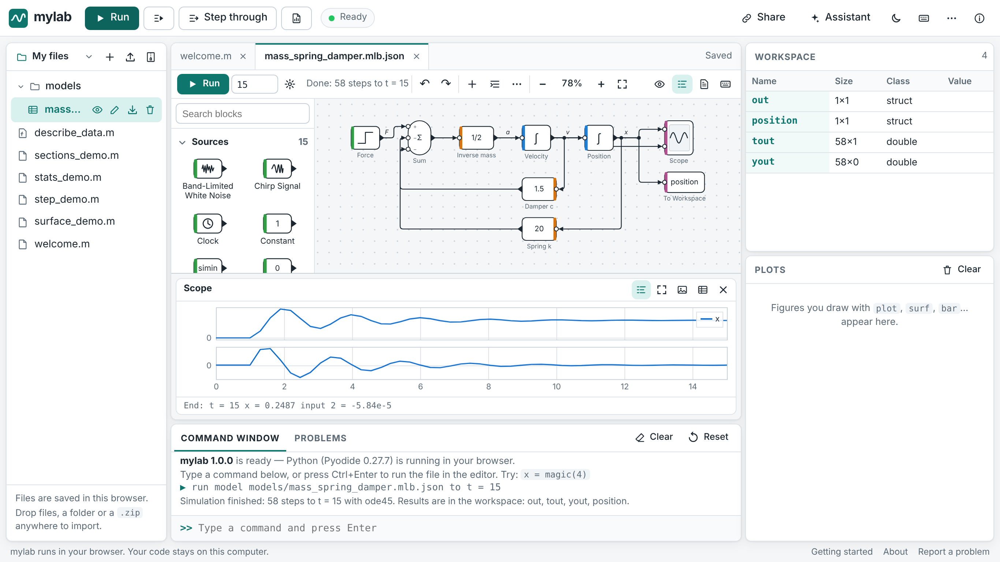
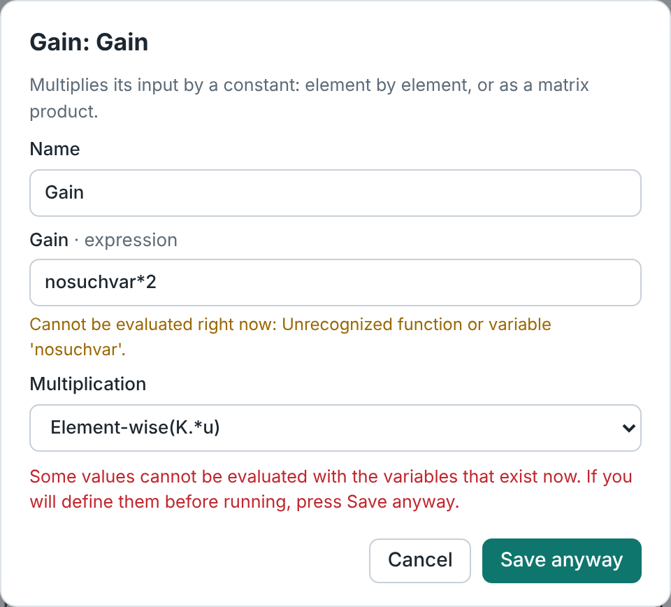
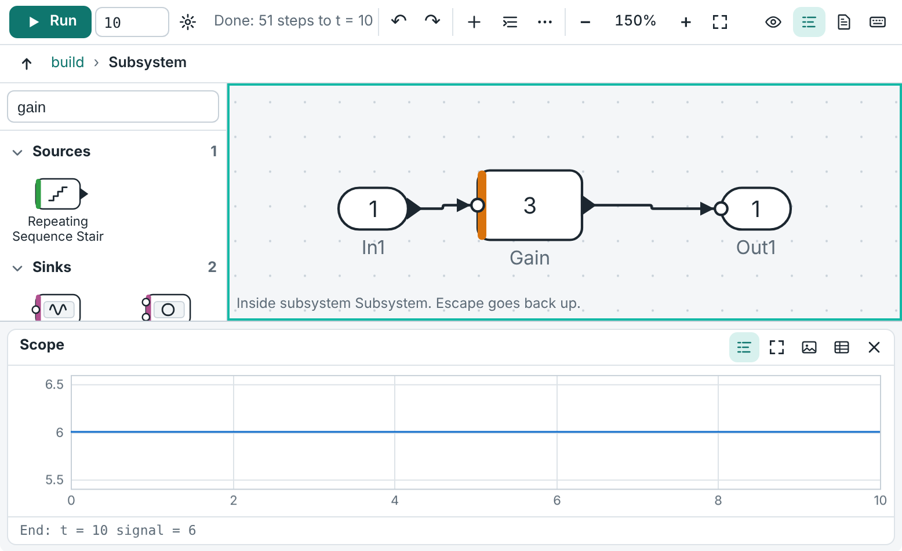
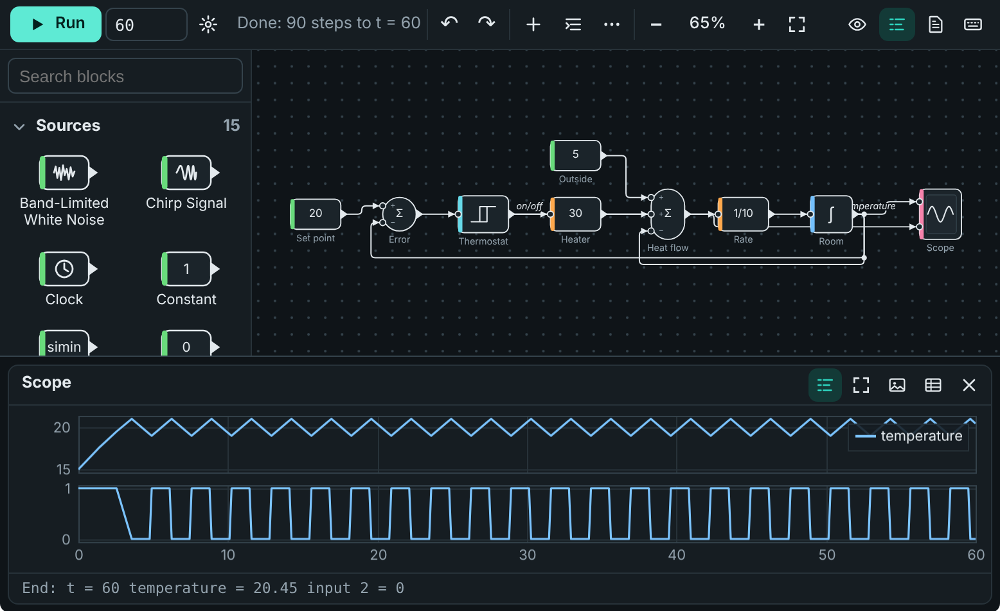
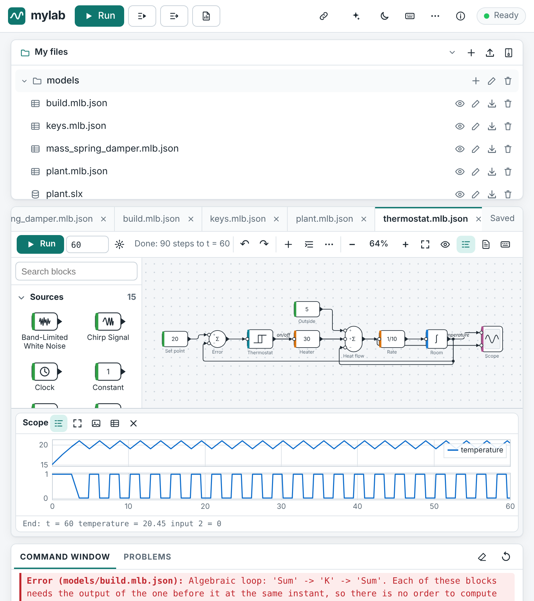

# mylab Blocks: block diagrams

mylab Blocks lets you build a model of a dynamic system from blocks joined by
signal lines, run it over time, and look at the signals. It is meant for
courses in control, signals and system dynamics.

It covers similar ground to Simulink® and can import simple `.slx` models, but
it is a separate program written from scratch. It is not affiliated with The
MathWorks, Inc., and it does not try to be a complete replacement (see
[What is not supported](#what-is-not-supported)).



Contents: [In the browser](#in-the-browser) · [From code](#from-code) ·
[The model file](#the-model-file) · [Blocks](#blocks) · [How a model runs](#how-a-model-runs) ·
[Importing .slx files](#importing-slx-files) · [What is not supported](#what-is-not-supported) ·
[How it was checked](#how-it-was-checked)

## In the browser

A model is a file in your project whose name ends in `.mlb.json`. Opening it
shows the diagram editor instead of the text editor.

To start: press Ctrl+Shift+P and choose **New block diagram…**, or pick one of
the six examples there (*Example model: …*). The examples are also in the
⋯ menu of the diagram toolbar.

### Building a model

- **Add blocks.** Drag a block from the library on the left onto the canvas,
  or click it. The search box filters by name and description. You can also
  press **A** (or double-click the canvas) and type the name of a block.
- **Draw lines.** Drag from an output port (a small triangle) to an input port
  (a small circle). Or click one port and then the other. Dropping a line on a
  block uses its first free input.
- **Branch a signal.** Start another line at the same output, or hold Ctrl and
  drag from an existing line. A dot marks where the lines part.
- **Move, resize, turn.** Drag blocks; drag a corner handle to resize; **R**
  rotates and **F** flips. Drag the middle part of a line to move it. Lines
  are always drawn with horizontal and vertical pieces.
- **Parameters.** Double-click a block (or press Enter). Values are MATLAB
  expressions, so a gain can be `K` or `1/(m*g)`; the variables are read from
  the workspace when the model runs. The dialog refuses values with unclosed
  brackets or quotes, and tells you when a value cannot be evaluated with the
  variables that exist now (you can save it anyway).

  

- **Names.** Double-click a block's name (or press F2) to rename it.
  Double-click a line (or press L) to name the signal; scopes use the name in
  their legend.
- **Subsystems.** Select blocks and press Ctrl+G to put them into a subsystem.
  Double-click a subsystem (or press Enter) to look inside; Escape or the path
  shown above the canvas leads back. A subsystem can have its own variables
  (set in its parameter dialog) that the blocks inside can use.

  

- **Tidy up.** *Arrange* places all blocks in columns from sources to sinks.
  The ⋯ menu aligns and spaces the selected blocks. Ctrl+Z and Ctrl+Y undo
  and redo any change. Ctrl+C, Ctrl+V and Ctrl+D copy, paste and duplicate.
- **Problems.** A block with an input that is not connected gets an amber
  mark, and the port is highlighted. When the engine has loaded, it also
  checks the model as you edit: algebraic loops, parameters that cannot be
  evaluated and unknown blocks get a red mark. The counter in the toolbar
  lists all problems; choosing one shows the block.

### Running

**Run** (or F5, or Ctrl+Enter) simulates the model up to the stop time shown
in the toolbar. The gear button holds the solver settings. **Stop** ends a run
that takes too long; like everywhere in the web app this restarts the engine,
which clears the workspace.

Each Scope block opens a plot under the canvas when the model runs (the first
three by themselves, the others from the *Scopes* menu or by double-clicking
the block). The curves grow while the simulation runs.

- Every input port of a scope has its own axes; a vector signal draws one
  curve per element.
- Drag across the plot to zoom in on that time range, use the mouse wheel, or
  double-click to see everything again.
- Move the pointer over the plot (or use ← and → when the plot has the
  keyboard focus) to read the values at that time.
- The buttons save the plot as a PNG image or the data as a CSV file.

The results also go to the workspace, so ordinary code can use them:
`out` (the same object `sim` returns), `tout`, `yout` and one variable per To
Workspace block. For example `plot(out.scopes.Scope.Time, out.scopes.Scope.Data)`.

### Keyboard, touch and themes

Everything can be done from the keyboard. Press **?** on the canvas for the
list. The main keys:

| Keys | Action |
|------|--------|
| Tab, Shift+Tab | Select the next or previous block |
| Alt+arrows | Select the nearest block in that direction (with Shift: add it) |
| Arrows | Move the selected blocks (Shift: by 1 px) |
| Enter | Parameters; open a subsystem or a scope |
| Esc | Clear the selection; leave the subsystem |
| A or / | Add a block by typing its name |
| C | Connect: two or more selected blocks in a chain, or choose the port from a list |
| L, F2 | Name the selected line; rename the block |
| R, Shift+R, F | Rotate, flip |
| Delete | Delete the selection |
| Ctrl+C, X, V, D, Z, Y, A | Copy, cut, paste, duplicate, undo, redo, select all |
| Ctrl+G | Make a subsystem from the selection |
| Ctrl+Shift+L | Arrange the blocks |
| +, −, 0, 1 | Zoom in, zoom out, show everything, 100 % |
| F5, Ctrl+Enter | Run |

Selected blocks and problems are announced for screen readers, and each scope
states its final values.

On a tablet: drag with one finger to move the view, pinch to zoom, tap a port
and then another port to connect them, and double-tap a block for its
parameters.

The editor follows the app's light, dark and high-contrast themes and works in
a narrow window.





The **text** button in the toolbar shows the model file itself. You can edit
it there; the diagram follows.

## From code

The same models can be built and run from scripts, in the browser, on the
command line and in notebooks. The function names are the ones existing
teaching scripts use.

```matlab
K = 2;
new_system('firstorder');
add_block('blocks/Step',       'firstorder/Step', 'Time', '0');
add_block('blocks/Sum',        'firstorder/Sum',  'Inputs', '+-');
add_block('blocks/Gain',       'firstorder/K',    'Gain', 'K');
add_block('blocks/Integrator', 'firstorder/Int');
add_block('blocks/Scope',      'firstorder/Scope');
add_block('blocks/Outport',    'firstorder/Out');
add_line('firstorder', 'Step/1', 'Sum/1');
add_line('firstorder', 'Sum/1',  'K/1');
add_line('firstorder', 'K/1',    'Int/1');
add_line('firstorder', 'Int/1',  {'Sum/2', 'Scope/1', 'Out/1'});

out = sim('firstorder', 'StopTime', '3');
plot(out.tout, out.yout)          % 1 - exp(-2 t)

save_system('firstorder');         % writes firstorder.mlb.json
```

- Library names: `'blocks/Gain'`, or the familiar ones such as
  `'simulink/Continuous/Integrator'`, `'simulink/Math Operations/Sum'` and
  `'built-in/Gain'`. Only the last part of the path matters.
- `sim('name')` loads `name.mlb.json` (or `name.slx`) from the current folder
  or the path if the model is not open yet.
- `sim` returns an object with `tout`, `yout` (the top-level Out blocks, one
  column per element), one field per To Workspace block (a struct with `Time`
  and `Data` by default), `scopes` (one struct per Scope), `logsout` (lines
  marked for logging) and `xout` when asked. `[t, x, y] = sim(model, tspan)`
  also works.
- Settings for one run: `sim(model, 'StopTime', '20', 'Solver', 'ode4',
  'FixedStep', '0.01')`, or `sim(model, 20)`.
- Parameters are looked up in the base workspace first, then in the function
  that calls `sim`.
- `set_param`, `get_param`, `find_system`, `delete_block`, `delete_line`,
  `load_system`, `close_system`, `bdroot`, `gcs` and `gcb` work on models and
  blocks. `get_param(block, 'PortHandles')` gives handles for the handle form
  of `add_line`.
- `[A, B, C, D] = linmod(model)` (also `linearize`) linearizes a model between
  its top-level In and Out blocks by central differences; `trim` looks for a
  steady state.
- `open_system` opens the editor in the web app. Elsewhere it loads the model
  and prints a note once.

`help sim`, `help add_block` and so on describe each function.

Python programs can use the engine directly:

```python
from mylab.blocks import build, simulate
m = build("lag", [("Step", "Step", {"Time": "0"}), ("G", "TransferFcn", {"Denominator": "[2 1]"}), ("Out", "Outport")],
          ["Step/1 -> G/1", "G/1 -> Out/1"], StopTime="8")
res = simulate(m)          # res.t, res.y, res.scopes, ...
```

## The model file

A model is one JSON file that you can read, compare and keep under version
control:

```json
{
  "format": "mylab-blocks-1",
  "name": "lag",
  "config": { "StopTime": "8", "Solver": "ode45" },
  "blocks": [
    { "name": "Step", "type": "Step", "position": [40, 40, 50, 40], "params": { "Time": "0" } },
    { "name": "G", "type": "TransferFcn", "position": [140, 35, 90, 50], "params": { "Denominator": "[2 1]" } },
    { "name": "Out", "type": "Outport", "position": [290, 48, 40, 24] }
  ],
  "lines": [
    { "from": ["Step", 1], "to": ["G", 1], "name": "u" },
    { "from": ["G", 1], "to": ["Out", 1] }
  ]
}
```

- `position` is `[x, y, width, height]`; `rotation` counts quarter turns;
  `flip` mirrors the block. Blocks without a size get a default one.
- `params` holds only the values that differ from the defaults. All values
  are text: MATLAB expressions, option names, or code.
- A line joins one output to one input. A signal that goes to several inputs
  is several lines with the same `from`. `points` (optional) lists corners of
  a hand-made route. `"log": true` records a named signal in `out.logsout`.
- A block of type `Subsystem` has its own `blocks` and `lines`, and may have
  `"mask": { "k": "2" }` for variables that the blocks inside can use.
- The control inputs of conditionally run subsystems are the ports
  `"enable"` and `"trigger"`.

## Blocks

Every block has a one-line description here and in the editor. The type name
is what the model file and `add_block` use.

<!-- BLOCK-TABLE:START -->

96 blocks.

**Sources**

| Block | Type name | What it does |
|-------|-----------|--------------|
| Band-Limited White Noise | `BandLimitedWhiteNoise` | White noise for continuous systems: random values of variance Cov/Ts held for Ts. |
| Chirp Signal | `Chirp` | Sine wave whose frequency rises linearly from f1 to f2 (Hz) over the target time. |
| Clock | `Clock` | Outputs the simulation time. |
| Constant | `Constant` | Outputs a constant value (a number, vector or matrix). |
| From Workspace | `FromWorkspace` | Plays back data from a workspace variable: a matrix [t, u] or a struct with Time and Data. |
| Ground | `Ground` | Outputs zero. |
| Pulse Generator | `PulseGenerator` | Rectangular pulses with a given period, width (percent of the period) and delay. |
| Ramp | `Ramp` | Rises (or falls) at a constant slope from a start time on. |
| Random Number | `RandomNumber` | Normally distributed random numbers, a new one every sample time. |
| Repeating Sequence | `RepeatingSequence` | Repeats a piecewise-linear wave given by time values and output values. |
| Repeating Sequence Stair | `RepeatingSequenceStair` | Steps through a list of values, one per sample time, and starts again. |
| Signal Generator | `SignalGenerator` | Sine, square, sawtooth or random wave with a given amplitude and frequency. |
| Sine Wave | `SineWave` | Sine wave: Amplitude*sin(Frequency*t + Phase) + Bias, frequency in rad/s. |
| Step | `Step` | Jumps from one value to another at a given time. |
| Uniform Random Number | `UniformRandomNumber` | Uniformly distributed random numbers between a minimum and a maximum. |

**Sinks**

| Block | Type name | What it does |
|-------|-----------|--------------|
| Display | `Display` | Shows the current value of its input. |
| Scope | `Scope` | Plots its inputs against time. Each input port gets its own axes. |
| Stop Simulation | `StopSimulation` | Stops the simulation when its input is not zero. |
| Terminator | `Terminator` | Ends a signal that is not used. |
| To Workspace | `ToWorkspace` | Saves its input to a variable (and a field of the object returned by sim). |
| XY Graph | `XYGraph` | Plots the second input against the first. |

**Continuous**

| Block | Type name | What it does |
|-------|-----------|--------------|
| Derivative | `Derivative` | Approximate time derivative of the input (difference between solver steps). |
| Integrator | `Integrator` | Integrates its input over time. Optional limits, reset input and external initial value. |
| PID Controller | `PIDController` | PID controller with filtered derivative, output limits and anti-windup. |
| State-Space | `StateSpace` | Linear system dx/dt = Ax + Bu, y = Cx + Du. |
| Transfer Fcn | `TransferFcn` | Linear transfer function given by numerator and denominator coefficients in s. |
| Transport Delay | `TransportDelay` | Delays the input by a fixed time. |
| Zero-Pole | `ZeroPole` | Linear transfer function given by its zeros, poles and gain. |

**Discrete**

| Block | Type name | What it does |
|-------|-----------|--------------|
| Delay | `Delay` | Delays the input by a number of sample times. |
| Discrete Derivative | `DiscreteDerivative` | Difference between this sample and the last, divided by the sample time. |
| Discrete FIR Filter | `DiscreteFir` | Discrete FIR filter: a weighted sum of the latest input samples. |
| Discrete Filter | `DiscreteFilter` | Discrete filter given by numerator and denominator coefficients in 1/z. |
| Discrete State-Space | `DiscreteStateSpace` | Discrete linear system x[k+1] = Ax[k] + Bu[k], y[k] = Cx[k] + Du[k]. |
| Discrete Transfer Fcn | `DiscreteTransferFcn` | Discrete transfer function given by numerator and denominator coefficients in z. |
| Discrete-Time Integrator | `DiscreteTimeIntegrator` | Integrates in steps of the sample time: forward Euler, backward Euler or trapezoidal. |
| Memory | `Memory` | Outputs the input of the previous solver step. |
| Rate Transition | `RateTransition` | Passes a signal between parts that run at different sample times (samples and holds). |
| Unit Delay | `UnitDelay` | Delays the input by one sample time. |
| Zero-Order Hold | `ZeroOrderHold` | Samples the input at its sample time and holds the value in between. |

**Math**

| Block | Type name | What it does |
|-------|-----------|--------------|
| Abs | `Abs` | Absolute value. |
| Bias | `Bias` | Adds a constant to the input. |
| Data Type Conversion | `DataTypeConversion` | Passes the signal on (all signals are double precision in mylab Blocks). |
| Divide | `Divide` | Divides the first input by the second. |
| Dot Product | `DotProduct` | Dot product of two vectors. |
| Gain | `Gain` | Multiplies its input by a constant: element by element, or as a matrix product. |
| Math Function | `MathFunction` | A choice of functions: exp, log, 10^u, log10, square, pow, reciprocal, hypot, rem, mod, transpose. |
| Min Max | `MinMax` | Smallest or largest of its inputs (or of the elements of a single input). |
| Polynomial | `Polynomial` | Evaluates a polynomial with the given coefficients (highest power first). |
| Product | `Product` | Multiplies and divides its inputs; the string (such as */) gives one operation per input. |
| Product of Elements | `ProductOfElements` | Multiplies the elements of a vector. |
| Reshape | `Reshape` | Changes the shape of a signal: 1-D vector, column, row, or the given [rows columns]. |
| Rounding Function | `Rounding` | Rounds to whole numbers: floor, ceil, round or fix. |
| Sign | `Sign` | Sign of the input: -1, 0 or 1. |
| Sqrt | `Sqrt` | Square root (also signed square root and reciprocal square root). |
| Sum | `Sum` | Adds and subtracts its inputs; the signs string (such as +-) gives one sign per input. |
| Sum of Elements | `SumOfElements` | Adds up the elements of a vector. |
| Trigonometric Function | `TrigonometricFunction` | sin, cos, tan and their inverse and hyperbolic versions; atan2 has two inputs. |
| Unary Minus | `UnaryMinus` | Negates the input. |
| Vector Concatenate | `Concatenate` | Joins its inputs into one vector, or side by side / on top of each other as matrices. |
| Width | `Width` | Outputs the number of elements of its input. |

**Logic**

| Block | Type name | What it does |
|-------|-----------|--------------|
| Bitwise Operator | `BitwiseOperator` | Bitwise AND, OR, XOR or NOT of whole-number inputs, optionally with a fixed mask. |
| Compare To Constant | `CompareToConstant` | Compares the input with a constant; the output is 1 or 0. |
| Compare To Zero | `CompareToZero` | Compares the input with zero; the output is 1 or 0. |
| Hit Crossing | `HitCrossing` | Outputs 1 at the step where the input crosses a level, otherwise 0. |
| Logical Operator | `LogicalOperator` | AND, OR, NAND, NOR, XOR, NXOR or NOT of its inputs (non-zero counts as true). |
| Multiport Switch | `MultiportSwitch` | Passes the data input chosen by the first (control) input: 1 for the first, 2 for the next... |
| Relational Operator | `RelationalOperator` | Compares two inputs (==, ~=, <, <=, >=, >); the output is 1 or 0. |
| Switch | `Switch` | Passes the first input when the middle (control) input meets the condition, else the third. |

**Nonlinear**

| Block | Type name | What it does |
|-------|-----------|--------------|
| 1-D Lookup Table | `LookupTable1D` | Interpolates in a table of breakpoints and values. |
| 2-D Lookup Table | `LookupTable2D` | Interpolates in a two-dimensional table: first input picks the row, second the column. |
| Backlash | `Backlash` | Play between two parts: the output only follows once the input has crossed the dead band. |
| Coulomb & Viscous Friction | `CoulombViscousFriction` | Friction: sign(u) * (gain*|u| + offset). |
| Dead Zone | `DeadZone` | Outputs zero inside a band; outside, the input shifted by the band edge. |
| Quantizer | `Quantizer` | Rounds the input to a multiple of the quantization interval. |
| Rate Limiter | `RateLimiter` | Limits how fast the output may rise and fall. |
| Relay | `Relay` | Switches on above one level and off below another (hysteresis). |
| Saturation | `Saturation` | Limits the input to the range between a lower and an upper limit. |
| Saturation Dynamic | `SaturationDynamic` | Limits the middle input to the range given by the upper and lower inputs. |

**Routing**

| Block | Type name | What it does |
|-------|-----------|--------------|
| Assignment | `Assignment` | Replaces chosen elements of the first input with the second input. |
| Bus Creator | `BusCreator` | Groups signals under their names so a Bus Selector can pick them out again. |
| Bus Selector | `BusSelector` | Picks signals by name out of the bus made by a Bus Creator. |
| Demux | `Demux` | Splits a vector signal into its elements (or into parts of given widths). |
| Enable | `EnablePort` | Put inside a subsystem: the subsystem only runs while its enable input is positive. |
| From | `From` | Outputs the signal of the Goto block with the same tag. |
| Goto | `Goto` | Sends its input to every From block with the same tag, without drawing a line. |
| In | `Inport` | Input of a subsystem. At the top level: an external input (zero unless one is given to sim). |
| Manual Switch | `ManualSwitch` | Passes the first or the second input, as chosen in its dialog. |
| Merge | `Merge` | Outputs whichever input was computed most recently (for conditionally run subsystems). |
| Mux | `Mux` | Joins its inputs into one vector signal. |
| Out | `Outport` | Output of a subsystem. At the top level its signal is logged in yout. |
| Selector | `Selector` | Picks elements of a vector (or rows and columns of a matrix) by index. |
| Subsystem | `Subsystem` | A group of blocks shown as one block. Double-click to look inside. |
| Trigger | `TriggerPort` | Put inside a subsystem: the subsystem runs once each time its trigger input crosses zero. |

**User-defined**

| Block | Type name | What it does |
|-------|-----------|--------------|
| Fcn | `Fcn` | A formula in u (the input; u(1), u(2)... for a vector) and t. The result is one number. |
| Interpreted Function | `InterpretedFunction` | Calls a function handle or a named function with the input: y = f(u). |
| MATLAB Function | `MATLABFunction` | Runs a function you write in the MATLAB language; its inputs and outputs become ports. |
<!-- BLOCK-TABLE:END -->

Notes:

- All signals are double-precision real numbers: scalars, vectors or
  matrices. Logic blocks output 1 and 0. Signals keep one size for the whole
  run.
- An input that is not connected reads as zero and gives a warning.
- Integrator: a reset, or an external initial value, takes effect at the step
  in which the reset signal fires; the logged value at that instant is the
  new one. The initial-value input may come from the integrator's own output
  (as in the bouncing-ball example) without an algebraic loop.
- Random sources are repeatable for a given seed, but the numbers are not the
  ones other programs produce for the same seed.
- PID Controller is continuous. Transfer Fcn, Zero-Pole and PID take a scalar
  input.
- Bus Creator and Bus Selector are minimal: the selector must be fed by a
  creator, and picks signals by the names of the lines going into it.

## How a model runs

1. **Flattening.** Subsystems, In and Out blocks, and Goto/From pairs are
   removed, so every input is tied directly to the output that drives it.
2. **Order.** A block whose output depends on its input at the same instant
   must run after the block that feeds it. Blocks with memory (Integrator,
   Unit Delay, Memory, a transfer function with more poles than zeros…) do
   not have this dependency. A cycle of such dependencies is an **algebraic
   loop**. mylab does not solve algebraic loops: it reports the blocks in the
   loop and how to break it.
3. **Sample times.** Continuous blocks run at every step. Discrete blocks run
   at their sample time (a period, or `[period offset]`) and hold their output
   in between; several rates can be mixed. A sample time of -1 takes the rate
   of the block's inputs.
4. **Major and minor steps.** A major step computes all outputs, records them
   in scopes and logs, and lets blocks update their memory. Between major
   steps the solver integrates the continuous states; its trial evaluations
   (minor steps) are never recorded.
5. **Events.** The solver always stops exactly at sample times and at the
   jump times of sources (Step, Pulse Generator…). Blocks such as Relay,
   Saturation, Switch, Abs, Compare, Hit Crossing and a limited or reset
   Integrator report zero crossings: when one changes sign within a step, the
   crossing time is found by bisection (to about 1e-10 of the time scale) and
   a major step is taken there. Until then these blocks keep their mode, so
   the equations stay smooth within a step. Turn this off with
   `ZeroCrossings` = `off`.

Solvers:

| Setting | Method |
|---------|--------|
| `ode45` (default), `ode23`, `ode113` | Variable step, explicit Runge-Kutta: orders 5(4), 3(2) and 8 (SciPy's RK45, RK23, DOP853) |
| `ode15s`, `ode23s` | Variable step for stiff models (SciPy's BDF and Radau) |
| `ode1`, `ode2`, `ode3`, `ode4`, `ode5` | Fixed step: Euler, Heun, Bogacki-Shampine, classic Runge-Kutta, Dormand-Prince |
| `FixedStepDiscrete`, `VariableStepDiscrete` | Models without continuous states |

- `RelTol` (1e-3) and `AbsTol` (1e-6) steer variable-step solvers. `MaxStep`
  defaults to one fiftieth of the run, so plots have at least 51 points.
- `FixedStep` defaults to the fastest sample time of the model, or one
  fiftieth of the run. Fixed-step runs do not locate zero crossings.
- The solver names are for familiarity. The methods are the ones listed
  above, so step sizes, and results at the level of the tolerances, differ
  from other programs.
- More than 500 zero crossings in a row at one instant (a switch chattering
  infinitely fast) stops the run with an explanation.

## Importing .slx files

`load_system('model')`, `sim('model')` and, in the web app, opening a `.slx`
file (or *Import a .slx model…*) convert the file to a mylab model. An `.slx`
file is a zip archive of XML parts; the reader was written from the structure
of public files, without vendor code or documentation. `.mdl` files are not
read.

What is converted:

- the blocks listed above, with the parameters they share;
- lines with their branches and corner points, signal names;
- subsystems, in both file layouts (everything in one part, or one part per
  subsystem), mask parameters of subsystems as subsystem variables;
- MATLAB Function blocks (their code);
- links to the common built-in library blocks, and links to library files
  that lie next to the model (a library `.slx` in the same folder tree);
- start and stop time, solver, step size and tolerances.

What is not: anything listed under [What is not supported](#what-is-not-supported),
mask initialization code, callbacks, data types, annotations and block
colours. A block without an equivalent is **kept as a grey placeholder under
its original type name**, with its ports and lines, and listed in a message.
A model with placeholders does not run; the error names them.

The file is treated as data: nothing in it is executed, sizes are limited,
and XML with entity declarations is refused.

### Tested on real files

The reader is run on 82 `.slx` files from eight public repositories with
permissive licenses (saved by releases R2019b to R2024b; 26 blocks in the
median file, 2,442 in the largest). The files are not part of mylab: they are
listed in `datasets/matlab-corpus/models.jsonl` and fetched with
`python datasets/matlab-corpus/tools/fetch_models.py`.

| Result | Files |
|--------|-------|
| Read without an error | 82 of 82 |
| Imported fully (every block converted) | 33 |
| Imported with placeholders for unsupported blocks | 49 |
| Then simulated to their stop time | 14 |
| Imported fully but need workspace variables or toolbox functions that are not in the file | 16 |
| Imported fully but stopped with an error while running | 1 |
| Empty diagrams | 2 |

Blocks without an equivalent, by number of files: links to toolbox or user
libraries that are not available (43 files; mostly physical modelling,
robotics and the projects' own libraries), physical connection ports (10),
variant subsystems (7), If with action subsystems (3), S-functions written in
MATLAB (3) or compiled (2), and, in one or two files each, lookup tables of
kinds mylab does not have (direct, pre-lookup, three and more dimensions),
dashboard sliders and gauges, a video viewer, a For iterator and a few block
options.

Keep in mind what these numbers do and do not say. "Simulated" means the
converted model ran to its stop time without an error. The results were
**not** compared with the original program, which is not available here. Of
the 14, seven are small control examples from a textbook repository, four are
ship-autopilot and wave demos, one is an actuator model, and two are library
files that hold only a few unconnected blocks. Most larger models in the set
depend on toolboxes.

Print the same report for your own files with

```bash
python -m mylab.blocks.import_report folder_with_slx_files
```

## What is not supported

- Code generation, real-time targets, hardware in the loop.
- State charts and flow charts.
- Physical modelling (mechanical, electrical, hydraulic networks with
  two-way connections).
- Solving algebraic loops (they are reported).
- Signals that change size while the model runs; fixed-point and integer data
  types; complex signals; bus objects; frames.
- Function-call subsystems, If and Switch Case action subsystems, For and
  While iterator subsystems, variant subsystems, model references, library
  links other than the ones described above.
- S-functions and blocks from add-on toolboxes.
- Lookup tables with more than two dimensions.
- Resettable subsystems; the "reset states when enabling" option of enabled
  subsystems (states are always held).
- Discrete-time PID, discrete zero-pole, and continuous blocks with
  per-block tolerances.
- Linearization of discrete states (`linmod` holds them constant), `dlinmod`.
- In the editor: annotations, block colours, several views of one model side
  by side, and pausing or stepping a simulation.
- Writing `.slx` or `.mdl` files.

## How it was checked

`tests/test_blocks_*.py` holds about 460 assert statements. Simulations are compared
with exact solutions and with `ode45` at tight tolerances:

| Model | Compared with | Largest error |
|-------|---------------|---------------|
| First-order step response | 1 − e^(−2t) | < 1e-7 |
| Second-order transfer function (ζ = 0.2) | exact response | < 1e-6 |
| Mass, spring and damper | exact response and `ode45` | < 1e-6 |
| State-Space, Zero-Pole and Transfer Fcn of one system | exact response | < 1e-7 |
| PI loop that reduces to a first-order system | 1 − e^(−t) | < 1e-7 |
| PID loop | the equivalent closed-loop transfer function | < 5e-5 |
| Van der Pol oscillator (μ = 1) | `ode45`; period 6.6633 | < 1e-5; < 2e-3 |
| Pendulum | energy is constant | < 1e-6 |
| Bouncing ball | impact times and rebound height from the formula | < 2e-6 s; < 2e-3 m |
| Thermostat with a relay | switching levels and cycle period from the formula | < 1e-6; < 1e-5 s |
| Integrator limit, switch | exact times of the events | < 1e-7 |
| Transport delay; delay differential equation | shifted input; method of steps | < 1e-4 |
| Sampled-data PI loop | the exact difference equation | < 1e-7 |
| Multi-rate counters | exact values at every sample time | exact |
| Fixed-step solvers | order of convergence 1 to 5 | as expected |
| Stiff problem with `ode15s` | exact solution | < 1e-3 |
| `linmod` of mass-spring-damper, pendulum, transfer function | exact matrices | < 1e-6 |

The static blocks (saturation, dead zone, relay, lookup tables…) are checked
against their definitions, each of the block types at least once, and
the `.slx` reader on small files built in the tests and on the real files
above. `scripts/test_web.mjs` drives the editor in a browser: it opens and
runs an example, builds a model with the mouse and with the keyboard alone,
changes a gain and runs again, makes and enters a subsystem, undoes and
redoes, checks the error markers, imports a `.slx` file and looks at the
themes and a narrow window.
