# mylab in the browser

The mylab web app runs MATLAB-language code entirely in your web browser.
There is nothing to install and no account to create. It is built for students
who don't have a MATLAB license, for teachers who want every student to be able
to run the course code, and for anyone on a Chromebook or a low-end laptop.

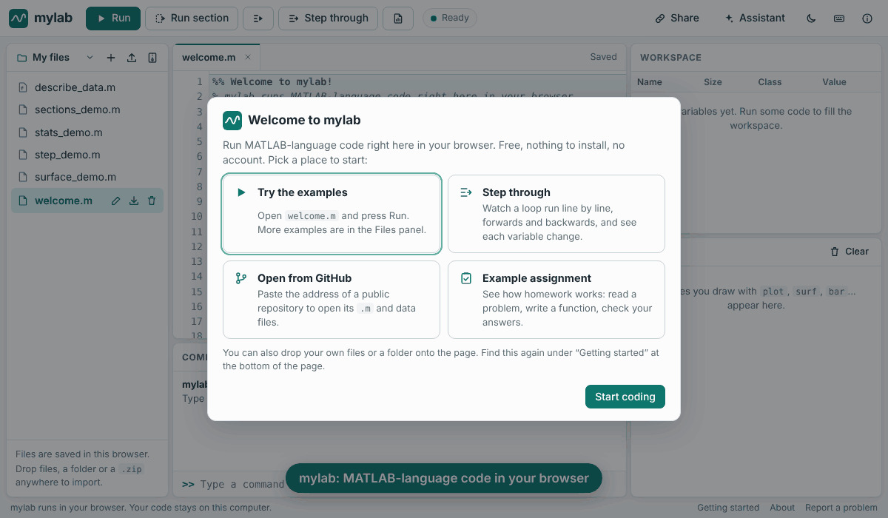

Contents: [For students](#for-students) · [For teachers](#for-teachers) ·
[The assistant](#the-assistant) · [Privacy](#privacy) ·
[Limitations](#limitations) · [For developers](#for-developers)

## For students

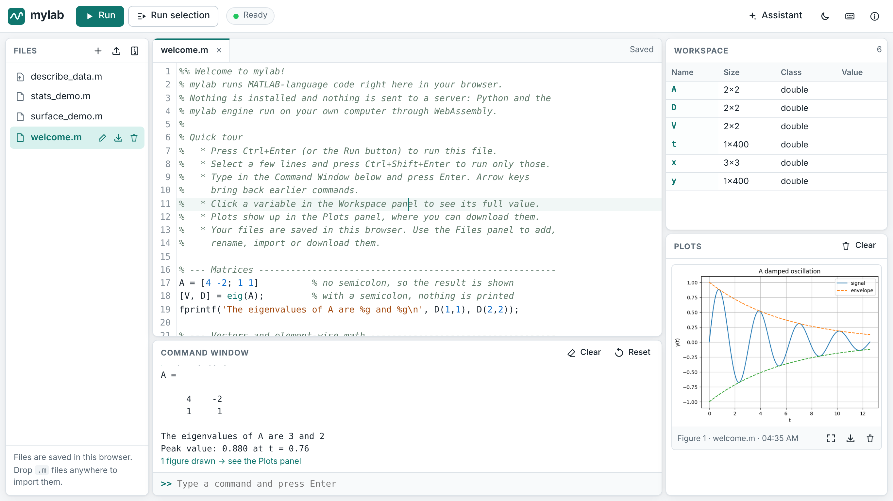

### The panels

| Panel | What it does |
|-------|--------------|
| **Files** (left) | The files of the current project, in folders if you like. Create, rename, move, delete, import and download files. The button at the top switches between projects. |
| **Editor** (center) | Tabs, syntax highlighting, automatic indentation, name suggestions, help on hover, problems underlined as you type, find and replace. Files save automatically. See [Editor help](#editor-help). |
| **Command Window** (bottom) | Type a command and press Enter. Arrow keys walk through your history. Tab completes names. `clc` clears the window. The **Problems** tab next to it lists what the checker found; a **Search** tab appears when you search all files. |
| **Workspace** (right) | Every variable with its size and class. Click one to open it in the [variable viewer](#variable-viewer). |
| **Plots** (right) | Figures and animations drawn by your code. Click to enlarge, or download them (PNG, or GIF for animations). |
| **Assignment** | Appears when you open an assignment: the problems, and a button to check your answers. |
| **App** | Appears when your code opens an app window (`uifigure`, `uicontrol`). See [Apps](#apps). |
| **Assistant** (optional) | An AI helper, see below. |

The first time you open the app, a welcome window points to the examples, to
*Step through*, to *Open from GitHub* and to an example assignment. You can
open it again with **Getting started** at the bottom of the page.

Everything the app can do is also in the **command palette**: press
Ctrl+Shift+P (or the ⋯ button in the top bar), type a few letters of what you
want ("fmt" finds *Format document*) and press Enter. Each entry shows its
keyboard shortcut. Ctrl+P is the same list for the files of the project.

### Running code

- **Run** (F5) runs the whole file in the editor.
- **Run selection** (Ctrl+Shift+Enter) runs the selected lines, or the line
  with the cursor.
- **Sections.** A line that starts with `%%` begins a new section. The section
  with the cursor is tinted. **Run section** (Ctrl+Enter) runs just that
  section; Alt+Enter runs it and moves to the next one. In a file without
  `%%` lines, Ctrl+Enter runs the whole file.
- Errors are shown in red with the file and line number, and the line is
  highlighted in the editor and listed under **Problems**. Each error has the
  links **Go to line**, **Explain this error** and **Fix this error** (the
  last two use the [assistant](#the-assistant)).
- **Stop** stops runaway code (for example an endless loop). The browser has
  no safe way to interrupt Python inside a worker, so Stop restarts the
  engine: **all variables are cleared**. Your files are not affected.
- **Reset** clears all variables without restarting.

A script can call functions saved in other `.m` files of the project (a file
`add_squares.m` that starts with `function s = add_squares(a, b)` can be
called as `add_squares(3, 4)`), including files in other folders of the
project. A file runs with its own folder as the current folder, so
`readmatrix('data.csv')` finds a `data.csv` that sits next to the script.

### Apps

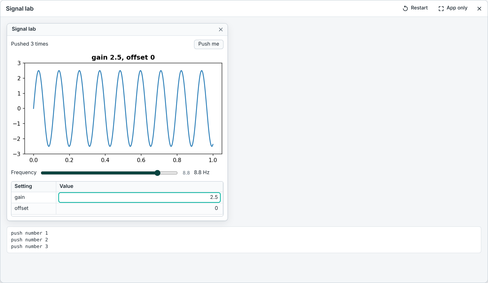

Code that builds a window with `uifigure` or `uicontrol` opens the **App**
panel when you run it. The buttons, sliders, tables and plots work: each
click runs your callback in the same workspace, so the app remembers its
state. **Restart** runs the file again, **App only** hides the editor, and
the **App** button in the top bar hides or shows the panel.

**New app** in the command palette opens the app builder: place components
on a grid with the mouse or the keyboard, set their properties, and let it
write the `.m` file with a callback function for each component. A file made
this way gets an **Edit layout** button.

[APPS.md](APPS.md) explains how to write apps, the builder, and what is not
supported.

### Editor help

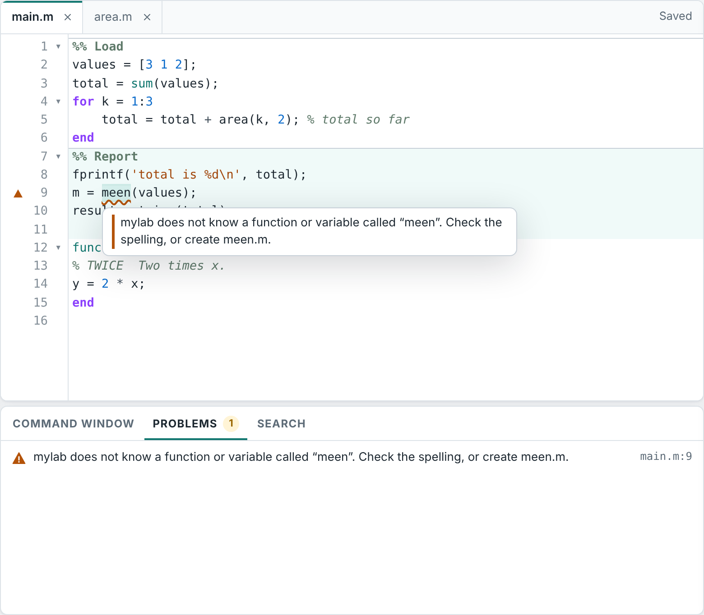

The editor works the way programmers' editors do, but you can ignore all of
it and just type.

- **Problems as you type.** A moment after you stop typing, mylab checks the
  file without running it. A syntax error gets a red underline; a name that is
  not a function or variable mylab knows gets an orange one (a likely typo).
  A mark beside the line number and the **Problems** tab show the same list;
  click an entry to jump to it. F8 goes to the next problem.
- **Help where you are.** Rest the mouse on a function name to see how it is
  called and one line about what it does. Type `name(` to see the same while
  you fill in the inputs. F1 opens the full help for the name at the cursor.
  This works for mylab's functions and for functions in your own files (the
  comment lines under a `function` line are its help).
- **Suggestions.** While you type a name, a list offers your variables, the
  functions in your project and mylab's functions, each with a short
  description. Tab accepts a suggestion; Enter always starts a new line.
  Ctrl+Space asks for the list.
- **Find your way.** Ctrl+click a function name (or press F12) to go to where
  it is defined, in this file or another file of the project. Ctrl+Shift+O
  lists the functions and `%%` sections of the file. Ctrl+F finds text in the
  file, Ctrl+H replaces it (with match count, and toggles for upper/lower
  case, whole words and regular expressions). Ctrl+Shift+F searches every
  file of the project.
- **Rename.** Put the cursor on a variable or function and press F2 to rename
  every use of it in the file. Comments and text in quotes are not touched.
- **Tidy code.** New lines are indented for you after `if`, `for`, `while`,
  `function`, `switch` and `try`, and `end`, `else` and `case` move back by
  themselves. *Format document* (Shift+Alt+F) fixes the indentation of the
  whole file; it only ever changes spaces at the start and end of lines.
  Blocks and `%%` sections can be folded with the small arrows beside the
  line numbers.
- **Editing keys.** Ctrl+/ comments lines, Alt+↑/↓ moves a line,
  Shift+Alt+↓ copies it, Ctrl+D selects the next place the selected word
  appears so you can change several at once (Alt+click adds a cursor
  anywhere).
- **Tabs.** Each open file has a tab; a dot marks changes that are not saved
  yet (files save by themselves after a moment, unless you turn that off in
  the settings). The app remembers the open tabs, the cursor in each file and
  your breakpoints for every project.
- **Version history.** mylab keeps the last 30 saved versions of each file in
  your browser (⋯ → *Version history*). Pick a version to see what changed
  since then, and restore it if you want. Restoring can be undone.

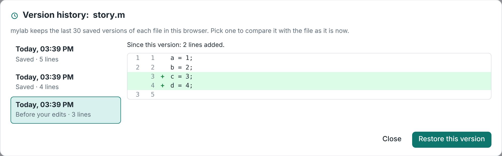

**Settings** (⋯ → *Settings*, or Ctrl+,): color theme (light, dark or high
contrast; by default the app follows your system), text size, keyboard
shortcut style and the helpers above. Drag the bars between panels to resize
them; double-click a bar to reset it. All of this is remembered in your
browser.

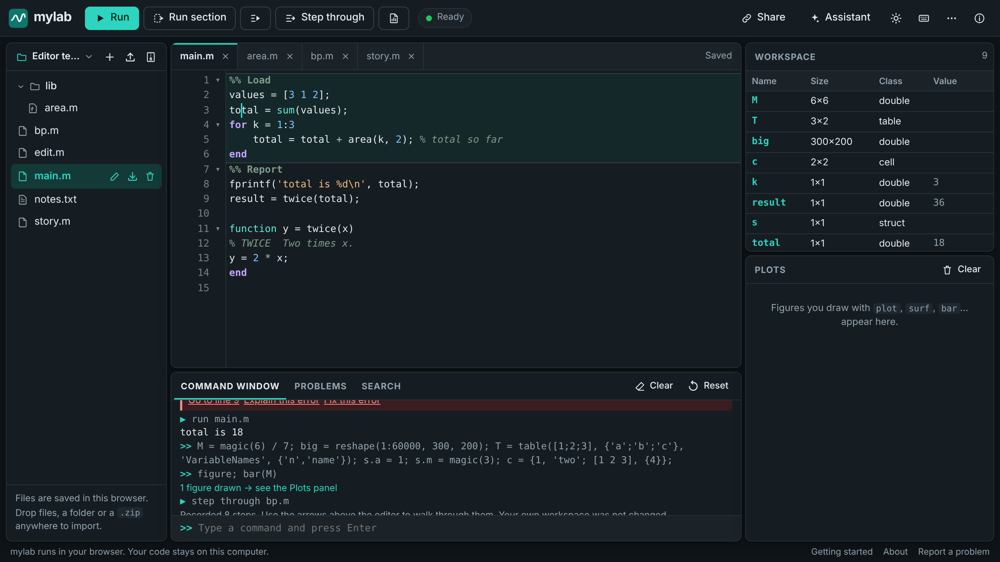

### Variable viewer

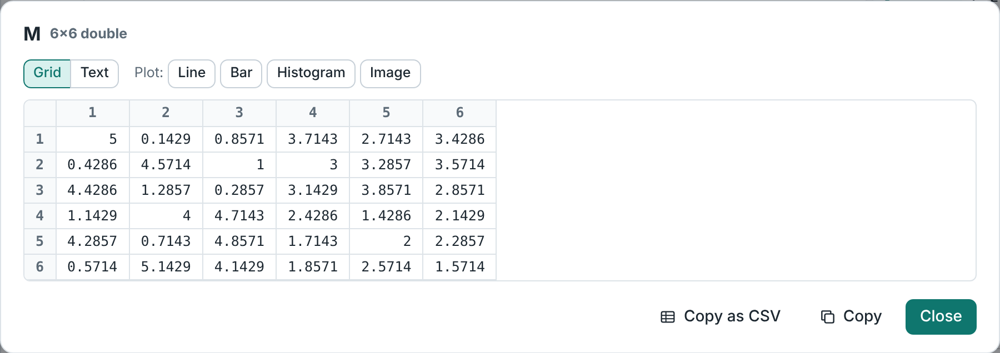

Click a variable in the Workspace panel to open it:

- Matrices, tables, cell arrays, string arrays and structs are shown as a
  **grid**. Large values are shown one page at a time (100 rows and 25
  columns). Values inside a struct or a cell can be opened with a click.
- **Text** shows the value the way the Command Window prints it.
- **Copy as CSV** copies the whole value (with full precision) so you can
  paste it into a spreadsheet.
- **Plot** draws a numeric matrix right away as a line plot, bar chart,
  histogram or image. The command it runs is shown in the Command Window, so
  you can copy it into your script.

### Step through your code

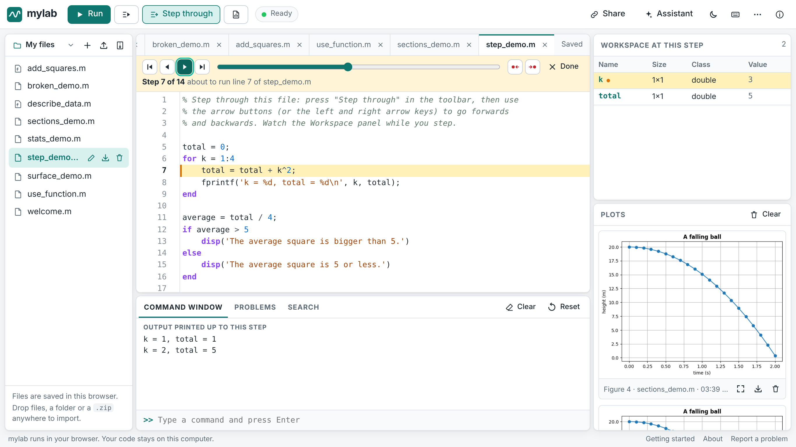

**Step through** runs the file once, records every line that ran, and then
lets you walk through the run:

- The arrow buttons (or the ← and → keys) go one step **back** or forward;
  Home and End jump to the first and last step; the slider moves anywhere.
- The line that is about to run is highlighted. If it is inside a function in
  another file, that file is shown.
- The Workspace panel shows the variables as they were at that step. Variables
  that just changed are marked. Inside a function you see that function's
  variables and how deep the call is.
- The Command Window shows what had been printed up to that step.
- Click beside a line number (or press F9) to set a **breakpoint** (a red
  dot). The two breakpoint buttons jump to the next or previous time that
  line is reached. *Run to the next breakpoint* (Alt+F5) starts stepping and
  goes straight to the first breakpoint, with the variables as they are
  there.
- If the run ends with an error, the last step shows the failing line and the
  error message.

Stepping uses its own fresh workspace, so your variables are not changed.
Very long runs are recorded up to 5,000 steps; the app tells you when a run
was cut short. Press **Done** (or Esc) to go back to editing.

### Reports to hand in

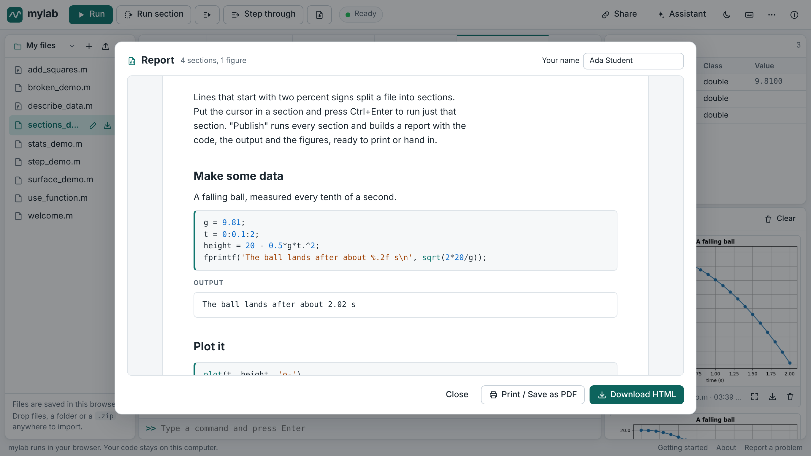

**Publish** runs the file section by section in a fresh workspace and builds a
document:

- the text after `%%` becomes the section title (the first one becomes the
  title of the report),
- comment lines directly under a `%%` line become ordinary text,
- then come the code (with colors), what it printed, and its figures.

Type your name in the preview if you want it in the header. **Download HTML**
saves one self-contained file (figures are inside it; it needs no internet).
**Print / Save as PDF** opens the browser's print window, where you can pick
"Save as PDF". If a section ends with an error, the report shows the error
and the later sections are not run.

### Projects, folders and data files

- A **project** is a set of files that belong together. The button at the top
  of the Files panel lists your projects and lets you create, rename, delete,
  export (.zip) and import (.zip) them.
- Put a file in a **folder** by giving it a name with a slash, such as
  `homework1/solve.m` (new file, or rename). Click a folder to fold it.
- Projects can hold **data files** too: `.csv`, `.txt`, `.json`, `.mat`,
  images and so on. Click an image to view it. The eye button previews a CSV
  file as a table.
- Files that your code writes (for example `saveas(gcf, 'plot.png')` or
  `writematrix(A, 'out.csv')`) appear in the Files panel after the run, where
  you can view and download them. Files over 5 MB are not copied back.
- **Open folder** imports a folder from your computer as a new project. You
  can also drop a folder, a `.zip` or single files onto the page. mylab
  imports `.m` files and common data files up to 5 MB each (30 MB in total)
  and shows a list of anything it skipped.
- **Open from GitHub** asks for the address of a public repository (or of a
  folder inside one) and downloads its `.m` and data files into a new
  project. Your copy is saved in the browser; opening the same link again
  brings you back to your copy with your changes.

### Block diagrams

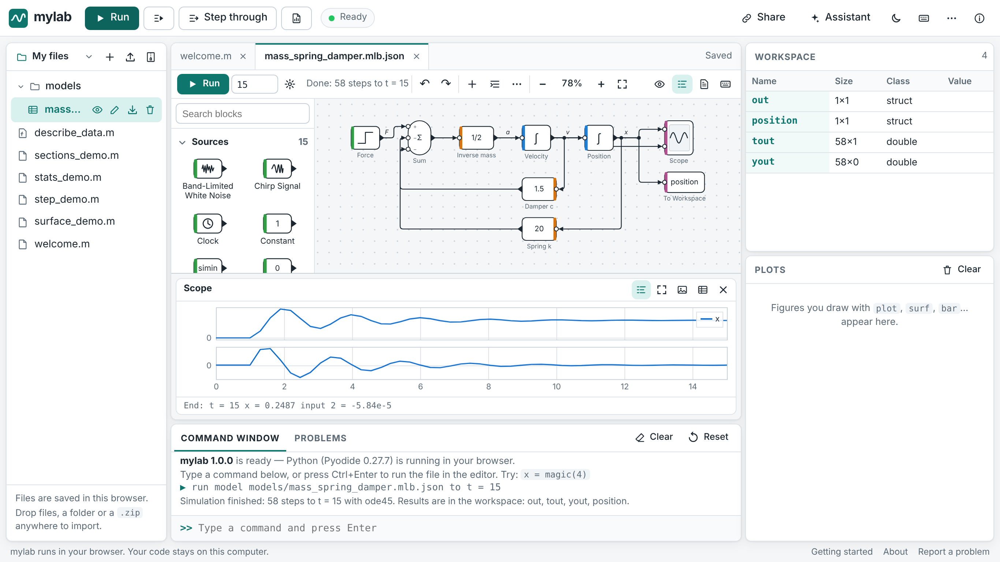

A file whose name ends in `.mlb.json` is a block-diagram model. It opens in a
diagram editor: drag blocks from the library, draw lines between their ports,
press **Run**, and watch the scopes. The results land in the Workspace, so
your scripts can plot them. Start with Ctrl+Shift+P → *New block diagram…* or
one of the *Example model* entries. `.slx` files can be imported.
[BLOCKS.md](BLOCKS.md) describes the editor, the blocks, and how the same
models are built and run from code with `add_block` and `sim`.

### Assignments

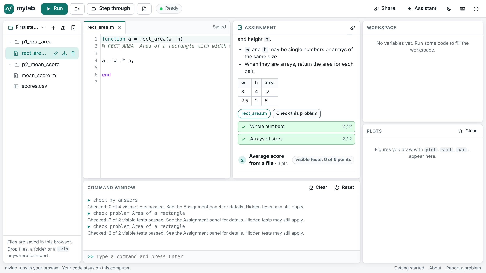

Your teacher may give you an assignment as a link or as a `.json` file. Open
the link, or use **Project menu → Open assignment** (or just drop the file on
the page). You get a project with one folder per problem and the starter files
in it, and the problems are shown beside the editor.

- Complete the starter file of each problem. Don't rename the function.
- **Check my answers** runs the tests that come with the assignment and shows
  which ones pass. For a failed test you see the message and the line. A test
  that runs longer than 15 seconds is stopped and marked "timed out" (look
  for a loop that never ends); the other tests still run.
- You can check as often as you like. The last results are remembered.
- **These checks are not your final grade.** Teachers usually keep some tests
  hidden; the panel shows how many points the visible tests cover.
- **Download my submission (.zip)** packs your files, one folder per problem,
  ready to upload wherever your teacher asked (an LMS, Gradescope, e-mail).
- Opening the assignment again never overwrites your work.

Try it: **Getting started → Example assignment**.

### Sharing your code

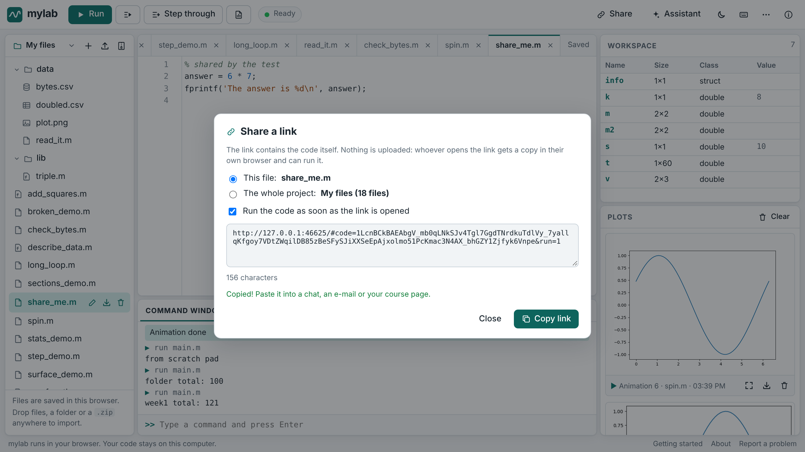

**Share** makes a link that contains the file (or the whole project) itself.
Nothing is uploaded. Whoever opens the link sees the code in a temporary
project, clearly marked, and can run it; their own files are not touched
unless they press **Keep a copy**. Tick "Run the code as soon as the link is
opened" to have it run by itself.

Tick "Open as app" for a file that builds an app window: the link then opens
straight into the running app, without the editor (`&app=1`).

Very long links (over about 8,000 characters) get cut off by some chat and
e-mail programs. The share window warns you; for big projects use a GitHub
repository instead.

### Keyboard shortcuts

| Keys | Action |
|------|--------|
| Ctrl+Shift+P | Command palette: every action, with its shortcut |
| Ctrl+P | Go to a file of the project (type `:12` for a line, `@` for the outline) |
| Ctrl+Enter | Run the section with the cursor (or the whole file if it has no `%%` lines) |
| Alt+Enter | Run the section and move to the next one |
| F5 | Run the whole file |
| Ctrl+Shift+Enter | Run the selection or the current line |
| F10 | Step through the file (then: next step) |
| F9, Alt+F5 | Set or remove a breakpoint; run to the next breakpoint |
| ← / →, Home / End, Esc | While stepping: back / forward, first / last step, leave |
| Ctrl+S | Save now (files also save automatically) |
| Ctrl+F, Ctrl+H | Find, find and replace in the file (F3 / Shift+F3: next / previous match) |
| Ctrl+Shift+F | Search in all files |
| F1 | Help for the function at the cursor |
| F12, Ctrl+click | Go to the definition |
| Ctrl+Shift+O | Outline: functions and sections of the file |
| F2 | Rename a variable or function in the file |
| F8, Shift+F8 | Next / previous problem; Ctrl+Shift+M shows the Problems list |
| Ctrl+Space, Tab | Complete a name (editor, command window) |
| Ctrl+/ | Comment or uncomment lines |
| Alt+↑ / Alt+↓, Shift+Alt+↓ | Move the line up / down, copy it down |
| Ctrl+D, Ctrl+Shift+L | Add the next match to the selection, select every match (several cursors) |
| Tab / Shift+Tab, Ctrl+] / Ctrl+[ | Indent / outdent |
| Shift+Alt+F | Format document (fix the indentation) |
| Ctrl+Shift+[ / Ctrl+Shift+] | Fold / unfold the block at the cursor |
| Alt+N, Alt+W | New file, close the tab (Alt+PgUp / Alt+PgDn: previous / next tab) |
| Ctrl+L, Ctrl+E | Go to the command window, go to the editor |
| Ctrl+, | Settings |

On a Mac, use ⌘ instead of Ctrl. The keyboard button in the top bar shows the
full list, made from the same table the app uses.

**MATLAB-style keys.** If your fingers know the MATLAB desktop, switch the
shortcut style (in the shortcut list or the settings): F5 runs the file, F9
runs the selection, Ctrl+Enter runs the section, Ctrl+Shift+Enter runs the
section and moves on, F12 sets a breakpoint, Ctrl+R comments and Ctrl+I fixes
the indentation.

## For teachers

Everything runs in the student's browser, so there is nothing to set up for a
class. What you hand out is a link.

### One link for a piece of code

Open the code in mylab, press **Share**, copy the link and paste it into your
chat, slides or course page. Add "run as soon as the link is opened" for
demos. The forms are:

| Link | Opens |
|------|-------|
| `…/#code=<data>` | one file |
| `…/#project=<data>` | several files, folders and small data files |
| add `&run=1` | and runs the main file once the engine has loaded |

### One link for a course repository

Keep the course files in a public GitHub repository and give students

```
https://<site>/#gh=owner/repository
https://<site>/#gh=owner/repository/week3          (one folder)
https://<site>/#gh=owner/repository/week3@v2024    (a branch or tag)
```

The first visit downloads the `.m`, `.csv`, `.txt`, `.json`, `.md`, `.png`,
`.jpg` and `.mat` files (up to 5 MB each, 25 MB and 300 files in total) into
a project in the student's browser. Later visits open that saved copy, so
students keep their changes. GitHub allows 60 file-list requests per hour per
network without signing in; mylab needs one per import, and tells students
when the limit is reached (a whole classroom behind one school network can
hit it; hand out a `.zip` in that case). Private repositories cannot be
opened.

### Assignments with automatic checks

1. Write the assignment and export a student bundle with the separate tool:
   `mylab-grade export examples/assignment-intro --out intro.student.json`.
   The bundle holds the problem texts, starter files, data files and the
   visible tests. Hidden tests and solutions are not in it.
2. Give it to students in one of these ways:
   - put the file on a web server that allows cross-origin requests (a GitHub
     "raw" address or GitHub Pages works) and share
     `https://<site>/#assignment=https://…/intro.student.json`;
   - open the bundle in mylab and press the link button in the Assignment
     panel: it copies a link with the whole bundle inside
     (`#assignmentdata=…`), which is fine for small assignments;
   - or simply send the `.json` file; students drop it onto the page.
3. Students work, press **Check my answers**, and hand in the `.zip` from
   **Download my submission**. Grade the submissions with `mylab-grade`,
   which also runs your hidden tests.

How the in-browser check works, so you know what students see:

- Every test runs in a fresh session, in a folder that holds the student's
  files for that problem plus the problem's data files (always the original
  data from the bundle).
- A test passes when its code runs without an error; use `assert` with a
  helpful message. `exit`/`quit` in student code counts as a failure.
- A problem's `points` is its full value including hidden tests. The panel
  shows "visible tests: X of Y points" and never presents passing the visible
  tests as full marks. A problem with no visible tests is shown as "graded
  after submission".
- A test is stopped after 15 seconds.

The bundle format (`mylab-assignment-1`):

```json
{"format": "mylab-assignment-1", "title": "…", "description": "markdown",
 "problems": [{"id": "p1", "title": "…", "points": 10, "function": "name",
               "prompt": "markdown",
               "starter": {"name.m": "code"}, "data": {"file.csv": "text"},
               "tests": [{"name": "…", "points": 5, "code": "assert(…)"}]}]}
```

Two sample bundles ship with the app: `web/samples/intro-assignment.json`
(four problems, made with `mylab-grade export`) and
`web/samples/first-steps.json` (two problems).

### Reports

Ask students to structure a script with `%%` sections and hand in the file
from **Publish → Download HTML** (or the PDF from the print window). The
report is produced by actually running the code in a fresh workspace, so the
output and figures in it match the code.

## The assistant

The assistant panel (Assistant button, top right) can explain an error, fix
your code, explain code, translate it to Python (NumPy/Matplotlib) or answer
questions. Code in its answers gets buttons to copy it, insert it into the
editor, run it, or **review the changes**: the app shows what the code would
change in your file, line by line, and nothing changes until you press
*Accept*. An accepted change can be undone, and the file as it was is kept in
the version history.

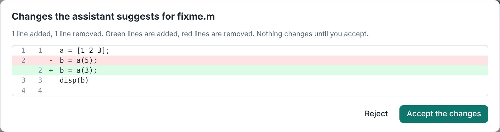

The assistant is also where the editor's shortcuts lead: **Explain this
error** and **Fix this error** under an error message, and **Explain
selection** when some code is selected.

With each question, the app sends your current file (or selection), your last
error and a list of variable names, sizes and classes (not their values).

The assistant is optional. Choose a provider in its settings (gear icon):

### Ollama (free, runs on your computer)

1. Install Ollama from [ollama.com](https://ollama.com).
2. Download a model, for example `ollama pull qwen2.5-coder` (small machines:
   try `qwen2.5-coder:1.5b` or `llama3.2`).
3. Ollama only accepts requests from web pages it trusts. Start it with
   `OLLAMA_ORIGINS` set to the site's address (the settings dialog shows the
   exact command for the page you are on):

   ```bash
   # macOS / Linux
   OLLAMA_ORIGINS="https://<user>.github.io" ollama serve
   ```

   ```powershell
   # Windows PowerShell
   $env:OLLAMA_ORIGINS="https://<user>.github.io"; ollama serve
   ```

   If the Ollama desktop app is already running, quit it first (or set
   `OLLAMA_ORIGINS` as a system environment variable and restart it).
4. In the settings, choose **Ollama**, keep the URL `http://localhost:11434`,
   click **Find models** and pick one.

Browsers allow an `https://` page to talk to `http://localhost`. Chrome may ask
once for permission to access devices on your local network; allow it.

### Anthropic Claude (your own API key)

Choose **Anthropic Claude**, paste an API key from
[console.anthropic.com](https://console.anthropic.com) and keep the default
model (`claude-opus-5-5`) or type another model id. The app uses the official
Anthropic SDK, loaded from jsDelivr, and calls the API directly from your
browser.

### OpenAI-compatible (your own API key)

Choose **OpenAI-compatible** and enter a base URL, model and key. This works
with any service that offers `POST {base}/chat/completions` with streaming and
allows browser requests (CORS), for example OpenAI
(`https://api.openai.com/v1`), OpenRouter (`https://openrouter.ai/api/v1`),
Groq (`https://api.groq.com/openai/v1`) or LM Studio on your computer
(`http://localhost:1234/v1`, enable CORS in its server settings; no key
needed).

## Privacy

- Your projects live in your browser's IndexedDB storage. They are not
  uploaded anywhere. If the browser blocks storage (some private modes do),
  the app keeps files in memory only and says so in the Files panel; download
  them before closing the tab.
- The version history, your settings, the open tabs and your breakpoints are
  kept in the same browser storage (IndexedDB and `localStorage`).
- Clearing your browser's site data deletes your files. Use **Export this
  project as .zip** to keep a backup.
- A share link holds the code in the part of the address after `#`. Browsers
  do not send that part to the web server. Anyone who has the link can read
  the code, so treat a link like the file itself.
- *Open from GitHub* and assignment links contact GitHub (or the address in
  the link) to download the files. Nothing of yours is sent.
- Code from a link runs like any other code in the app: inside the engine's
  sandbox in your browser tab. It cannot read your other projects' files or
  your saved API keys.
- API keys are saved in this browser's `localStorage` and sent only to the
  provider you chose, never to mylab. **Anyone who can use this browser
  profile can read a saved key**, so don't save keys on shared or public
  computers. Use **Forget saved keys** in the settings to remove them.
- With an online provider, the context described above is sent to that
  provider and handled under its terms. With Ollama, everything stays on your
  computer.

## Limitations

- `input()` is not available in the browser yet. It raises an error; set
  values in variables at the top of your script instead. Dialogs such as
  `inputdlg` and `questdlg` return their default answer and print a note;
  `msgbox` shows its text in the Command Window.
- First load is large (about 40 MB) and needs a reasonably modern browser
  with WebAssembly (Chrome, Edge, Firefox, Safari from the last few years).
  The browser caches these files, so later visits start much faster, and the
  app keeps working without a connection as long as they stay cached
  (*Open from GitHub* and assignment links need a connection).
- Stop restarts the engine and clears the workspace (see above). The same
  happens when an assignment test times out.
- Code runs on a single thread, and Python in WebAssembly is slower than
  native Python. Very large computations are better run with the desktop
  `mylab` command.
- Apps cannot wait for the user in the middle of code: `uiwait` returns at
  once and `uiconfirm` returns its default answer (use callbacks). See
  [APPS.md](APPS.md).
- Plots are static images (plus GIF animations from `drawnow`/`pause` loops).
  There is no zooming or rotating of 3-D plots.
- Step through records a finished run; it cannot pause a running program, and
  it stops recording after 5,000 steps. Values are shown as the Workspace
  panel shows them (size, class and a short preview).
- Share links cannot hold large projects. Use a GitHub repository for those.
- `exit`/`quit`, system commands and files outside the project folder are
  not available.
- The checker behind **Problems** reads one file at a time and does not run
  it. It reports syntax errors and unknown names; it does not know about
  variables that only exist after other code has run (it stays quiet about
  names in your Workspace and about files that use `load` or `eval`).
- Rename (F2) works within one file. The editor shows one file at a time
  (there is no split view).
- Some browsers keep a few shortcuts for themselves (Firefox uses
  Ctrl+Shift+P for a private window). Ctrl+Alt+P and the ⋯ button open the
  command palette everywhere.

## For developers

### How it works

- The mylab interpreter is Python. The web app runs it with
  [Pyodide](https://pyodide.org), a version of Python compiled to
  WebAssembly, together with NumPy, SciPy, Matplotlib and Pillow.
- SymPy, used for [symbolic math](SYMBOLIC.md), is downloaded the first time
  a program uses `syms`, `sym`, `solve` or a related function. The app shows
  "Loading symbolic math…" while it loads.
- The engine runs in a **Web Worker** (`web/worker.js`), so the page stays
  responsive while code runs.
- Nothing runs on a server. The site is plain static files.

### Local development

You need Python 3.10+ and `pip`.

```bash
python scripts/build_web.py --serve          # build the wheel, serve web/ on http://127.0.0.1:8000/
python scripts/build_web.py --serve --port 8123
```

`build_web.py` builds a pure-Python wheel of mylab, copies it to
`web/wheels/` and writes `web/wheels/manifest.json`. The worker reads the
manifest and installs the wheel with `micropip`. `web/wheels/` is not
committed; CI builds it.

The app has no build step: `web/index.html`, `web/styles.css`, ES modules in
`web/js/` and the worker `web/worker.js`. Third-party code is loaded from CDNs
with pinned versions: Pyodide 0.27.7 (jsDelivr), CodeMirror 5.65.16 (with its
octave mode and the matchbrackets, closebrackets, comment, active-line,
show-hint, runmode, searchcursor, match-highlighter, foldcode and foldgutter
addons and the sublime keymap's commands) and JSZip 3.10.1 (cdnjs), and the
Anthropic SDK 1.3.0 (jsDelivr, only when that provider is used).

### Code map

| File | Role |
|------|------|
| `js/app.js` | State, file tree, editor, command window, workspace, plots, running code, sections, welcome, link routing. Creates the `app` object the other modules plug into. |
| `js/storage.js` | `ProjectStore`: projects and files in IndexedDB (database `mylab`, version 2: stores `projects` and `pfiles`; version 1's flat `files` store is migrated into the project `main`). File content is a string or a `Uint8Array`. Projects created with `temp: true` stay in memory. |
| `js/engine.js`, `worker.js` | Request/response client and the Pyodide worker. |
| `js/projects.js`, `js/github.js` | Project menu, .zip, folder import, drag-and-drop, GitHub import. |
| `js/share.js`, `js/codec.js` | Share links; deflate + base64url packing. |
| `js/sections.js`, `js/publish.js`, `js/report.js` | `%%` sections and the report document. |
| `js/stepper.js` | Step-through panel and breakpoints. |
| `js/assignment.js` | Assignment panel, checking, submission .zip. |
| `js/commands.js` | The command list: every action with its shortcut. The key handler, the command palette, the file switcher and the shortcut list are built from it. Shortcut presets (standard, MATLAB-style). |
| `js/blocks.js` | Block structure of code (which lines open and close `if`/`for`/`function`… blocks) as plain text work: used for auto-indent, *Format document*, folding and the outline. |
| `js/editing.js` | Auto-indent, *Format document*, folding, line and multi-cursor commands. |
| `js/search.js` | Find and replace in the file; search across the project. |
| `js/problems.js` | Problems as you type: asks the worker to run `mylab.lint.check_source`, underlines the findings and fills the Problems tab. |
| `js/intel.js` | Hover help, usage hints, F1 help, autocomplete, go to definition, outline, rename. |
| `js/varview.js` | The variable viewer (grid pages come from the worker). |
| `js/history.js`, `js/diff.js` | Version history (IndexedDB database `mylab-history`, store `versions`, last 30 saves per file) and the line diff view, which also shows edits proposed by the assistant. |
| `js/settings.js` | Themes, text size, the settings dialog and the ⋯ menu. |
| `js/ui.js`, `js/markdown.js` | DOM helpers, dialogs, menus; a small safe Markdown renderer. |
| `js/ai.js` | The assistant. |
| `js/uiapp.js`, `js/uirender.js`, `css/uirender.css` | The App panel for app windows. `uirender.js`/`.css` draw the component tree; they are copies of `mylab/uiweb/` (the `mylab` command serves the same files), refreshed by `scripts/build_web.py`. |
| `js/designer.js`, `css/apps.css` | The app builder (design data, canvas, property panel, code generation, reading a design back from a file) and the styles of both. |
| `js/blocks/index.js` | mylab Blocks: shows `.mlb.json` files in the diagram editor (a view laid over the code editor; the CodeMirror document stays the saved text), toolbar, block library panel, menus, running a model, problem markers, `.slx` import, commands. Hooks: `app.runSpecial(path)` and `app.openSpecial(path)`. |
| `js/blocks/editor.js` | `DiagramEditor`: the SVG canvas. Selection, dragging, lines, keyboard, clipboard, undo (snapshots of the model), subsystems. Knows nothing about the app. |
| `js/blocks/model.js`, `js/blocks/route.js`, `js/blocks/draw.js` | The model JSON, port counts and positions; orthogonal line routing, automatic layout, alignment; SVG shapes of blocks and lines. |
| `js/blocks/scope.js`, `js/blocks/dialogs.js`, `js/blocks/blocks.css` | Scope plots on a canvas (live data, zoom, cursor, PNG/CSV); parameter, settings and pick-list dialogs; styles. |
| `js/blocks/catalog.js`, `js/blocks/examples.js` | Generated by `scripts/gen_blocks_data.py` from `mylab/blocks/library.py` and `examples/blocks/`. A test fails when they are out of date. |

### Worker protocol

Requests are `{ id, type, … }`; replies are `{ id, ok, result | error }`.

- `run { code, fs, cwd }` runs in the persistent session. `fs` mirrors the
  project into `/home/pyodide/work`: `{ reset, files: [{ path, content? }] }`,
  where `content` is left out for files that did not change since the last
  request, unlisted files are deleted and `reset` wipes the folder (new
  project). `cwd` is the project folder to run in; the command window omits
  it. The search path is the current folder, the project root and every
  subfolder with `.m` files (paths added with `addpath` are kept). The result
  is `RunResult.to_dict()` plus `variables`, `error_file` (project path of the
  file an error happened in), `dialogs` (msgbox texts) and
  `files: { written, skipped, missing }`: files the code created or changed
  (as bytes, up to 5 MB each and 20 MB per run), files too big to copy, and
  project files the code deleted.
- `trace { code, fs, cwd, maxSteps }` calls
  `mylab.debugger.trace(session, code).to_dict()` on a fresh session.
- `publish { sections, tail, fs, cwd }` runs each section's code in one fresh
  session and returns one result per section (later sections are
  `{ skipped: true }` after an error). `tail` holds a script's local
  functions; it is appended to every section.
- `test { files, code }` wipes `/home/pyodide/grade`, writes `files` there and
  runs `code` in a fresh session with that folder as the current folder.
- `variables`, `showVariable`, `complete`, `help`, `reset`.
- `lint { code, known }` returns `mylab.lint.check_source(code)` without the
  warnings about names in `known` (the project's `.m` files) or in the
  workspace. `helpIndex` returns `{ name: [usage lines, one-line description] }`
  from `mylab.help_data` for hover help and autocomplete.
- Results of `run` carry `ui` when app windows are open: the component tree
  described at the top of `mylab/ui.py`. `uiEvent { event }` delivers one
  user action (`{ id, event, value, … }`), runs the callbacks and returns
  `{ error, output, update, figures, variables, files }`, where `update` is
  a full tree or a patch of changed properties. `uiClose` closes every app
  window. `uiEvent` is a background request, so Run stays available.
- `blocks { op, args, fs, cwd }` serves the diagram editor through
  `mylab/blocks/web.py`. `op` is `run` (simulate `args.model`; the result has
  `ok`, `error { message, path, paths }`, `diagnostics`, `scopes`, `displays`,
  `warnings`, `variables`), `check` (diagnostics without running), `validate`
  (can these parameter expressions be evaluated?) or `import_slx`. While a
  model runs the worker posts `{ type: "event", name: "blocks", data }`
  messages with new scope samples; `Engine` re-emits them as a `blocks`
  event. `check` and `validate` are sent in the background.
- `inspect { name, path, row, rows, col, cols }` returns one page of a
  variable as a grid of short texts (`path` walks into struct fields and
  cells); `csv { name, path, maxCells }` returns it as CSV text.

Requests that only look things up (`lint`, `helpIndex`, `help`, `inspect`,
`csv`) are sent with `Engine.background()`: they wait their turn in the
worker like any other request, but they do not make the app look busy, so
Run stays available.

Feature modules talk to each other through a small event bus on the `app`
object (`app.on(name, fn)` / `app.emit(name, …)`; the events are listed at
the top of `js/app.js`) and add their actions with
`app.commands.register([{ id, title, group, keys, run }])`.

The step-through view rebuilds the workspace of step *i* by replaying the
`set`/`del` changes of all earlier steps with the same `frame`; `out` is the
number of characters of the output printed so far.

### Link formats

| Fragment | Meaning |
|----------|---------|
| `#code=<p>` | `<p>` packs `{ n: name, c: code }` |
| `#project=<p>` | `<p>` packs `{ n: name, m: main file, f: { path: text or { b: base64 } } }` |
| `&run=1` | run the main file when the engine is ready |
| `&app=1` | run the main file and show only its app window (no editor) |
| `#gh=owner/repo[/folder][@ref]` | import through `api.github.com/repos/{owner}/{repo}/git/trees/{ref}?recursive=1` (one request; `HEAD` when no ref is given) and `raw.githubusercontent.com` |
| `#assignment=<url>` | fetch a bundle (https, or the app's own origin) |
| `#assignmentdata=<p>` | `<p>` packs a bundle |

A packed value `<p>` is JSON, compressed with `CompressionStream("deflate-raw")`
and base64url-encoded, with the prefix `1`. Browsers without
`CompressionStream` write (and everyone reads) the prefix `0` for
uncompressed base64url JSON.

### Tests

`scripts/test_web.mjs` builds and serves the app, then drives it in headless
Chromium with Playwright (needs network access to the CDNs; GitHub and the AI
providers are mocked with `page.route`, no real API is called):

```bash
npm install playwright   # once, if Playwright isn't available
node scripts/test_web.mjs                    # all checks; also refreshes the stills in docs/images/
node scripts/test_web.mjs --no-screenshot    # all checks, leave the images alone
PYTHON=.venv/bin/python node scripts/test_web.mjs --gif   # record docs/images/demo.gif (needs Pillow)
```

It checks the welcome window, command window, workspace, plotting, error line
numbers, functions in other files, run selection, the assistant (mocked),
the editor helpers (command palette and file switcher, find/replace and
search in files, problems as you type, hover help, usage hints and F1,
autocomplete, go to definition, outline, rename, editing shortcuts,
auto-indent, formatting, folding, tabs, the variable viewer, run to
breakpoint, version history, themes and settings, assistant edits as a diff,
keyboard access and focus), sections, published reports, stepping forward and back, breakpoints, folders
and binary files through the engine's file system, files written by code,
animations, projects and .zip round trips, folder import, GitHub import and
its error messages, share links opened in a second browser context,
app windows and the app builder (`scripts/test_web_apps.mjs`, which also runs
on its own: a button, a slider drag, a table edit, themes, an app link on a
phone, building an app, generating code and reopening it),
assignments (wrong answer, right answer, `exit`, the timeout watchdog,
submission .zip, reload), block diagrams (an example model run and its scope
values, building a model with the mouse and with the keyboard alone,
parameter validation, undo and redo, subsystems, error markers, `.slx`
import, themes, an 800 px window, touch), Stop, persistence (files, tabs, cursor,
breakpoints), the phone layout down to 320 px, and that there are no console
errors.

### Deployment

`.github/workflows/pages.yml` builds the wheel with `scripts/build_web.py`
and publishes `web/` to GitHub Pages. To turn it on:

1. Open the repository's **Settings → Pages** and set **Source** to
   **GitHub Actions**. Publishing Pages from a private repository needs a paid
   GitHub plan; public repositories can publish for free.
2. Under **Settings → Secrets and variables → Actions → Variables**, add the
   variable `DEPLOY_PAGES` with the value `true`.

After that, every push to `main` redeploys the app. You can also run the
workflow by hand from the **Actions** tab. The site address is
`https://<user>.github.io/<repository>/`.

The app is a plain static site, so any static host works too (Netlify,
Cloudflare Pages, a university web server). Run `python scripts/build_web.py`
and upload the `web/` folder.
